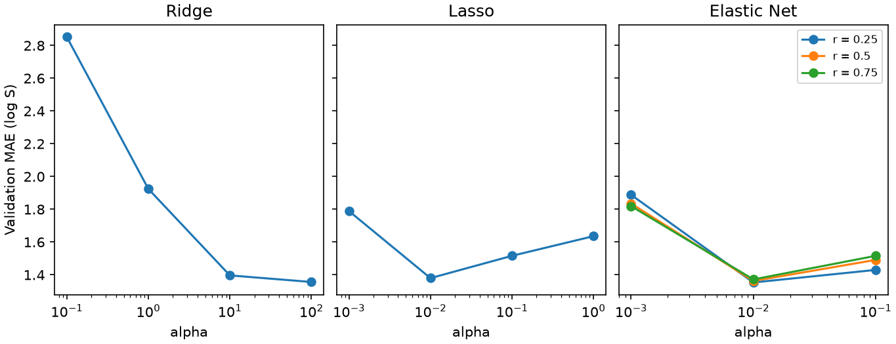

# 正則化：Ridge、Lasso、Elastic Net {#sec-regularization}

## 只有 902 個訓練分子，怎麼替 1,024 個指紋位元估係數？ {#開場問題}

答案是替係數加上限制，不讓它們隨意變大。在 @sec-linear-regression 的水溶解度範例裡，線性模型只要估四個係數；換成 1,024 個 Morgan 指紋位元後，係數比分子還多，好幾組差很多的係數都可能把訓練分子預測得一樣好。**正則化**（regularization）的做法是在擬合時多加一項「懲罰」：係數越大，懲罰越重。訓練誤差差不多時，模型就會選係數比較小、比較保守的那一組。接下來我們比較係數縮小的幅度、哪些係數變成零，以及模型對新骨架的預測誤差。

## 核心概念

想像兩個指紋位元總是一起出現。如果所有訓練分子都讓它們同時亮、同時暗，模型只看得到兩個係數加起來的效果；把一個調高、另一個調低同樣多，預測完全不變。但遇到只有其中一個位元亮起的新分子，這兩個互相抵銷的大數字就會讓預測偏得很遠。

**嶺迴歸**（Ridge regression）把係數的平方和 $\sum_j w_j^2$ 加進擬合時要最小化的量（稱為**目標函數**，objective function）。懲罰有多重，由 $\alpha$ 決定；像 $\alpha$ 這種不是從資料學來、而是由我們事先設定的參數，稱為**超參數**（hyperparameter）。平方和的懲罰會讓模型偏好把貢獻平均分給兩個相似的位元，而不是一個很大、一個反向抵銷。所以 Ridge 通常會留下許多小小的非零係數。

**套索迴歸**（Lasso regression）改為懲罰係數絕對值的總和 $\sum_j |w_j|$，結果是有些係數會直接變成零，等於把那個位元從預測式裡拿掉。不過，被留下的位元不一定特別重要：位元常常成群出現，留下來的那一個可能只是替同伴代言，換一批訓練分子，兩者的角色就可能對調。

想根據 Lasso 的結果修改某個化學片段時，還要確認這個位元對應到哪些原子環境。固定長度的指紋可能把不同的環境擠進同一個位元，所以係數表不能直接當成官能基效應表來讀。

**彈性網路**（Elastic Net）把兩種懲罰放在一起。絕對值的懲罰叫 L1，平方和的懲罰叫 L2。在 scikit-learn 裡，`alpha` 調整體的懲罰強度，`l1_ratio` 調 L1 所占的比例，例如 0.25 代表 L1 占 0.25、其餘分給 L2。最後有幾個係數變成零，要擬合完才數得出來。

比較不同方法時要小心：同樣寫 `alpha=1`，Ridge 和 Lasso 對平方誤差的尺度和懲罰形式都不同，強度並不相等。想知道限制係數帶來什麼影響，最可靠的方法是直接比較擬合出的係數和驗證誤差。

## 動手做

[下載本節 notebook](../../notebooks/ch09/09-03-regularization.ipynb){.btn .btn-sm .btn-outline-primary}　[在 Colab 開啟](ch09/09-03-regularization.ipynb)

我們用 @sec-moleculenet 的 `load_delaney` 載入 ESOL 的實測 log S，關閉標籤轉換，依骨架分成 902、113 和 113 筆。RDKit 替每個分子產生半徑二、長度 1,024 的 Morgan 位元指紋，每欄是零或一，三種模型都直接用原始位元，沒有另外做標準化。如果輸入換成單位各異的連續描述符，係數大小會受單位影響，這時要先用訓練資料估算各欄的平均和標準差，再把同一套轉換套用到其他組。[@delaney2004esol]

我們事先列好候選模型：Ridge 試四個強度，Lasso 也試四個，Elastic Net 則是三個強度各搭配三個混合比例，一共十七種。每一種都用完全相同的訓練資料擬合，記錄驗證集的 MAE 和非零係數的個數。

這裡只用驗證集挑參數。如果每試一個設定就偷看測試分數，再挑最準的那個，測試資料就已經參與了選擇，不能再當作一次獨立的考試。

```python
rows = []
for family, models in candidates.items():
    for model in models:
        model.fit(X_train, y_train)
        mae = mean_absolute_error(y_valid, model.predict(X_valid))
        rows.append((family, model, mae))
        print(f"{family:12s} {model.alpha:6g} {getattr(model, 'l1_ratio', '-')} "
              f"{mae:.4f} {np.count_nonzero(model.coef_)}")
```

{#fig-regularization fig-alt="三個面板共用驗證 MAE 縱軸。Ridge 在候選範圍內隨強度增加而下降，Lasso 和三條 Elastic Net 曲線在中間強度附近較低。"}

這段程式逐一取出每個候選模型，用訓練集擬合、在驗證集上算 MAE，把結果存進 `rows`，並印出模型種類、強度、混合比例（Ridge 和 Lasso 沒有這一項，就印 `-`）、MAE 和非零係數的個數。

先看 @fig-regularization 的 Ridge 圖。懲罰強度從 0.1 提高到 100，驗證 MAE 從 2.8519 降到 1.3562。100 是四個設定裡誤差最小的，但它也是試過的最大值，再強下去會怎樣還不知道。四組設定都有 969 個非零係數，因為 Ridge 只會把係數縮小、不會歸零，所以光數非零係數看不出它們的差別。

Lasso 的懲罰強度從 0.001 提高到 0.01，非零係數從 418 個減到 88 個，驗證 MAE 也從 1.7893 降到 1.3797。強度提高到 1 時，所有指紋係數都歸零，只剩截距，誤差回升到 1.6358。這時不管輸入哪個分子，預測都一樣，也就是說懲罰已經強到把分子之間的結構差異全抹掉了。

Elastic Net 可以固定強度、比較不同的混合比例。在 $\alpha=0.01$ 這一列，比例 0.25、0.50、0.75 分別留下 338、199、123 個非零係數，驗證 MAE 依序為 1.3532、1.3624、1.3717，留下最少欄的設定誤差也最大。如果目的是交付一條容易逐欄檢查的式子，就要另外訂出可以接受的誤差和欄數。

本例事前訂的規則只有一條：「驗證 MAE 最小」。依此選出 $\alpha=0.01$、比例 0.25 的組合，最後才對測試集預測一次，MAE 為 1.3103 個 log S 單位。

用在自己的資料上時，Lasso 的全零模型是個好用的參考點。截距不受懲罰，所有係數歸零後，最好的截距就是訓練標籤的平均數，不管輸入難溶還是好溶的分子，預測都停在同一個值，就像 9.1 的常數基準。和它比較，才知道加入指紋後，模型有沒有真的用上分子之間的差別。這個平均數要用訓練標籤算；改用驗證標籤，就不符合「收到新結構時還不知道答案」的實際情況了。

另一種讀法是固定混合比例、沿著強度比較。橫軸是對數刻度，相鄰兩點的強度差十倍。線在兩點之間往下，只能說右邊那個試過的設定誤差較小，中間沒試過的強度並沒有分數。想把範圍縮小，可以在兩點之間多試幾個強度，並記下試過哪些值。但試得越多，越有機會碰巧迎合這批驗證分子，所以還是要另外留一批分子，等參數決定後再估誤差。

入選組合的驗證 MAE 只比 Ridge 最好的結果少約 0.003。依事前的規則，這次選 Elastic Net，但多收一組骨架，名次就可能對調。想了解分組方式的影響，可以參考 @sec-cross-validation 的**交叉驗證**（cross-validation）：把資料輪流切成好幾份，每次留一份當驗證、其餘拿來訓練，看分數在不同切法下穩不穩定。重切時任務和指紋定義要保持不變，並在每次切分裡重新訓練候選模型，才分得出分數的變動來自哪一步。

## 重點整理

- Ridge 把係數壓小，Lasso 會讓部分係數歸零，Elastic Net 則混合兩者。
- 比較強度時要同時看驗證誤差和係數，留下的欄位少，預測不一定比較準。
- 用驗證集挑設定，設定固定後才用測試集。

## 小練習

如果最多只能保留 100 個非零係數，哪一個候選模型的驗證 MAE 最小？它的誤差比原本入選的模型增加多少？

提示：從 `rows` 篩出非零係數不超過 100 個的紀錄，再比較這些紀錄的第三欄（MAE）。截距不算指紋係數。

## 延伸閱讀

scikit-learn 列出了 Ridge、Lasso 與 Elastic Net 的目標函數，可以看到平方誤差項的分母和混合比例怎麼寫。[線性模型文件](https://scikit-learn.org/stable/modules/linear_model.html)
