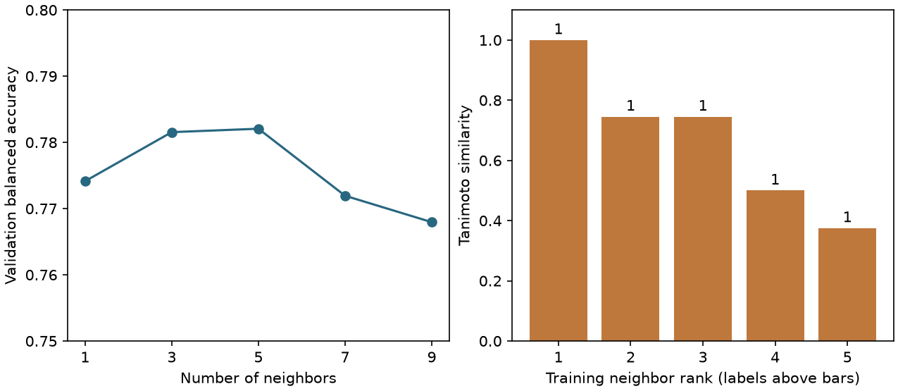

# k-NN {#sec-nearest-neighbors}

## 一個還沒測過的分子，能讓結構最接近的幾個分子替它投票嗎？ {#開場問題}

可以。**k 近鄰法**（k-nearest neighbors，k-NN）的想法很直接：先找出結構最接近的 $k$ 個已量過的分子，再看它們的實測結果。本節做二元分類，每個鄰居各投一票，多數決定預測。不過，聽到「五個鄰居全都投陽性」時，別急著下結論，先問這五個分子和待測分子到底有多像，距離又是怎麼算的。

## 核心概念

新分子來了，線性模型是把描述符代進先前估好的式子；近鄰法則要回頭翻訓練資料，找出和它最接近的幾筆紀錄，所以得一直保留訓練分子的特徵和標籤。預測水溶解度時，可以取鄰居實測值的平均；預測 Ames 試驗結果時，就數一數鄰居中陽性和陰性各有幾個。兩種情況都一樣，要先只靠結構特徵選出鄰居，再去看他們的量測欄。如果是先知道測試分子是陽性，才去挑陽性的鄰居，答案就已經影響了選擇。

「最近」得先選一把尺。用連續的描述符時，**歐幾里得距離**把每一欄的差平方後加總再開根號，**曼哈頓距離**則是把每一欄的絕對差加起來，兩者都是明氏距離（Minkowski distance）的特例，分別對應 $p=2$ 與 $p=1$。要注意各欄的單位：分子量常差幾十，芳香原子比例最多只差一，直接相減的話，選出的鄰居幾乎只反映分子量。所以要先用訓練集決定標準化的尺度，新分子也用同一把尺。如果想比較局部的原子環境，就改用二元分子指紋，把「距離」換成兩個分子共享多少亮起的位元。

鄰居數 $k$ 也會改變預測的性格。只找最近的一個，結果容易追溯，可是萬一那個分子的標籤有誤，這一票就直接決定預測。多找幾個，單一紀錄的影響會變小，代價是連結構比較遠的分子也算進來。另外也要留意鄰居是不是來自同一個系列：一系列衍生物如果都含有同一段結構，最近的五筆可能全都出自這個系列，雖然各有一票，卻稱不上五份獨立的證據。

## 動手做

[下載本節 notebook](../../notebooks/ch09/09-04-nearest-neighbors.ipynb){.btn .btn-sm .btn-outline-primary}　[在 Colab 開啟](ch09/09-04-nearest-neighbors.ipynb)

我們想預測的是化合物在 Ames 試驗中是否呈陽性。Lou 等人整理了 Hansen 基準和 ISSSTY 的 Ames 紀錄，Maom Lab 從原始資料建立 MutagenLou2023 鏡像，另外提供 realistic split 的訓練與測試名單。這裡使用鏡像的 `train_test` 子集，`Y=1` 代表 Ames 陽性，`Y=0` 代表陰性。這份資料不在 @sec-moleculenet 介紹的資料集裡，notebook 會下載指定的版本，並檢查兩個 CSV 檔的雜湊值（可以想成檔案指紋），確認內容沒有被改動。特徵只從 SMILES 計算，標籤、ID 和資料附帶的分子量都不放進指紋。[@lou2023mutagen] [Maom Lab 資料卡，CC BY 4.0](https://huggingface.co/datasets/maomlab/MutagenLou2023/blob/a9780a60774eb522b78bd92b83c30d8deae00ff5/README.md)

兩個檔案分別有 6,862 與 1,714 筆。程式先略過讀不進來的結構，再用 RDKit 的正規 SMILES 把同一檔內標籤相同的重複紀錄合併成一筆，標籤互相矛盾的結構則直接排除。如果某個結構在訓練檔和測試檔都出現，訓練側就不再使用它，免得模型提前看過答案。最後依陽性和陰性的比例，從開發資料中抽 15% 當驗證集，亂數種子固定為 42，得到 5,610 筆訓練、990 筆驗證和 1,663 筆測試。測試名單沿用公開副本提供的版本，另外附的外部驗證集沒有使用。

我們先把每個分子轉成半徑二、長度 1,024 的 Morgan 位元指紋。計算 Tanimoto 相似度時，先數兩個分子都是 1 的位元，再除以至少一邊是 1 的位元總數，所以只有一邊亮起的位元越多，相似度就越低。這種算法不會因為很多位元在兩邊都是 0，就讓兩個分子看起來很像。再用 1 減去相似度，就是這裡的距離。兩個指紋完全相同時，距離是 0；不過這只表示指紋相同，不表示化學細節完全一樣，例如這個設定沒有編入手性，手性不同的兩個候選就分不開。

在 notebook 裡，`D_train` 是一張距離表：每一列是一個訓練分子，每一欄是它到某個訓練分子的距離，所以對角線都是 0。`D_valid` 和 `D_test` 的列換成要預測的分子，欄還是原來的訓練分子，順序也不能變，這樣呼叫 `fit` 時，每一欄才對得上那筆訓練標籤。如果誤把驗證分子彼此的距離交給 `predict`，即使表是方形的，也沒有告訴模型該請哪些訓練分子來投票。

```python
choices = [1, 3, 5, 7, 9]
scores = []
for k in choices:
    model = KNeighborsClassifier(n_neighbors=k, metric="precomputed", weights="uniform")
    model.fit(D_train, y_train)
    pred = model.predict(D_valid)
    scores.append(balanced_accuracy_score(y_valid, pred))
    print("k, validation balanced accuracy:", k, scores[-1])
```

候選的 $k$ 都取奇數，是因為二元投票時奇數票不會平手。不過距離本身還是可能相同，例如第 $k$ 個和第 $k+1$ 個分子離待測分子一樣遠；如果這兩筆標籤不同，選到哪一筆就可能影響結果。這份範例固定了資料的順序，大家才能重現同一份鄰居名單。

{#fig-nearest-neighbors fig-alt="左圖的驗證平衡準確率在 k 等於五時最高。右圖依近到遠排列測試集第一個分子的五名鄰居，相似度從 1 降至 0.375，五個標籤都為一。"}

@fig-nearest-neighbors 左圖用**平衡準確率**（balanced accuracy）來比較不同的鄰居數。做法是先算實測陽性的分子判對幾成，再算實測陰性的分子判對幾成，兩者取平均，這樣即使兩類的筆數差很多，各類還是各占總分的一半。在驗證集上，鄰居數從一個增加到三個、五個，分數依序是 0.7741、0.7815、0.7821；再增加到七個、九個，分數反而降到 0.7719 和 0.7679。所以我們選五個鄰居，再拿到獨立的測試集評估，得到 0.6027。驗證和測試用的是不同的分子，這兩個分數的落差，不能直接解讀成模型能力變了。

右圖列出測試集第一個分子的五個訓練鄰居，相似度依序是 1.000、0.745、0.745、0.500、0.375。五個鄰居的標籤都是 1，預測結果也和這個分子的實測類別一致。不過請看最近和最遠的兩個鄰居：相似度差了 0.625，卻各投一票。就算某個分子離五個鄰居都很遠，演算法還是會照投票結果給出類別。所以向同事說明結果時，除了票數，最好也附上鄰居的相似度和結構，讓大家判斷這些分子適不適合當對照。

票數也常被當成模型給陽性的分數。以五個鄰居的投票來說，分數只會是 0、五分之一、五分之二，一路到 1。右圖那個分子的分數是 1，代表五個鄰居的紀錄完全一致。至於「下一批同分數的分子也都會呈陽性」，就得另外拿有實測標籤的分子來檢驗：把分數相同的分子放在一起，數一數其中實際有多少是陽性。這個比例和鄰居的投票比例，即使寫成同樣的百分比，分母也不一樣。

如果拿 $k=1$ 的模型去預測訓練資料，最近的那一個往往就是分子自己，訓練成績再漂亮，也看不出它能不能預測其他分子。所以我們在驗證圖上比較各個候選設定時，只讓訓練分子投票；就算某個待測分子找不到很像的鄰居，也會如實反映在驗證表現上。

## 重點整理

- 用相似度選鄰居，用訓練標籤投票；預先算好的距離表，順序要和訓練分子對齊。
- 鄰居數 $k$ 用驗證分子來選，選好之後再用測試集評估一次。
- 票數和結構相似度回答的是不同的問題，讀單筆預測時兩個都要看。

## 小練習

沿用五近鄰模型，從測試集第一筆依序往下找，哪個分子最先出現鄰居意見不一致的情形？寫下兩類各得幾票，再比較預測和實測結果是否相符。

提示：把 `D_test` 交給 `kneighbors`，用索引取出各鄰居的訓練標籤，每列加總就是投給 1 的票數。

## 延伸閱讀

scikit-learn 說明了等權重與依距離加權的投票，也提醒位於決策邊界的同距離鄰居可能受到資料順序影響。[近鄰分類官方文件](https://scikit-learn.org/stable/modules/neighbors.html#nearest-neighbors-classification)

Lou 等人的原始研究說明 Ames 資料整理方式與原研究的訓練、測試設計。鏡像資料卡另列本節實際使用的分割方式。[原始研究](https://doi.org/10.1186/s13321-023-00707-x)
