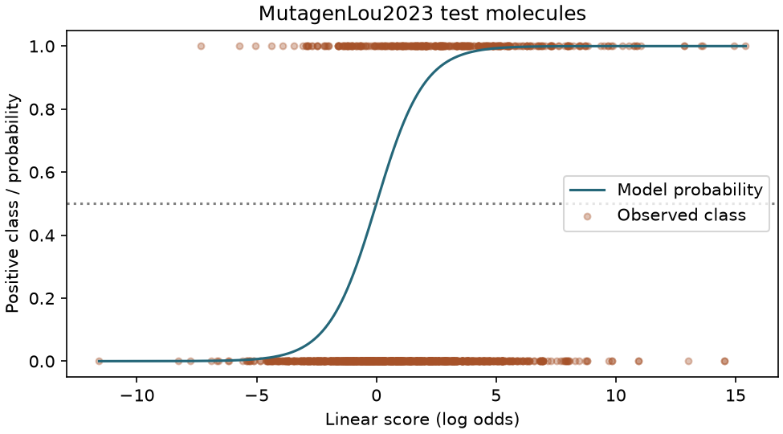

# 邏輯迴歸 {#sec-logistic-regression}

## 預測一個分子的 Ames 試驗會不會呈陽性，為什麼可以用「迴歸」？ {#開場問題}

因為它預測的不是類別，而是「陽性的機率」這個連續數值。Ames 試驗的結果只有陰性和陽性，資料分別記為 0 和 1。**邏輯迴歸**（logistic regression）先把結構特徵加權算出一個分數，再換算成介於 0 和 1 之間的陽性機率。兩個分子即使都判為陽性，機率也可能分別是 0.52 和 0.92；只剩一個送測名額時，這兩個數字就能幫實驗室排出先後。

上一節的做法是替新分子找出幾個最相似的訓練分子，再數其中有幾個呈陽性。這一節沿用同一批 Ames 分子，改成從整批訓練資料估計每個特徵的權重；拿到新指紋時，把亮起的位元和對應的權重代入，就算得出陽性機率。換句話說，k-NN 是「問鄰居」，邏輯迴歸是「把全班的經驗濃縮成一條式子」。

## 核心概念

把模型估的陽性機率記作 $p$，**勝算**（odds）就是 $p/(1-p)$，例如機率 0.75 代表陽性對陰性是三比一。邏輯迴歸讓特徵的線性組合等於**對數勝算**，$z=\log[p/(1-p)]=b+\sum_j w_jx_j$，反算回來就是 $p=1/(1+\exp(-z))$。

為什麼要繞這一圈？因為機率只能落在 0 和 1 之間，而線性組合可以是任何數。對數勝算剛好把 0 到 1 的機率拉開成整條數線，所以兩邊才對得上。$z=0$ 時兩類勝算相等；$z$ 從 0 增加到 1，機率從 0.50 變成約 0.73；$z$ 再怎麼變大，機率只會越來越靠近 1，不會超過。這樣既保留線性模型容易逐項檢查的優點，輸出也一定是合理的機率。

訓練時，同樣是猜錯，代價也分輕重。一個實測陽性的分子，模型估 0.49 或 0.01，用 0.50 當門檻都會判成陰性，但估 0.01 是「很有把握地答錯」，損失大得多。擬合就是依這種損失調整權重，scikit-learn 預設還會加上 9.3 介紹過的 L2 正則化，避免係數變得太大。

既然要懲罰係數，各欄的尺度就要先對齊：分子量多一個單位和氫鍵供體多一個，化學意義差很遠。所以我們用訓練集的平均值和標準差換算每一欄，驗證和測試資料沿用同一組數值。本來就只記錄有無的指紋，則直接用 0 和 1。

係數的方向可以讀，但要講清楚條件。其他欄位不變時，某一欄增加一個輸入單位，對數勝算就增加該欄的係數，勝算則乘上係數的指數；如果這一欄標準化過，「一個單位」指的是訓練集的一個標準差。

實際上替分子多接一段碳鏈時，分子量、脂溶性和可旋轉鍵數往往一起變，所以單看分子量的係數，推論不出這次修飾會讓致突變性變高還是變低。模型學到的是這批化合物的二元試驗標籤，不是結構修飾造成的因果效果。

## 動手做

[下載本節 notebook](../../notebooks/ch09/09-05-logistic-regression.ipynb){.btn .btn-sm .btn-outline-primary}　[在 Colab 開啟](ch09/09-05-logistic-regression.ipynb)

我們要預測 Ames 試驗的陽性或陰性，用的是可公開取得的 MutagenLou2023。這份資料不在 @sec-moleculenet 介紹的 DeepChem 資料集裡，程式會另外從 Maom Lab 的公開副本讀入分子結構和二元標籤，`Y=1` 表示陽性。如果實驗室想優先檢查可能呈陽性的化合物，送測清單就按模型分數從高到低排。[@lou2023mutagen]

這一節想問的是：分類器不換，只換特徵，陽性分子會不會排得更前面？第一組特徵是六個描述符：分子量、sp³ 碳比例、計算的 logP、可旋轉鍵數、氫鍵受體數和供體數。兩個官能基位置不同的分子，這六欄可能幾乎一樣。第二組用半徑 2、長度 1,024 位元的 Morgan 指紋，記錄每個原子附近有哪些局部結構，位元多，可以擬合的權重也多。

我們沿用公開副本指定的測試集。整理時，每個檔案裡同一個正規 SMILES 只留一筆，標籤互相矛盾的結構剔除；測試檔已經出現的結構，訓練檔就不再使用，以免模型提前看過答案。剩下的資料再依類別比例取 15% 當驗證集，亂數種子固定為 42。最後是 5,610 個訓練、990 個驗證和 1,663 個測試分子。

```python
small = make_pipeline(StandardScaler(), LogisticRegression(max_iter=1000, random_state=SEED))
bits = LogisticRegression(max_iter=1000, random_state=SEED)
y = train.y.ravel()
small.fit(describe(train), y)
bits.fit(train.X, y)
```

上面的程式建了兩個模型：描述符版本先接一個標準化步驟再接邏輯迴歸，指紋版本則直接用邏輯迴歸，兩者都用同一批訓練標籤擬合。

成績方面，六項描述符的驗證 **ROC-AUC** 為 0.685，Morgan 指紋為 0.854。ROC-AUC 量的是排序好不好：任取一個陽性和一個陰性分子，陽性排在前面就算一次命中，同分算半次，所以 0.5 相當於隨機排，1.0 是完美排序。我們依驗證分數選了指紋模型，之後才算測試 ROC-AUC，得到 0.686。另外，機率是線性分數經過一個遞增的函數換來的，排序不會變，所以用分數或機率排，清單完全一樣。

訓練用的分子約 62% 呈陽性，保留的測試集卻只有 362／1,663、約 22% 呈陽性。兩批分子的組成差這麼多，同一個 0.50 門檻在兩邊選出的清單，命中比例自然也不會接近。

{#fig-logistic-mutagen fig-alt="橫軸是線性分數，S 形曲線從左下升到右上。實測結果散在 0 與 1 兩列，兩類的分數範圍相互重疊。"}

在 @fig-logistic-mutagen 中，上排點是實測陽性的分子，下排是陰性。沿著機率 0.50 的虛線找到曲線的交點，對應的線性分數剛好是零。若從這裡畫界線，把右側的分子列入送測名單，共 1,077 個入選，其中 294 個呈陽性、783 個呈陰性，左側還有 68 個陽性分子漏掉了。

界線往左移可以少漏幾個，代價是多測一些陰性分子。這是門檻的取捨，和模型本身無關：調門檻只是用同一組權重重排名單，不必重新訓練。

曲線呈 S 形，只是因為橫軸的分數和縱軸的機率來自同一個公式，就算模型判錯很多分子，形狀還是這樣。要知道模型估的 0.8 準不準，得另外檢查：在保留資料中找出預測機率接近 0.8 的分子，看實測陽性的比例是不是接近八成。這叫檢查模型的**校準**（calibration）。看的時候別忘了分母，十個裡有八個和一百個裡有八十個，比例一樣，可信度差很多。

再看六項描述符的係數。標準化可旋轉鍵數的係數約為 −0.74，意思是其他五項不變、可旋轉鍵數高出一個標準差時，陽性勝算會乘上 exp(−0.74)，約為原來的 0.48 倍。

同樣的倍數，落在機率上的效果卻不同。原本勝算一比一（機率 0.50）時，換算後機率約 0.32；原本是九比一（機率 0.90）時，新的機率約 0.81。另外，sp³ 碳比例這次的係數是 0.09。這個正負號只屬於這次的資料、標準化方式和正則化強度；換一批分子，或換一組描述符重新擬合，方向很可能就不同。所以係數適合拿來重算模型的預測，不適合直接當成某種結構特徵造成陽性的證據。

這套讀法也可以用在指紋模型上：挑一個分子，從截距開始，把值為 1 的位元對應的係數加起來，再和程式算出的線性分數比較。數字相同，就表示我們完整重現了模型的計算。

想進一步說某個係數代表哪個官能基的作用，就要回到產生這個位元的原子環境。同一個位元可能由不同環境映射而來，一次化學修飾也常同時打開和關掉好幾個位元。這些限制影響的是結構解釋，不影響拿固定的指紋模型替待測分子排序。

## 重點整理

- 特徵線性加總得到的是對數勝算，再由邏輯函數換成 0 到 1 的機率。
- 在同一批 Ames 驗證分子上，Morgan 指紋比六項描述符更能把陽性分子排在前面。
- 排序好不好、門檻怎麼訂、機率準不準，是三個要分開檢查的問題。

## 小練習

用選定的指紋模型替驗證分子評分。送測門檻從 0.50 降到 0.35 後，名單多了幾個分子，其中有幾個實際呈陽性？

提示：用 `predict_proba` 取得陽性機率，對兩個門檻各數一次入選總數和入選且標籤為 1 的筆數，再相減。

## 延伸閱讀

scikit-learn 列出邏輯迴歸的目標函數、正則化強度與求解器選項。[Logistic regression](https://scikit-learn.org/stable/modules/linear_model.html#logistic-regression)

Lou 等人的研究說明 Ames 標籤與原始資料來源，實作使用 Maom Lab 依 CC BY 4.0 提供的鏡像及其切分。[原始研究](https://doi.org/10.1186/s13321-023-00707-x)、[Maom Lab 的 MutagenLou2023 鏡像](https://huggingface.co/datasets/maomlab/MutagenLou2023)。
