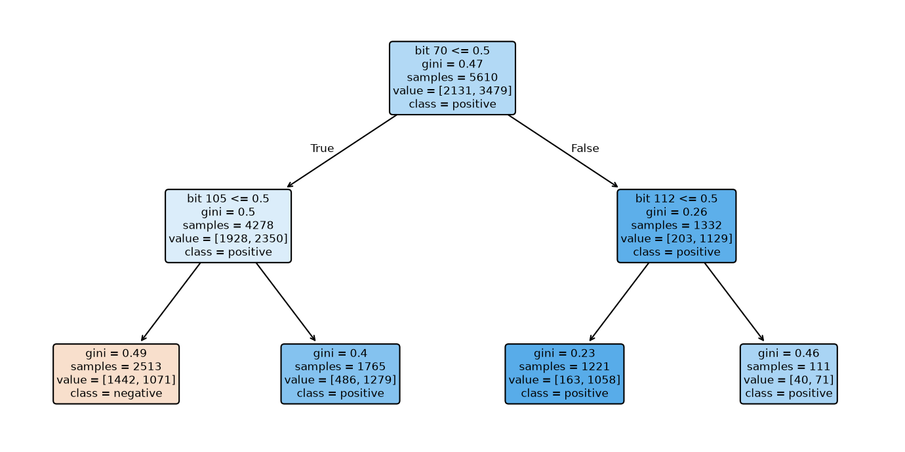

# 決策樹 {#sec-decision-trees}

## 決策樹判定 Ames 試驗可能呈陽性，我們能追出它問了哪幾個問題嗎？ {#開場問題}

可以，而且這是**決策樹**（decision tree）最大的好處。決策樹就像一張是非題流程圖：從最上面的**根節點**出發，每到一個節點就檢查某項特徵有沒有超過門檻，依答案往左或往右走，直到走進沒有分支的**葉節點**，模型就按落在那裡的訓練分子決定類別。只要保留每個節點的條件和訓練樣本數，我們隨時可以把這條路走一遍，看看最後兩類分子各有幾個。

## 核心概念

怎麼決定先問哪個問題？直覺是：挑一個問題，讓分開後的兩群盡量「乾淨」，也就是各自盡量只剩同一類分子。衡量乾淨程度的指標叫**吉尼不純度**（Gini impurity）。陽性比例為 $p$ 時，二元分類的吉尼不純度是 $1-p^2-(1-p)^2$：兩類各半時最大，等於 0.5；全是同一類時是零。

對每個候選條件，程式先把分子分成左右兩群，各算不純度，再依兩群的分子數加權平均。這個加權很重要：如果一個條件只把一個陰性分子單獨隔開，那一群雖然完全乾淨，分子太少，對整批資料的幫助有限。樹會選讓加權不純度降得最多的條件，再往兩邊繼續分。

讀一個分子的預測時，先看根節點問什麼。圖上寫「bit 70 ≤ 0.5」，但指紋只有 0 和 1，所以它其實是在問第 70 位是不是 0：是 0 往左走，是 1 往右走。

接下來只讀自己走到的那一支。舉例來說，如果只有右支才問某個官能基在不在，這個問題就只適用於第 70 位為 1 的分子。跳過上一層單獨看一個條件，很容易把局部適用的判斷誤當成全庫通用的規則。

樹每次只挑當下最划算的一刀，不會回頭檢查整棵樹是不是最精簡的解釋。分子不多時，只要多問幾題，就能把個別特殊的樣本隔開，甚至讓一片葉子只剩一個分子。這樣訓練正確率很漂亮，卻正是 9.2 說過的過度擬合，遇到新分子不一定管用。

有兩種常見的煞車。`max_depth` 限制樹最多長幾層，讓它提早停；`min_samples_leaf` 要求每片葉子至少要有幾個訓練分子，直接針對樣本太少的問題。兩者管的事情不同，樹很淺也可能分出樣本很少的葉子。

## 動手做

[下載本節 notebook](../../notebooks/ch09/09-06-decision-trees.ipynb){.btn .btn-sm .btn-outline-primary}　[在 Colab 開啟](ch09/09-06-decision-trees.ipynb)

這一節沿用致突變性這個端點，分子結構和標籤（陽性為 1）取自 Lou 等人的 MutagenLou2023，來源是 Maom Lab 的公開副本，取得方式和 @sec-moleculenet 介紹的資料集不同。我們沿用它提供的測試集，整理方式和 9.5 相同：每個檔案裡同一個正規 SMILES 只留一筆，標籤矛盾的結構剔除，測試檔出現過的結構不放進訓練檔，剩下的資料再依類別比例取 15% 當驗證集，種子固定為 42。最後是 5,610 個訓練、990 個驗證和 1,663 個測試分子。

特徵用的是 MACCS 指紋。它和 Morgan 指紋不同，每一位對應一個事先定義好的結構問題，例如「有沒有某種官能基」。RDKit 的 MACCS 陣列共 167 格，第 0 格預留不用，所以讀條件時要沿用原始索引，否則每個條件都會錯讀成隔壁一格。模型只吃從結構算出的位元。[@lou2023mutagen]

```python
for depth in depths:
    tree = DecisionTreeClassifier(max_depth=depth, random_state=SEED)
    tree.fit(train.X, train.y.ravel())
    rows.append((tree.score(train.X, train.y.ravel()), tree.score(valid.X, valid.y.ravel())))
    models.append(tree)
```

上面的程式對每個候選深度建一棵樹，用同一批訓練分子擬合，再記下它在訓練集和驗證集上的正確率。

我們試了深度 1、2、4、8 和不限深度，驗證正確率依序是 0.620、0.686、0.735、0.771 和 0.802，不限深度的樹領先，所以選它。但把這棵樹拿到保留的 1,663 個測試分子上，正確率只有 0.512。

這個落差可以從兩個地方來看。第一是類別比例：驗證分子是依類別比例從訓練資料抽出來的，陽性和訓練資料一樣約占六成；測試分子只有 362 個陽性，約占兩成。在測試集上，什麼都不看、全部猜陰性就能猜對 1,301 個，正確率是 78.2%，而選出來的樹連這個基準都沒達到。所以讀正確率時，要先問「這批分子隨便猜能拿幾分」。

第二是資料的來源：驗證分子和訓練分子出自同一批資料，測試分子則是另外保留的名單，結構的分布也不同。驗證分數一路上升，主要說明深一點的樹更貼合和訓練資料相似的分子；到了結構不同的測試名單，這個優勢就沒有跟過來。這也是第 10 章要談的主題：驗證集如果太像訓練集，選出來的模型就會偏樂觀。

想看模型究竟問了哪些問題，@fig-maccs-tree 畫出了剛才比較過的深度 2 模型。5,610 個訓練分子中有 2,131 個陰性、3,479 個陽性。根節點挑的是第 70 位，在 RDKit 的定義裡，它找的是「中央一個氮，連著兩個既非碳也非氫的原子」。不符合的 4,278 個分子往左走，再依第 105 位分；符合的 1,332 個分子往右走，再依第 112 位分，後者找的是「與四個鄰接原子相連的原子」。要注意這個位元是在整個分子上計算的，符合它的原子不一定就是剛才那個中央氮。

{#fig-maccs-tree fig-alt="根節點依 MACCS 第 70 位分開，左支再檢查第 105 位，右支檢查第 112 位。每格列出 Gini、訓練樣本數與兩類數量。"}

先看右邊。第 70 位為 1 的分子再依第 112 位分成兩群：第 112 位為 0 的葉節點有 1,221 個訓練分子，其中 1,058 個呈陽性，所以模型給落在這裡的新分子約 0.867 的陽性機率；第 112 位為 1 的葉節點有 111 個訓練分子，71 個呈陽性，比例約 0.640。兩片葉子都以陽性居多，比例卻差了一截。這也說明為什麼預測類別相同，分支後的加權吉尼不純度還是會下降。

左邊的分支則會改變預測類別。第 70 和第 105 位都是 0 時，葉節點有 1,442 個陰性、1,071 個陽性，多數類是陰性；第 70 位為 0、第 105 位為 1 時，變成 486 個陰性、1,279 個陽性，模型改判陽性。第 105 位問的是「某個原子是否連著三條環上的鍵」。它出現在樹上，只表示這個條件有助於分開這批訓練分子；想知道改變某個環系能不能降低致突變性，還是要回到第 7 章那樣的配對分子比較。

最左邊那片葉子可以用紙筆驗算一次：1,071 除以總數 2,513，陽性比例約 0.426，代回不純度公式得到約 0.489，接近兩類各半的 0.5，可見這群分子的標籤還很混雜。圖上的 Gini 越小，表示走到那裡的訓練分子標籤越一致。

這些數字全部來自訓練分子，所以 0.489 不是預測新分子的錯誤率。想知道這條規則對新分子多可靠，要把保留資料送進同一棵樹，另外數每片葉子分到幾個分子、判對幾個。

同一個分子放進不限深度的樹，就算前兩層剛好走過一樣的條件，後面還會繼續分支。所以要解釋深樹的預測，得查這個分子最後落在哪片葉子、那裡有多少訓練分子，不能直接拿這張深度 2 的圖來說明。針對單一候選物，也可以只畫出它在實際使用的那棵樹上從根到葉走過的路徑。

## 重點整理

- 讀分支要連同上游條件一起讀；位元 ≤ 0.5 就是這個位元為 0。
- 葉節點記的是預測類別和樣本分布，同樣判陽性的兩片葉子，陽性比例可能差很多。
- 深度用驗證分子比較，測試分子事先留出，留給最後一次評估。

## 小練習

在深度 2 的樹上，第 70 位為 1 的分子都走到根節點右側。用第 112 位把它們再分成兩群後，加權吉尼不純度降了多少？

提示：先讀出根節點右子節點的不純度，再讀它兩個子節點的樣本數和不純度，加權時以進入右支的分子總數當分母。

## 延伸閱讀

scikit-learn 說明分支的加權方式、樹的停止條件與葉節點預測。[Decision trees](https://scikit-learn.org/stable/modules/tree.html)

RDKit 說明公開 MACCS 位元的定義及與其他實作的差異，讀樹時可以對照所用版本。[MACCSkeys](https://www.rdkit.org/docs/source/rdkit.Chem.MACCSkeys.html)

Lou 等人的研究說明 Ames 標籤與原始資料來源，實作使用 Maom Lab 依 CC BY 4.0 提供的鏡像及其切分。[原始研究](https://doi.org/10.1186/s13321-023-00707-x)、[Maom Lab 的 MutagenLou2023 鏡像](https://huggingface.co/datasets/maomlab/MutagenLou2023)。
