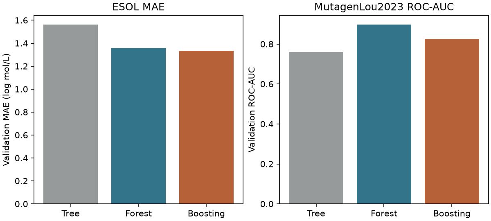

# Random Forest 與 Gradient Boosting {#sec-tree-ensembles}

## 同樣用一百棵樹做預測，隨機森林與梯度提升有什麼差別？ {#開場問題}

差別在於第八十棵樹要學什麼，取決於前七十九棵怎麼用。**隨機森林**（random forest）讓每棵樹各自從不同的訓練樣本和候選特徵學習，最後把預測取平均，所以第八十棵樹也得自己預測分子的溶解度或陽性機率。**梯度提升**（gradient boosting）則是一棵接著一棵，每棵負責修正前面的結果。以溶解度為例，先把前七十九棵的預測加到起始值上，第八十棵只需要估計還要再調整多少。

## 核心概念

先想一棵沒有限制深度的決策樹：最上方的分支一變，後面能拿來分的資料也跟著變。森林利用這個特性，訓練每一棵樹時，都從訓練集**有放回地抽樣**（bootstrap sampling），同一個分子可能被抽到好幾次，有些分子則一次也沒抽中。節點要分支時，也只從隨機抽出的一部分特徵裡找門檻，讓每棵樹有機會用到不同的指紋位元。做迴歸時，把各棵樹預測的數值取平均；做分類時，scikit-learn 平均各棵樹給每一類的機率，再選平均機率最高的類別。要注意的是，如果每一棵樹都把同一群分子估得太低，平均再多次，這個偏差還是在。

梯度提升的樹得一棵接著一棵長。以預測溶解度為例，一開始先給每個分子同一個答案，也就是訓練集的平均值。用實測值減去這個答案，就得到第一輪的**殘差**（residual）；下一棵淺樹要學的，就是怎麼把殘差補回來，例如某個系列的分子普遍被低估，就把預測往上調。每次只把修正量乘上**學習率**（learning rate）再加進去，算出新的殘差後，才輪到下一棵樹。分類的做法相近，只是修正的依據是分類損失對目前分數的負梯度，所以不能直接把陽性標籤當成溶解度去相減。

`n_estimators` 這個參數在兩種方法裡都是樹的數量，意義卻不一樣。森林多訓練幾棵樹，通常只是讓平均結果比較不受某一次抽樣影響，兩棵很像的樹能互補的程度也有限。提升模型每加一棵，都會改變前一輪的預測；輪數多了，可能繼續補到有用的結構差異，也可能開始追著少數訓練誤差跑。所以比較提升的輪數時，要連學習率一起交代：用 0.1 更新一百輪，和用 1.0 更新十輪，即使兩個乘積相同，每一步面對的誤差已經不一樣，不會得到同樣的樹。

## 動手做

[下載本節 notebook](../../notebooks/ch09/09-07-tree-ensembles.ipynb){.btn .btn-sm .btn-outline-primary}　[在 Colab 開啟](ch09/09-07-tree-ensembles.ipynb)

這一節有兩個任務：ESOL 預測水溶解度，Ames 預測致突變性（二元分類）。ESOL 沿用 @sec-moleculenet 的 DeepChem 介面，依骨架切分，目標值是以 mol/L 表示的溶解度取常用對數。Ames 則從 Maom Lab 的 MutagenLou2023 公開副本讀入結構與二元標籤（1 表示陽性），測試名單沿用副本提供的版本。整理方式和前面幾節相同：同一檔內相同的正規 SMILES 只留一筆，標籤互相矛盾的結構剔除，測試檔出現過的結構不放進訓練檔，剩下的資料依類別比例取 15% 當驗證集，種子固定為 42，最後是 5,610 個訓練、990 個驗證和 1,663 個測試分子。

在同一個任務裡，三種模型使用同樣的訓練、驗證和測試分子，也都用半徑 2、長度 1,024 位元的 Morgan 指紋。[@delaney2004esol; @lou2023mutagen]

```python
reg = {"Tree": DecisionTreeRegressor(random_state=SEED),
       "Forest": RandomForestRegressor(n_estimators=100, max_features=0.33, random_state=SEED, n_jobs=1),
       "Boosting": GradientBoostingRegressor(n_estimators=100, max_depth=2, learning_rate=0.1, random_state=SEED)}
```

上面的程式建了三個迴歸模型。森林和提升各用一百棵樹；迴歸森林每次分支先看約三分之一的位元，分類森林則取特徵數的平方根。兩個提升模型都限制每棵樹最多兩層，學習率是 0.1。單樹是比較的起點，不限制深度。這些設定是事先指定的，只涵蓋演算法能調的一小部分，所以比較完也不能說已經找到每種方法的最佳設定。如果只比較預設模型，就下結論說某種演算法天生比較好，讀者很難分辨是方法的差別，還是參數剛好適合這批分子。

{#fig-tree-ensembles fig-alt="左圖以 ESOL 驗證 MAE 比較三根柱，單樹最高，森林與提升樹接近。右圖以 Ames 驗證 ROC-AUC 比較三根柱，森林最高。兩圖皆從零起算。"}

@fig-tree-ensembles 左圖比較 ESOL 的**平均絕對誤差**（mean absolute error，MAE），柱子愈矮，預測愈接近實測值。單樹在訓練集的 MAE 只有 0.052，到了驗證集卻有 1.563 個 log S 單位，這就是不限深度的樹過度擬合的典型樣子。森林和提升樹的驗證 MAE 分別是 1.359 和 1.336，只差 0.023；換一批骨架，這個差距會變大還是變小，這次沒有估計。我們依事先訂好的標準，選了驗證 MAE 最低的提升模型，再用保留的測試分子評估，得到 1.409。注意這是對數尺度上的誤差，不是每公升差了 1.409 mol。

右圖是分類，這次要找較高的柱子。Ames 驗證分子的 ROC-AUC 依序是單樹 0.761、森林 0.898、提升 0.827，最高的隨機森林進入測試評估，得到 0.637。不限深度的單樹常把訓練分子分進只剩一種類別的葉子，於是不同的分子共用 0 或 1 兩種分數。這樣的清單就算把訓練分子分得很乾淨，遇到一長串都被判為陽性的候選物，也排不出哪個該優先送測。森林把各棵樹的陽性機率平均，原本同分的分子就可能拿到不同的分數；提升模型累加各輪的分數，同樣能把清單排出更細的順序。

ESOL 這次選到提升樹，Ames 則選到森林。這個結果只代表這次的設定：我們只比較了 scikit-learn 的三種模型，也只用這一份切分、這組指紋和這幾個指標。換成其他實作（例如 LightGBM 或 XGBoost）、其他切分或其他評分方式，排名都可能不同。所以更有用的做法，是像本節這樣固定輸入、切分和評分方法，再拿新模型來比。

再看訓練結果，可以比較兩種方法怎麼用掉這一百棵樹。ESOL 森林在訓練分子的 MAE 是 0.321，提升樹是 0.917；提升模型在訓練集留著比較多誤差，到了驗證集卻稍微領先。如果當初只看訓練 MAE，會挑出誤差只有 0.052 的單樹，偏偏它就是左圖驗證誤差最大的那一個。所以訓練分數遠好於驗證分數時，可以回頭檢查樹的深度和分子的切分；如果兩邊都很差，就算讓兩個分數靠近，預測也不會因此有用。

提升樹還有一個方便的檢查方式：資料和參數固定時，前十棵樹的總預測，就是第十輪結束時的結果，保留這些中間預測，就能比較每一段更新貢獻了多少。做下面的練習時，請只看驗證資料來選輪數。如果已經看過測試結果，又反覆依它調整輪數，那批測試分子就等於參與了選模，之後得另找一批沒看過的分子，才能檢驗調整後的表現。

## 重點整理

- 隨機森林讓多棵樹分別學習後取平均，樹與樹之間的差異越大，平均能抵消的誤差越多。
- 梯度提升依序學習修正量，輪數、學習率和每棵樹的深度，共同決定它能學到多少。
- 柱高只能在同一個任務內比較：ESOL 看驗證 MAE 最低，Ames 看驗證 ROC-AUC 最高。

## 小練習

取出 ESOL 提升模型在第 10、50、100 輪的預測，分別計算驗證 MAE。如果只能選其中一輪，你會保留哪一輪的模型？

提示：`reg["Boosting"].staged_predict(valid_r.X)` 會依序產生每一輪更新後的預測，第一筆對應第一輪；比較時用同一份驗證標籤。

## 延伸閱讀

scikit-learn 將森林的抽樣、提升的損失函數與學習率分開說明。[Ensemble methods](https://scikit-learn.org/stable/modules/ensemble.html)

ESOL 原始研究說明使用水溶解度作為模型目標時的實驗尺度。[Delaney，2004](https://doi.org/10.1021/ci034243x)

Lou 等人的研究說明 Ames 標籤與原始資料來源，實作使用 Maom Lab 依 CC BY 4.0 提供的鏡像及其切分。[原始研究](https://doi.org/10.1186/s13321-023-00707-x)、[Maom Lab 的 MutagenLou2023 鏡像](https://huggingface.co/datasets/maomlab/MutagenLou2023)。
