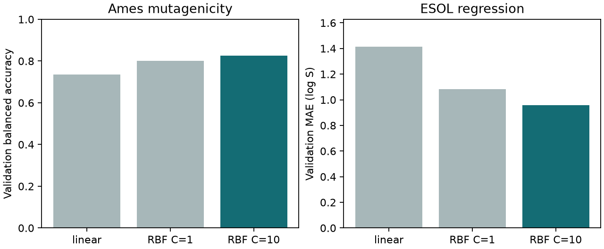

# SVM 與 SVR {#sec-support-vector-machines}

## 同一套分子指紋，可以用來判斷致突變性，也可以拿來估水溶解度嗎？ {#開場問題}

可以。同一套結構指紋，既能拿來判斷分子在 Ames 試驗是陽性還是陰性，也能拿來估計它的水溶解度。前者是分類問題，**支持向量機**（support vector machine，SVM）會從訓練分子中找出一條把兩類分開的邊界。後者是迴歸問題，**支持向量迴歸**（support vector regression，SVR）要預測連續的數值，並容許預測和實測之間差一小段距離。換句話說，兩者讀入的指紋格式相同，差別在於怎麼計算「預測錯了多少」。

## 核心概念

想像把兩個描述符畫成紙上的兩條軸。如果陽性分子都在右上方、陰性分子都在左下方，中間通常可以畫出好幾條分界線。線性 SVM 挑的是讓線兩側留下最寬空白的那一條，這段空白稱為**間隔**（margin）。

真實的試驗資料很少分得這麼乾淨，同一系列裡也可能有指紋很像、量測結果卻相反的分子。**軟間隔**（soft margin）的做法是容許少數分子跑進間隔，甚至落到分界線的另一側，但要付出代價；代價有多重，由參數 $C$ 決定。調高 $C$，模型會更努力照顧這些越界的訓練分子。至於遇到新骨架時是否也分得更準，要另外用驗證資料來看。

換成 SVR 時，可以想像在預測曲線的上下各畫一條線，與曲線相距 $\epsilon$，中間這條帶子叫做容許帶。實測值落在帶內的分子不算犯錯，只有超出帶子的部分才計入損失。舉例來說，若 $\epsilon=0.1$，而預測比實測高 0.3 個溶解度對數單位，超出容許帶的部分就是 0.2。模型擬合時只看這 0.2，但預測和實測之間的絕對誤差仍然是 0.3。

那些貼著或跑進間隔的分類分子，以及貼著或超出容許帶的迴歸分子，都可能成為**支持向量**（support vectors）。之後預測新分子時，模型就是拿新分子和這些支持向量逐一比較，再依各自的係數加總。

如果一條直線分不開資料，可以換一種衡量「兩個分子有多像」的方式，這個衡量方式稱為**核函數**（kernel）。**徑向基底函數**（radial basis function，RBF）核用 $\exp(-\gamma\lVert x-x'\rVert^2)$ 計算兩個輸入的相似程度：兩者越接近，核值越接近 1。以沒有縮放的二元指紋為例，每多一個不同的位元，平方距離就加一。$\gamma$ 越大，核值隨著不同位元增加而下降得越快，每個支持向量只影響和它很像的分子。

**核技巧**（kernel trick）讓演算法只用這些兩兩之間的核值就能求解，不必真的把每個分子轉換成新的特徵再列出來。也就是說，選核函數時，最該問的是：指紋上的距離，對應到什麼樣的化學差異？

## 動手做

[下載本節 notebook](../../notebooks/ch09/09-08-support-vector-machines.ipynb){.btn .btn-sm .btn-outline-primary}　[在 Colab 開啟](ch09/09-08-support-vector-machines.ipynb)

分類任務用的是 Maom Lab 放在 Hugging Face 上的 MutagenLou2023 資料（CC BY 4.0）。我們從 SMILES 計算分子的結構鍵，欄位 Y 的 1 和 0 分別代表 Ames 試驗陽性和陰性。這份資料已經分好一組稱為 realistic split 的訓練檔和測試檔，我們沿用這個分組。

清理步驟是這樣的：先用 RDKit 讀取結構，把標籤一致的重複結構合併成一筆，略過讀不出來的結構，以及同一個檔案裡標籤互相矛盾的結構。測試檔也有的結構，就從訓練檔刪掉。最後從訓練檔抽出 15% 當驗證集，抽樣時維持原本的陽性、陰性比例，亂數種子設為 42。這樣同一個正規 SMILES 就不會同時出現在訓練和測試資料裡，不過相似的骨架仍可能分散在不同組。[@lou2023mutagen] [資料卡與分組說明](https://huggingface.co/datasets/maomlab/MutagenLou2023)

迴歸任務依 @sec-moleculenet 的方式讀入 ESOL，目標是實測水溶解度（以 mol/L 表示後取常用對數，記為 log S），訓練、驗證與測試集按骨架切分。兩個任務的化合物各自獨立，不需要一一配對。所謂「同一套指紋」，是指兩邊的結構都用 MACCS **結構鍵**（structural keys）編碼：分子只要符合某個子結構規則，對應的位元就設為 1。因為每個位元都只有 0 和 1，兩個分子的平方距離就剛好等於它們有幾個位元不同。[@delaney2004esol]

每個任務都比較下面三種候選設定。RBF 的 `gamma="scale"` 表示讓程式根據訓練特徵自動決定 $\gamma$，迴歸則沿用預設的 $\epsilon=0.1$。我們每次只改清單上列出的參數，其他條件都不動，這樣分數有差異時，才知道是哪個參數造成的。

```python
candidates = [("linear", {"kernel": "linear", "C": 1}),
              ("RBF C=1", {"kernel": "rbf", "C": 1, "gamma": "scale"}),
              ("RBF C=10", {"kernel": "rbf", "C": 10, "gamma": "scale"})]
```

這個清單的每一項是一組「名稱＋參數」：第一組是線性核，後兩組是 RBF 核，只差在 $C$ 是 1 還是 10。程式會依序拿每組參數建立模型、用訓練集擬合，再到驗證集評分。

{#fig-svm-kernels fig-alt="左圖比較 Ames 三種設定的平衡準確率，愈高愈好；右圖比較 ESOL 的平均絕對誤差，愈低愈好。深色柱標出各自選中的模型。"}

@fig-svm-kernels 左圖比較的是 9.4 介紹過的平衡準確率：分別算出陽性和陰性分子各有幾成判對，再取平均，柱子愈高愈好。如果模型一律猜樣本較多的那一類，就會一類全對、一類全錯，得分只有 0.5。右圖是平均絕對誤差（MAE），愈低愈好，單位和 log S 相同；差一個單位，就相當於濃度差了十倍。左右兩圖量的是不同的東西，所以不能拿柱子高低來比較哪個任務比較容易。

先看 Ames。MutagenLou2023 清理後有 5,610 筆訓練、990 筆驗證與 1,663 筆測試資料。在驗證集上，線性核的平衡準確率為 0.7360，RBF 在 $C=1$ 時為 0.8012，$C$ 調到 10 時升到 0.8255，所以選中 $C=10$ 的 RBF。

但這個模型到了預先分好的測試集，只得到 0.5682。兩組的陽性比例確實不同：驗證集有 614／990 是陽性，測試集只有 362／1,663。不過平衡準確率本來就給兩類相同的權重，陽性比較少並不足以解釋分數下降。從結果來看，用訓練檔切出的驗證分子選參數時看到的好成績，沒能延續到另外分開的測試資料。

再看 ESOL，三組分子數是 902、113 和 113。驗證 MAE 依圖中順序為 1.4151、1.0820、0.9581，同樣選中 $C=10$ 的 RBF，測試 MAE 為 0.9717。兩個任務碰巧挑到同一組設定；換一種指紋的話，同一個 $C$ 在兩個任務上的表現要各自重新比較。

Notebook 也列出了各模型的支持向量數。以選出的 ESOL 模型為例，有 756 個訓練分子成了支持向量；之後每收到一個新分子，都要拿它的指紋和這 756 個分子逐一比較。所以要替大量候選化合物評分、排序時，支持向量越多，預測就越花時間。至於溶解度估得準不準，還是要看驗證和測試誤差。

想知道分類器怎麼判斷一個新分子，可以看它的**決策分數**（decision score）。二元 SVC 會拿新分子和每個支持向量算一次核值，乘上訓練時學到的權重（有正有負），全部加總後再加上截距。分數落在零的哪一側，就判為哪一類。兩個新分子可能都不太像大多數訓練分子，卻因為對它們影響最大的正類和負類支持向量不同，得到方向相反的分數。

如果要把這個分數交給負責篩選化合物的同事，記得註明它是決策分數，而不是「呈陽性的機率」。舉例來說，分數變成兩倍，陽性的機率並不會跟著變成兩倍。

這次 RBF 的 $\gamma$ 是固定的，所以比較 $C=1$ 和 $C=10$，看到的就是加重越界代價的效果。如果還想試不同的 $\gamma$，可以固定 $C$，先比較幾個相差較大的值，再看高分是不是只出現在很窄的範圍裡。

要記得，每多試一種設定，就等於多用驗證集做了一次選擇。如果反覆依照測試誤差修改參數，原本留到最後評估用的分子，就變成了另一組驗證資料。資料不多、又需要大範圍搜尋參數時，可以只在訓練集內依骨架重新分成幾折，另外保留一批骨架，等設定決定之後再拿來評估。

對 ESOL 來說，容許帶還有一個容易搞混的尺度問題。如果先把標籤除以訓練集的標準差，卻仍用同一個 $\epsilon$，換回 log S 之後，容許的偏差就變了。本節關閉了 DeepChem 的標籤轉換，所以預設的 0.1 就是 0.1 個 log S 單位。要注意，0.1 只是損失函數的一個設定，和實驗能把溶解度量到多精確是兩回事。

## 重點整理

- SVM 找出兩側間隔最寬的分界線，SVR 則容許預測落在 $\epsilon$ 寬的帶子內不算錯。
- $C$ 決定越界要付多少代價，RBF 的 $\gamma$ 決定相似度隨指紋差異下降得多快。
- 兩個任務都先在驗證集上選好設定，再用保留的測試集評估一次。

## 小練習

把 ESOL 的 RBF 模型（$C=10$、`gamma="scale"`）的 $\epsilon$ 從 0.1 放寬到 0.5，支持向量數和驗證 MAE 各改變多少？

提示：從 `esol` 取出訓練和驗證資料，用 `epsilon=0.1` 和 `epsilon=0.5` 各擬合一次 `SVR`。模型的 `support_` 記錄了哪些訓練列是支持向量，算它的長度就知道有幾個。

## 延伸閱讀

scikit-learn 的使用指南分別畫出軟間隔、核函數與迴歸的容許帶，並說明資料規模和特徵尺度會如何影響求解。[支持向量機使用指南](https://scikit-learn.org/stable/modules/svm.html)
