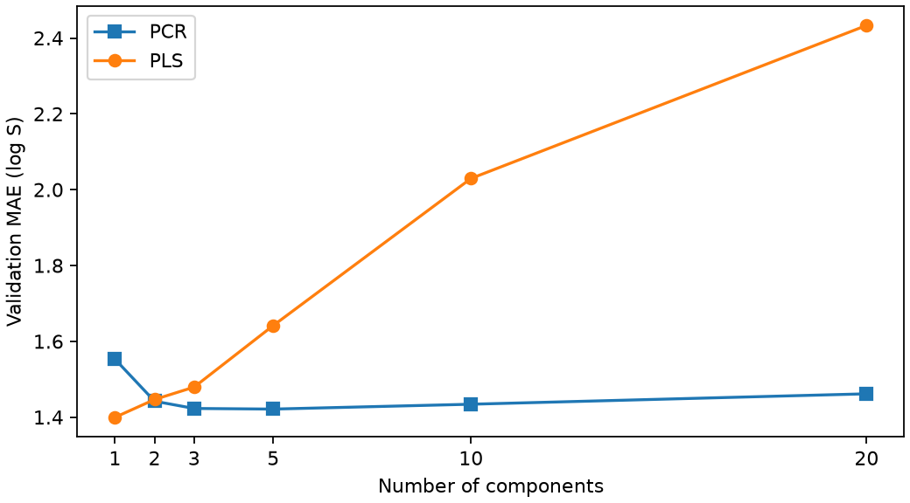

# 從 PCA 到 PCR 與 PLS {#sec-partial-least-squares}

## 如果只能把 512 個指紋位元壓成一個數字，該保留什麼？ {#開場問題}

要看我們想用這個數字做什麼。如果只是想描述分子之間的結構差異，可以在指紋中找出分子彼此差最多的方向。如果這個數字還要拿來預測水溶解度，選方向時就可以把實測值也考慮進去。**偏最小平方迴歸**（partial least squares regression，PLS）就是同時看訓練分子的指紋和溶解度，找出兩者一起變動的方向。舉例來說，一群分子在指紋上和其他分子差很多，但只要它們的溶解度沒有跟著不同，這個結構差異就不一定會成為第一個成分。

## 核心概念

把每個分子的指紋排成一列、每個位元排成一欄，就得到特徵矩陣 $X$。有些位元常常一起亮起，例如同一個常見環系附近，幾個半徑不同的局部環境往往同時出現。用這些欄位做 @sec-linear-regression 的普通最小平方法（OLS）迴歸時，如果兩欄總是一起變動，資料就很難告訴我們哪一欄該分到多少權重，這個現象稱為**多重共線性**（multicollinearity）。對熟悉的結構，兩種不同的權重分配可能給出差不多的預測；遇到只有其中一個位元亮起的分子，兩者的差異才會顯現。

我們先把溶解度那一欄蓋起來，只看訓練分子的指紋。**主成分分析**（principal component analysis，PCA）會找出一個方向，讓分子沿著這個方向排開時分得最散，這個方向記為 PC1。把分子「投影」到某個方向，意思是替每個分子算出它在這條軸上的位置，這個數字稱為分數。第二個方向 PC2 和 PC1 垂直，在這個條件下盡量保留剩下的差異。

把每個分子的 PC1、PC2 分數當成座標，就能畫出它在這批結構中的位置。**解釋變異比例**（explained variance ratio）告訴我們某條軸保留了多少指紋上的差異；算這個比例時，完全沒有用到溶解度。

現在把溶解度那一欄打開。把訓練分子的主成分分數當輸入、實測 log S 當答案，擬合一條線性迴歸式。先做 PCA 決定座標，再用這些座標做迴歸，兩步合起來就是**主成分迴歸**（principal component regression，PCR）。

假設第一主成分主要把大分子和小分子分開。只留這一條軸，分子大小的差異還看得到；但質量相近的化合物也可能因為極性不同，溶解度差很多，這種差別就可能被丟掉。多留幾個成分，確實能保留更多指紋上的差異；至於預測會不會比較準，要拿另一批有量測值的分子來看。

PLS 則是用標籤來決定投影方向。只預測一個目標時，可以把第一步想成找一組權重，讓加權後的指紋分數和水溶解度的**共變異**（covariance）盡量大，也就是讓兩者盡量一起升降。扣掉第一個成分已經說明的部分後，再從剩下的資料找下一個成分。新分子只要提供指紋，就能用訓練好的權重算出分數和預測值。

正因為這些權重看過標籤，PLS 的成分必須只用訓練分子來算，即使後面的迴歸只用訓練集也一樣。如果要做交叉驗證，每一折都要在那一折的訓練分子上重新計算投影。

## 動手做

[下載本節 notebook](../../notebooks/ch09/09-09-partial-least-squares.ipynb){.btn .btn-sm .btn-outline-primary}　[在 Colab 開啟](ch09/09-09-partial-least-squares.ipynb)

我們從 @sec-moleculenet 的 ESOL 取出 1,128 個分子，用 RDKit 的 Morgan 指紋記錄每個原子周圍兩個鍵以內的局部環境，再折疊成 512 個位元。因為經過折疊，一個位元有時對應到好幾種局部環境；就算某個位元在成分中權重很大，也要回頭查是哪些結構讓它亮起，才能拿來設計後續實驗。

標籤是實測 log S，骨架切分得到 902 筆訓練、113 筆驗證與 113 筆測試資料。DeepChem 的標籤轉換設為空，所以報告的 MAE 單位就是原本的 log S。[@delaney2004esol]

先執行 notebook 的 PCA 示範，這一步只用訓練指紋。程式印出 PC1 和 PC2 各自的解釋變異比例，再用同一組軸算出驗證分子的座標。接著把這兩欄座標交給線性迴歸，印出第一個驗證分子的預測 log S。換句話說，第一個輸出告訴我們分子在結構圖上的位置，第二個輸出才回答它大概溶多少。

接下來比較 1、2、3、5、10 和 20 個成分。PLSRegression 的 `scale=True` 會用訓練資料把特徵和目標都減去平均、除以標準差，預測時再換回原本的尺度。PCR 也先用訓練集把每一欄標準化，再做 PCA 和線性迴歸，所以兩種方法都是從縮放過的指紋出發。

對 0、1 位元來說，一欄的標準差取決於它在訓練集裡多常亮起。很少亮的位元，只要亮一次，標準化後的數值就會離平均很遠。所以縮放規則也是實驗設定的一部分，換一種規則，挑出的成分數可能就不一樣。

```python
if name == "PLS":
    model = PLSRegression(n_components=k, scale=True)
else:
    model = make_pipeline(StandardScaler(), PCA(n_components=k, svd_solver="full"),
                          LinearRegression())
model.fit(xt, yt)
```

這段程式依方法名稱建立模型：PLS 直接用 `PLSRegression`；PCR 則用 `make_pipeline` 把標準化、PCA 和線性迴歸三個步驟串成一條流程，`k` 是保留的成分數。最後一行用訓練指紋 `xt` 和訓練標籤 `yt` 擬合。

{#fig-pls-components fig-alt="橫軸是成分數，縱軸是驗證 MAE。PLS 在一個成分時最低，之後逐步升高；PCR 在五個成分附近最低。"}

先看 @fig-pls-components 最左邊的兩點。只留一個成分時，PCR 的驗證 MAE 為 1.5529，PLS 為 1.3996。也就是說，在這批驗證分子上，如果每個分子只能用一個數字表示，選方向時參考溶解度確實有幫助。

往右看，情況就不同了。留到五個成分時，PCR 的 MAE 降到 1.4213，PLS 反而升到 1.6416；留到二十個成分，PLS 更升到 2.4332。成分越多，模型越能遷就訓練分子特有的結構和量測差異，但這些差異對預測新骨架未必有幫助。

如果決定採用 PLS，依驗證結果應該保留一個成分。固定模型後在測試集上評估，MAE 為 1.3718。要注意，這一個成分是由許多指紋位元加權組成的，所以「一個成分」不表示 512 個位元裡只有一個有用，也無法直接對應到某一種官能基。

另外，PLS 的方向是依水溶解度找出來的。換成另一種物性，即使分子完全相同，標籤和位元的共變異也可能不同，所以要沿用這條預測式，前提是要估的仍是水溶解度。

有時候成分數一開始就被限制住了，這時要比較的就不是曲線的最低點。例如後續只打算畫一張二維圖，就只能保留兩個成分。這時 PCR 的驗證 MAE 是 1.4421，PLS 是 1.4466，只差約 0.0045 個 log S 單位。和只留一個成分的結果放在一起看，可以發現 PLS 用了標籤，並不保證它在每一種成分數下都比較好。

兩種方法誤差接近時，可以依想看的資訊來選圖軸。想呈現這批分子最常見的結構差別，用 PCR 的主成分；想沿著和水溶解度一起變動的方向找分子，就看 PLS 的分數。

畫成分圖時，也要留意橫軸到底代表什麼。指紋的每一欄都有固定的編號和意義，投影分數卻是從這批訓練分子估出來的。如果把某個方向的所有權重都乘上負一，分子在這條軸上就會左右對調；迴歸係數跟著調整後，對同一個分子的溶解度預測完全一樣。所以拿兩張用不同分子做的圖比較時，要先確認它們用的是同一套訓練權重，再來討論分數正負代表親水還是疏水。

還有一點容易誤會：在這些模型裡指定三個成分，新分子還是要先算出完整的 512 欄指紋，而且半徑、位元長度和欄位順序都要和訓練時相同，模型才能把它壓成三個分數。如果真正的目的是少算一些描述符，就要另外評估直接刪掉欄位的做法。投影和刪欄都能讓模型後段處理的資料變少，但前段要準備的特徵完全不同。

## 重點整理

- PCR 只看指紋決定方向，PLS 則同時參考溶解度，所以 PLS 的投影也是訓練的一部分。
- 每個成分都是許多位元加權組成的分數，要連回化學結構，得查位元對應的局部環境。
- 用同一批驗證分子比較成分數；本例的 PLS 在只留一個成分時誤差最小。

## 小練習

分別擬合保留一個成分和十個成分的 PLS 模型，比較成分增加後，訓練 MAE 和驗證 MAE 各有什麼變化。

提示：把 `n_components` 分別設成 1 和 10，每個模型各呼叫兩次 `predict`，一次傳入訓練指紋 `xt`、一次傳入驗證指紋 `xv`。指紋、縮放和資料切分都保持不變。

## 延伸閱讀

scikit-learn 的圖例示範，當目標主要沿低變異方向改變時，PCR 和 PLS 的一維投影會有什麼差異。[PCR 與 PLS 的比較](https://scikit-learn.org/stable/auto_examples/cross_decomposition/plot_pcr_vs_pls.html)
