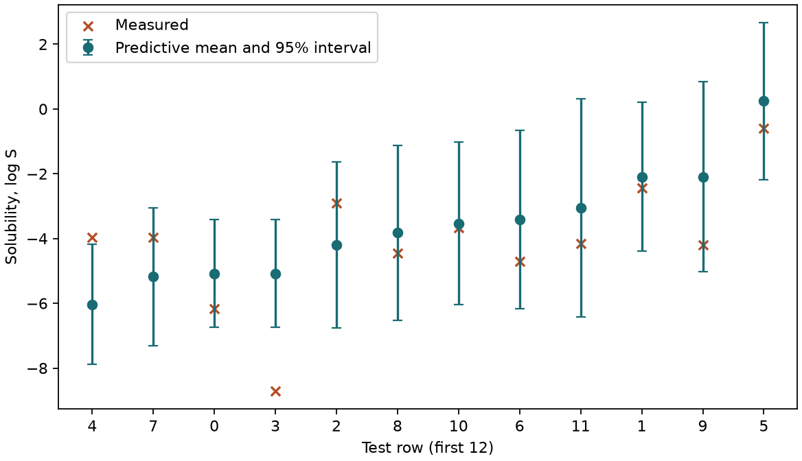

# 高斯過程（GP） {#sec-gaussian-processes}

## 模型預測水溶解度時，能一起告訴我們範圍有多寬嗎？ {#開場問題}

可以。**高斯過程迴歸**（Gaussian process regression，GPR）除了給出一個預測值，還會告訴我們新分子的水溶解度大概落在哪個範圍。它的輸出是一個預測分布：平均值是預測的溶解度，標準差則表示在模型的假設下，量測值可能散開多少。如果想靠這個範圍決定哪些分子值得再測，可以先拿保留下來的分子試試看，數一數實測值有幾成真的落在預測區間內。

## 核心概念

**高斯過程**（Gaussian process，GP）不是直接找出一條預測式，而是對「所有可能的預測函數」給出一個機率分布。任取幾個分子，這些函數在這些分子上的值會服從聯合常態分布；要符合常態分布的是函數值，輸入本身可以是 0、1 組成的指紋。

訓練之前，**核函數**（kernel function）先規定兩個分子的函數值預期會怎麼一起變動。看過量測值之後，模型再更新對新分子的預測。舉例來說，如果同一系列已經有好幾個近似物量過溶解度，而且指紋能分辨這個系列內的差異，新分子的預測通常會受到這些近似物比較大的影響。

我們用 @sec-support-vector-machines 介紹過的 RBF 核來表達這個想法。兩個分子的指紋距離接近零時，模型預期它們的溶解度關聯很強。距離拉到多遠還算「相近」，由**長度尺度**（length scale）決定：長度尺度大，函數可以平緩地延伸到比較遠的分子；長度尺度小，即使是附近的分子，預測也可以差很多。要注意的是，如果兩種差異很大的結構剛好得到相同的指紋，模型會把它們放在同一個位置，這時預測範圍再窄，也看不出指紋漏掉了什麼差異。

同一個分子量兩次，指紋當然一樣，溶解度卻可能不同。為了容許這種差異，我們在核函數裡加上一項**白雜訊**（white noise），讓每次量測都可以有各自獨立的小變動。本例假設每個分子的雜訊大小相同，所以即使某個系列特別難量，模型也不會自動替它加大雜訊。

這個雜訊是從資料估出來的。缺少重複量測、或原始實驗條件沒記全時，估出的雜訊還可能混進指紋和模型沒能解釋的差異，所以它和儀器的精密度是兩回事。

## 動手做

[下載本節 notebook](../../notebooks/ch09/09-10-gaussian-processes.ipynb){.btn .btn-sm .btn-outline-primary}　[在 Colab 開啟](ch09/09-10-gaussian-processes.ipynb)

我們依 @sec-moleculenet 載入 ESOL 的 1,128 個實測 log S，按骨架分出 902、113、113 個訓練、驗證與測試分子。本例事先固定核函數的形式，只用訓練集估計核參數，驗證集沒有用到。分子用 RDKit 轉成 MACCS 結構鍵，每個位元代表一項結構規則；兩個分子不同的位元越多，指紋之間的距離就越大。這個距離本身沒有濃度單位，是訓練資料估出的核參數，把它和水溶解度連了起來。[@delaney2004esol]

```python
kernel = ConstantKernel(1.0) * RBF(length_scale=3.0) + WhiteKernel(noise_level=0.1)
model = GaussianProcessRegressor(kernel=kernel, alpha=1e-8, normalize_y=True,
                                 random_state=SEED)
model.fit(xt, yt)
```

這段程式先組合核函數：常數核乘上 RBF，決定函數可以起伏多大；再加上 WhiteKernel，容許個別觀測偏離這條函數。`alpha` 設成一個很小的正數，會在訓練核矩陣的對角線上加一點點數值，讓矩陣分解比較穩定；這和替未來量測估計雜訊是兩回事。最後一行用訓練指紋 `xt` 和標籤 `yt` 擬合模型。

`normalize_y=True` 會先用訓練標籤的平均和標準差把目標標準化。所以程式印出的白雜訊變異 0.158 是標準化之後的數字，不是以 log S 為單位的誤差。呼叫 `predict(xs, return_std=True)` 時，得到的平均和標準差則已經換回 log S 單位。

{#fig-gp-solubility fig-alt="十二筆測試分子依預測平均值由小到大排列，圓點與垂直線為預測平均和區間，叉號是對應的實測值。"}

@fig-gp-solubility 畫出測試集的前十二筆資料，依預測平均值由小到大排列，橫軸標的是原本的列號。第 3 列的實測值（叉號）比區間下界還低，表示模型高估了這個分子的溶解度。第 0 列的實測值為 −6.176，落在區間內，但和預測平均值 −5.077 仍差了約 1.10 個 log S 單位。

這 1.10 的誤差要等量過才知道，模型卻能在量測之前，就給出預測標準差 0.848。用預測平均值加減 1.96 個標準差，得到的區間約為 −6.74 到 −3.42。把兩個端點分別當成 10 的指數，就能換回 mol/L。因為對數刻度上等長的一段代表相同的倍數，換回濃度後，區間上下兩端離中心預測值的距離就不一樣長了。

核參數固定之後，照理說這個區間應該蓋住約 95% 的新觀測，這個比例稱為**名目涵蓋率**（nominal coverage）。因為核函數包含 WhiteKernel，區間描述的是新量測可能出現的範圍，而不只是函數本身。實際檢查全部 113 筆測試分子，有 101 筆落在區間內，實際涵蓋率為 89.4%；點預測的 MAE 為 0.9474 個 log S 單位。

換句話說，在這批新骨架上，模型給的區間有點太窄，只看第 0 列是看不出來的。反過來，某一列落在區間外，也還不足以斷定量測有誤；要回頭看結構表示、量測條件，以及訓練集裡有多少類似的分子。

假設實驗室有兩個候選分子，預測平均值差不多，要先測哪一個就看實驗目的。想弄清楚模型最沒把握的地方，可以先測區間較寬的那個；想挑比較有把握能溶的分子，就比較兩者區間的下界。這兩種選法都要靠區間可信，所以手上如果有同系列的歷史量測，可以先用它們算算實際涵蓋率。

看涵蓋率時，也要一起看區間有多寬。把每條線都拉得很長，蓋住的點自然會變多；但如果範圍跨了好幾個數量級，實驗人員還是不知道該從哪個濃度開始試。所以對同一批分子，可以同時報告「有幾個落在區間內」和「區間平均寬幾個 log S 單位」。如果不同系列的區間寬度差很多，一個平均值會把差別蓋掉，這時可以挑同一骨架附近的分子一起看。圖中只畫十二個點，是為了看清楚個別分子；報告整體表現時，還是要把全部測試分子算進去。

核函數也決定了建模要花多少記憶體和時間。精確的 GP 擬合時，要處理訓練分子兩兩之間的核值，902 筆訓練資料就構成一個 902 乘 902 的方陣。樣本數加倍，矩陣元素就變成四倍，而分解這種矩陣的運算量大約隨樣本數的三次方增加。所以規畫這類分析時，除了指紋有幾個位元，也要想想有多少筆量測要一起放進模型；訓練分子一多，即使特徵很少，求解這個矩陣也可能成為最花時間的一步。

## 重點整理

- GP 用核函數描述分子之間的關聯，預測時同時給出平均值和標準差。
- 加了 WhiteKernel，區間就包含量測雜訊；標籤經過標準化時，要分清楚哪些數字是哪個尺度。
- 用保留的測試分子算實際涵蓋率，並一起報告區間寬度和點預測誤差。

## 小練習

把區間改成預測平均值加減一個標準差，數一數 113 個測試分子中有幾個實測值仍落在區間內，並算出區間的平均寬度（log S 單位）。

提示：`np.abs(ys - mu)` 是每個分子實測值和預測平均的差距，拿它和 `sd` 比較，就知道有沒有落在區間內；每筆的寬度是上端點減下端點。

## 延伸閱讀

scikit-learn 的高斯過程章節說明核函數如何表示共變異，並區分訓練對角線的調整與模型中的白雜訊核。[高斯過程使用指南](https://scikit-learn.org/stable/modules/gaussian_process.html)
