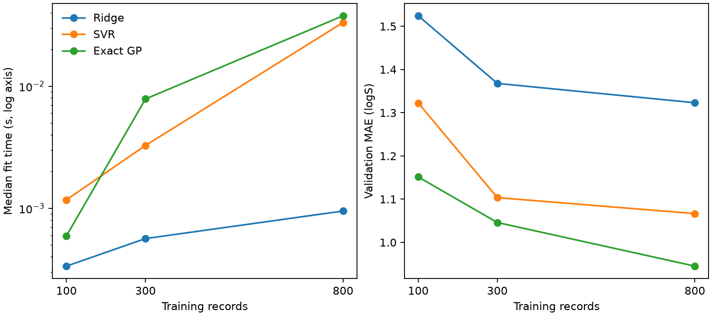

# 模型怎麼選：資料量與計算成本 {#sec-model-selection}

## 小批資料上誤差最低的模型，等分子數目增加後，還跑得起來嗎？

不一定，要實際量過才知道。做法是分幾次增加訓練分子，在同一台機器上記錄每次擬合花多久，並用同一批驗證分子計算誤差；把時間和誤差兩條曲線放在一起看，就知道多花的時間換來多少改善。有的方法在小批資料上預測得很好，樣本多了幾倍之後，記憶體卻可能放不下核矩陣，這時就要考慮換演算法、改用近似方法，或升級硬體。反過來，跑得最快的模型，如果準確度還比不上簡單基準，也不適合拿來篩選分子。

## 核心概念

模型要花多少時間，取決於它要對哪些東西做運算。以 @sec-gaussian-processes 使用 RBF 核的高斯過程迴歸為例，常見的精確解法要算出每一對訓練分子之間的共變異，排成一個邊長等於訓練筆數的方陣。光是存這個矩陣，需要的空間就隨筆數的平方成長；再用標準的 Cholesky 分解求解，運算量更是隨筆數的三次方成長。

所以估記憶體時，先數矩陣有幾個元素；估擬合時間時，還要考慮分解矩陣的運算。舉例來說，訓練筆數變成兩倍，如果只把原本的耗時乘以二，就會大大低估成本。此外，讀取資料、計算核值和其他陣列，也都會占用時間或空間。

使用核函數的 SVR 也要比較分子之間的相似性，但它的求解方式和精確高斯過程不同，容許誤差 $\epsilon$、懲罰強度 $C$、收斂的快慢和核值的快取都會影響時間。本例的 Ridge 則是直接對指紋欄位估係數，不需要存下所有分子配對的核值。

不過，選模型最後還是要回到實驗本身。線性模型如果抓不到結構和性質之間的關係，也許要換一種更合適的分子表示。反過來，如果模型很少需要重新訓練，而每個送測名額都很珍貴，多花一些時間擬合核模型也可能很值得。

比較速度之前，要先說清楚計時從哪裡開始、到哪裡結束。前面幾節都只用訓練集擬合一次；如果改做五折交叉驗證，還要比較好幾組超參數，就得反覆擬合很多次。如果把網格搜尋也算進去，量到的就是整套選模流程要跑多久，而不是單次擬合的時間。這一節先固定特徵和參數，只量訓練分子增加後，擬合一次需要多少時間。換句話說，要比較兩個秒數，先確認它們量的是同一件工作。

## 動手做

[下載本節 notebook](../../notebooks/ch09/09-11-model-selection.ipynb){.btn .btn-sm .btn-outline-primary}　[在 Colab 開啟](ch09/09-11-model-selection.ipynb)

我們沿用 @sec-moleculenet 的 ESOL 水溶解度、167 欄 MACCS 指紋和骨架切分，並把資料規模縮小，讓一般電腦的 CPU 也能從頭跑一遍。先用種子 42 把訓練分子打亂順序，再依次取前 100、300 和 800 筆。因為是從同一個順序往後取，小組的分子都包含在下一個較大的組裡，而且同一列不會被抽到兩次。

三種模型在每個資料量上都用完全相同的分子，也都用同一批驗證分子評分。這樣才不會發生某個模型剛好多抽到容易預測的分子，差異卻被算在演算法頭上。最終測試集則保留下來，不拿來挑模型。

Ridge、RBF 核的 SVR 和精確高斯過程都使用固定的參數。GP 的長度尺度和雜訊設定也固定下來，關掉自動調整核參數的功能；如果要反覆搜尋長度尺度，那就是另一項要分開計時的工作。

計時方式是這樣的：先用少量訓練資料「暖機」，讓程式完成第一次執行時的準備工作，再對每個模型和每個資料量各擬合三次，取時間的中位數。底層數值函式庫能控制的執行緒數都限制為一，也就是不讓函式庫同時動用多個 CPU 核心平行計算。下載資料、計算指紋、抽樣、建立模型物件和預測的時間，都不算在內。所以這套設定適合比較三個模型本身，但無法告訴我們從收到一份新的結構檔到交出預測，整個流程要多久。

```python
for repeat in range(3):
    model = clone(prototype)
    start = perf_counter()
    model.fit(Xn, yn)
    times.append(perf_counter() - start)
err = mean_absolute_error(valid.y[:, 0], model.predict(valid.X))
```

迴圈跑三次，每次用 `clone` 複製一個全新、還沒訓練過的模型，在 `fit` 前後各讀一次時間，兩者相減就是這次擬合花的秒數，存進 `times`。迴圈結束後，再用模型預測驗證分子，計算 MAE。

{fig-alt="左圖是三種模型在 100、300、800 筆訓練資料下的擬合時間，使用對數刻度。右圖用相同的樣本數比較驗證 MAE，三組模型在 800 筆時均比 100 筆時低。"}

左圖的縱軸是對數刻度，同樣的垂直距離代表耗時增加同樣的倍數，至於實際多等幾秒，要看起點在哪裡。只花幾毫秒的擬合特別容易受到電腦當時其他工作的干擾。如果重跑時兩條相鄰的曲線換了位置，可以先看三次測量之間差多少，再多量幾次，看排名穩不穩定。

向團隊報告成本時，記得一起寫下 CPU、軟體版本、執行緒設定，以及有沒有花時間搜尋超參數。舉例來說，一套 GP 在 GPU 上做近似訓練，另一套在 CPU 上做精確分解，光看總耗時，分不出到底是哪一步省了時間。

右圖的縱軸是以原始 log S 計算的驗證 MAE。訓練筆數從 100 增加到 800，Ridge 從 1.5242 降到 1.3231，SVR 從 1.3225 降到 1.0665，固定核參數的 GP 則從 1.1513 降到 0.9450。從結果來看，三個模型在 800 筆時都比 100 筆時準，而且在這兩個資料量上，GP 的誤差都最低。

這些數字描述的是這批驗證分子、這三組模型設定和這次抽樣的結果。換成另外八千個分子時，三個模型是否還是同樣的順序，要另外再量。尤其最小的子集只取了訓練序列的開頭一段，如果剛好沒涵蓋驗證集中常見的結構，等到那些化學系列第一次加進來，曲線就可能一下子掉很多。

實際選模型時，可以先請實驗同事決定：溶解度誤差要差到多少，才會改變下一步的決定。如果兩個模型的差距小於這個門檻，模型更新要多久、需要多少記憶體、要花多少人力操作，就可能變成決定因素。想知道改進是否穩定，可以在開發資料內換幾個抽樣種子，或改做分組驗證；保留的測試標籤則留到最後才看。

如果想把這個測量延伸到維度更高的 Morgan 指紋，要記得換指紋不只是欄數變多，連「兩個分子有多像」的定義也一起改了。所以兩組結果可以並列記錄，但時間和誤差的變化，不能全部歸因於維度。

再回頭看作者原本的計時筆記。如果要把結果交給別人重測，最好連抽了哪幾列（抽樣索引）都存下來。兩次都寫「取八百筆」，仍可能拿到不同的分子；就算用了可重複的亂數序列，也要說明抽樣時允不允許同一列出現兩次。在同一批分子上換核函數或換模型，才能把模型本身的差異和抽樣造成的差異分開。

如果下一輪要量的是每天重新訓練整條流程要多久，就要把本例刻意排除的資料處理和選模步驟加回去，並另外列出預測一批候選分子需要的時間。

## 重點整理

- 用同樣的訓練分子、同一批驗證分子和說清楚的計時範圍，同時比較擬合時間和誤差。
- 精確 GP 的核矩陣大小隨訓練筆數的平方成長，資料變多之前可以先估算矩陣有多大。
- 硬體、特徵、調參方式和化學範圍都會影響排名，最好在自己的資料和預算下實際量一次。

## 小練習

實驗室只能送測 10 個分子，希望其中越多個水溶解度達到 10 mmol/L 越好。把 ESOL 的 113 個驗證分子當作候選，分別用 300 筆和 800 筆訓練資料擬合本節的精確 GP，各自選出預測溶解度最高的 10 個分子，再數一數兩份名單各有幾個實測達標。同時考慮命中數和擬合時間，你會用哪個模型排下一批送測名單？

提示：沿用種子 42 產生的訓練順序和原本的 MACCS 指紋。10 mmol/L 就是 $10^{-2}$ mol/L，對應 log S = −2。先依預測值由高到低排序（同分時維持驗證集原本的順序），選完 10 個之後才查實測值。擬合時間可以從 `results["Exact GP", n]` 讀取，`n` 是訓練筆數。

## 延伸閱讀

scikit-learn 的文件說明了精確 GP 的實作、可用的分類與迴歸器，以及使用核函數的 SVM 的運算成本。計時用 Python 的高解析度計時器。[高斯過程](https://scikit-learn.org/stable/modules/gaussian_process.html) · [支持向量機](https://scikit-learn.org/stable/modules/svm.html) · [Python perf_counter](https://docs.python.org/3/library/time.html#time.perf_counter)
