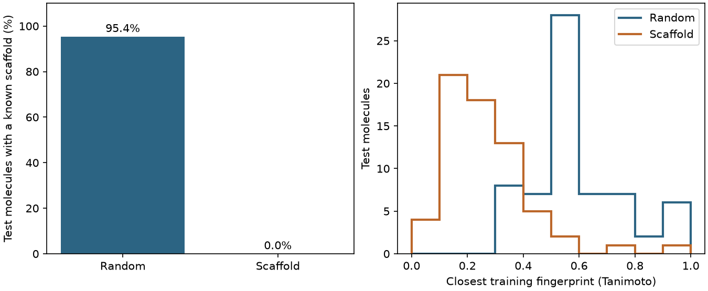

# 資料切分：random 與 scaffold split {#sec-random-and-scaffold-splits}

## 測試集裡的分子都沒參與訓練，為什麼換一個母核後，預測還是可能失準？ {#開場問題}

因為隨機切分出來的測試集裡，大多是模型「熟悉系列」的分子。**隨機切分**（random split）讓每筆紀錄各自抽籤，如果同一個母核有十幾種衍生物，通常有幾個進了訓練集、另外幾個進了測試集。舉例來說，假如對氯苯甲酸分到訓練集、對溴苯甲酸分到測試集，模型等於是在預測一個很像的老朋友。如果研究目標是換一個全新的母核，可以改用**骨架切分**（scaffold split），把骨架相同的分子整組分到訓練、驗證或測試集，這樣模型在訓練時就連測試分子的骨架都沒見過。

## 核心概念

這裡用 RDKit 的 Bemis–Murcko 骨架來分組。所謂骨架，就是把分子環外的側鏈去掉後剩下的部分：苯甲酸和對氯苯甲酸去掉側鏈後都只剩一個苯環，所以歸在同一組。兩個環之間如果有碳鏈相連，骨架也會保留這段碳鏈；把環上的一個碳換成氮，骨架就變成另一種。1-丁醇沒有環，RDKit 會傳回空字串。其他無環分子也一樣，所以不管它們的結構和性質差多少，都會被分到同一組。[@bemis1996frameworks]

常見的切分比例是八成做訓練，一成做驗證、用來比較模型，最後一成留到模型定案後才拿來測試。DeepChem 的 ScaffoldSplitter 會把骨架群組由大到小排序，逐組嘗試放進訓練集；放不下的話，就改試下一個資料集，後面的小群組也還有機會填進先前的空位。因為同一骨架必須整組分配，各組的筆數不一定剛好符合指定比例。假如一半的分子都沒有環，這一半就得全部放在一起。另外，只要資料順序和套件版本相同，換一個隨機種子重跑，骨架分組的結果也不會變。

切好之後，可以用**骨架重疊率**看測試集和訓練集有多像，它有兩種算法。第一種按分子計算：同一個苯環系列在測試集有二十筆，就算二十次，它回答的是「整批候選分子中，有多少沿用訓練時見過的骨架」。第二種按骨架計算：如果想從幾個不同系列各挑一個起始分子，每種骨架的份量應該相同，這時就先把重複的測試骨架去掉，再算其中有多少比例在訓練集出現過。

## 動手做

[下載本節 notebook](../../notebooks/ch10/10-01-random-and-scaffold-splits.ipynb){.btn .btn-sm .btn-outline-primary}　[在 Colab 開啟](ch10/10-01-random-and-scaffold-splits.ipynb)

FreeSolv 收錄了中性小分子從氣相進入水相時的實驗水合自由能，我們要用分子結構來預測這個量，單位維持 kcal/mol。開啟 notebook 後，選用書籍的 Python 或 Colab 2026.07，執行第一格安裝環境。這裡用 DeepChem 的 `load_sampl()` 讀入整份 FreeSolv，指定實驗值那一欄 `expt`，保留還沒切分、也沒標準化的原始數值。[@mobley2014freesolv]

第一筆是 4-甲氧基-N,N-二甲基苯甲醯胺，實驗值為 −11.01 kcal/mol。同一列也有一欄計算值，這兩欄要分清楚，不要混用。兩種切分都用同一張表，也都配上半徑 2、長度 1,024 位元的 Morgan 指紋。這樣一來，如果兩次的分數有差距，就知道不是特徵不同造成的。

下面這段是 notebook 迴圈裡的計算。切分器傳回的是資料列的位置編號，所以標籤、指紋和骨架都可以用同一組編號取出。

```python
train, valid, test = splitter.split(full, seed=0)
assert len(set(train) | set(valid) | set(test)) == len(full)
seen = set(keys[train])
overlap = np.mean([key in seen for key in keys[test]])
train_fps = [fps[j] for j in train]
nearest = [max(DataStructs.BulkTanimotoSimilarity(fps[j], train_fps)) for j in test]
```

用白話說，`seen` 是訓練集裡出現過的骨架清單（重複的只留一個）。`overlap` 那一行逐一檢查每個測試分子的骨架在不在清單裡，在的話記 `True`（算 1），不在記 `False`（算 0），取平均就是測試分子沿用已知骨架的比例。最後一行則替每個測試分子找出它和所有訓練分子之間最高的相似度。如果你手動檢查前幾個分子，記得保留骨架的空字串，因為它代表無環分子，刪掉就會改變分母。

骨架不同的分子，還是可能帶有相同的官能基、側鏈，甚至共用一大段環系，所以我們另外看指紋相似度。**Tanimoto 相似度**（Tanimoto similarity）的算法是：兩個指紋都亮起的位元數，除以至少有一個指紋亮起的位元數，數值介於 0 到 1。右圖替每個測試分子只記一個數字，也就是它和最像的那個訓練分子的相似度。如果改成算所有配對的平均，就算有一個非常接近的訓練分子，也會被大量不相似的配對稀釋掉。

{#fig-freesolv-splits fig-alt="左側長條比較兩種切分下測試分子具有已知骨架的百分比，右側用相同組距顯示各測試分子到最近訓練分子的 Tanimoto 相似度。"}

FreeSolv 的 642 個分子共有 63 種骨架，光是無環分子就有 320 個，單一苯環的骨架又占了 152 個。在 @fig-freesolv-splits 左圖中，隨機切分有 95.4% 的測試分子沿用訓練時見過的骨架，骨架切分則是零。右圖中，測試分子和最近訓練分子的相似度中位數，從隨機切分的 0.556 降到骨架切分的 0.229。也就是說，在 FreeSolv 裡把骨架整組留出來，確實讓許多測試分子更難找到相似的訓練分子。不過如果測試分子骨架不同、卻都帶著同樣的大側鏈，右圖就不一定會出現這麼明顯的差距。

兩種切法剛好都分出 513 個訓練分子、64 個驗證分子和 65 個測試分子。我們在兩邊各用 500 棵樹的隨機森林預測水合自由能，隨機種子都設為零。這裡用兩個指標來看結果。**均方根誤差**（root mean squared error，RMSE）可以想成「預測值平均偏離實驗值多少」，單位和標籤一樣是 kcal/mol，越小越好。**決定係數**（coefficient of determination，R²）則是拿模型和「每筆都猜平均值」相比，1 代表完全預測正確，0 代表和猜平均值一樣好。

從結果來看，隨機切分的測試 RMSE 為 1.448 kcal/mol，骨架切分為 4.363 kcal/mol；決定係數分別是 0.783 和 −0.440。決定係數變成負的，表示模型在骨架切分的測試集上，比每筆都猜測試標籤的平均值還差。要注意的是，這裡各只切分一次，兩組測試分子的結構和標籤分布本來就不同，所以這個差距只能說明「換骨架變難了」，還不能拿來估算每換一個骨架會多出多少誤差。

要重現這次實驗，除了演算法名稱，還要記下種子、資料版本和三組索引。如果只記三份資料的大小，資料順序一旦改變，就無從得知當初每一組有哪些分子。比較兩套演算法時，也要讓它們共用同一次切分；若一套用隨機切分、另一套用骨架切分，成績的差距就同時混進了演算法和測試分子兩個因素。

那麼該選哪一種切分？要看研究問題。如果想根據已經量過的同系列溶劑，估計末端甲基換成乙基後水合自由能會變多少，隨機切分的結果就有參考價值。如果想評估新的環系，就要確認測試骨架都沒在訓練集出現過。另外，即使指紋很接近，一處取代也可能改變分子和水的作用，所以相似度只能當作參考，換算不出自由能的誤差。報告時寫清楚切分規則、骨架定義、分子數，以及測試分子和訓練資料的關係，讀者才能判斷這個分數適用於哪一種研究問題。

## 重點整理

- 隨機切分的測試集多半是模型熟悉的系列；目標是新母核時，要按骨架整組留出。
- 所有無環分子都對應同一個空骨架，這種大群組會直接影響三份資料分到哪些分子。
- 骨架重疊率看分組、最近鄰相似度看結構距離，兩者要和同一次切分的測試誤差一起讀。

## 小練習

用 seed 0 隨機切分 FreeSolv，分別「按測試分子數」和「按不重複的測試骨架數」計算骨架重疊率，比較兩個比例並說明為什麼會不同。

提示：重新呼叫 `RandomSplitter().split(full, seed=0)`，再改寫 `overlap` 那一行，分母分別用測試分子總數和不重複的測試骨架總數。空字串也算一種骨架。

## 延伸閱讀

Bemis 與 Murcko 介紹分子骨架如何保留環與連接部分，可以對照文中兩個苯甲酸衍生物的例子。[原始論文](https://doi.org/10.1021/jm9602928)

DeepChem 文件列出切分器傳回的索引、資料比例和種子參數。[DeepChem 的分子切分器](https://deepchem.readthedocs.io/en/latest/api_reference/splitters.html#scaffoldsplitter)
