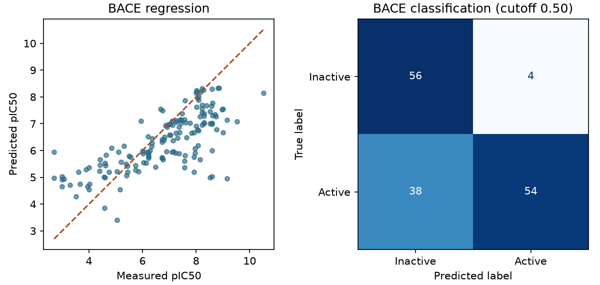

# 評估指標怎麼看（迴歸、分類） {#sec-evaluation-metrics}

## 想從候選分子中挑出抑制劑，該看預測活性的誤差，還是看挑中了幾個？ {#開場問題}

兩種都可以看，要選哪一種，取決於實驗室接下來要做什麼決定。如果要比較兩個候選物的效力差多少，就用**迴歸**（regression）預測活性，看預測值和實測值差幾個單位。如果要從一份清單裡挑出一批分子送測，就用**分類**（classification）來評估：有活性的分子有沒有排在前面？照某個門檻送測，會挑中幾個、漏掉幾個？同一批分子可以回答這兩類問題，只是計分的方式不一樣。

## 核心概念

先看迴歸。把預測值減去實驗值，正值代表高估，負值代表低估。如果直接把誤差相加，高估和低估會互相抵消，所以**平均絕對誤差**（mean absolute error，MAE）先取絕對值再平均，每個分子的份量都一樣。換句話說，MAE 就是「模型平均差了多少」。**均方根誤差**（root mean squared error，RMSE）則是先把誤差平方、取平均後再開根號；因為平方會放大大的誤差，只要有少數幾筆差很多，RMSE 就會被拉高。這兩個指標的單位都和目標值相同。

**決定係數**（coefficient of determination，$R^2$）回答的是另一個問題：模型比「每筆都猜測試標籤的平均值」好多少？它的算法是把模型的誤差平方和，除以各測試標籤和平均值之差的平方和，再用一減去這個比值。所以全部預測正確時得一，每筆都猜平均值時得零，比猜平均值還差時就是負分。要注意，測試集的平均值只是拿來計分用的參照；如果真的要用一個常數去預測新分子，這個常數應該從訓練標籤估計。

再看分類。分類器通常會先替每個分子打一個「有活性」的分數，分數越高，模型越傾向判定它有活性。**ROC 曲線下面積**（ROC-AUC）可以這樣讀：從實驗上有活性和沒活性的分子中各隨機抽一個，有活性的那個得到較高分的機率是多少（同分算半次）。也就是說，它評的是排序好不好，還沒決定要送測幾個分子。

如果有活性的分子很少，可以另外看**平均精確率**（average precision，AP）。它把門檻由高往低移動，每多找回一部分活性分子，就記下當時清單的命中比例，再加權平均。解讀 AP 時要一併交代這批資料中有活性的比例，因為就算完全不靠模型、隨便抽，抽中的機會也會隨這個比例改變。

定好門檻、列出送測清單後，就可以把分子分進**混淆矩陣**（confusion matrix）的四格。以有活性為正類：入選的活性分子是真陽性（TP），入選但沒有活性的是偽陽性（FP），沒入選的活性分子是偽陰性（FN），沒入選也沒有活性的是真陰性（TN）。**精確率**（precision）回答「送測的分子有多少比例真的有活性」，算法是 TP 除以送測總數 TP＋FP。**召回率**（recall）回答「所有活性分子中找回了多少」，算法是 TP 除以活性分子總數 TP＋FN。要算召回率，清單內外的分子都得有實驗標籤，才知道漏掉了幾個。

## 動手做

[下載本節 notebook](../../notebooks/ch10/10-02-evaluation-metrics.ipynb){.btn .btn-sm .btn-outline-primary}　[在 Colab 開啟](ch10/10-02-evaluation-metrics.ipynb)

BACE 資料集收錄針對人類 β-分泌酶 1 的抑制劑。抑制一半活性所需的濃度稱為 IC₅₀，把它換成 mol/L 後取負的常用對數，就得到 pIC₅₀。數字越大，表示達到相同抑制程度所需的濃度越低；pIC₅₀ 差一，換回濃度就是差十倍。DeepChem 提供兩個讀取介面，迴歸版讀 `pIC50`，分類版讀原始資料的 `Class`。訓練分類器時，我們只把結構指紋交給模型。如果把實驗測得的 pIC₅₀ 也放進特徵，將來拿一個剛畫好、還沒量過的分子來預測時，就沒有這一欄可用。[@subramanian2016bace]

在 Colab 2026.07 或書籍環境執行 notebook，兩個任務都用骨架切分。程式會逐一比對訓練、驗證、測試三組的分子識別字，確認迴歸和分類兩邊的每一列都是同一個分子。接著用半徑 2 的 Morgan 指紋，分別訓練 200 棵樹的隨機森林迴歸器和分類器。迴歸器輸出各棵樹預測值的平均；分類器的 `predict_proba` 則傳回每一類的分數，取欄位時要用 `classes_` 確認哪一欄代表有活性。

```python
score = clf.predict_proba(test_c.X)[:, list(clf.classes_).index(1)]
label = test_c.y.ravel().astype(int)
picked = score >= 0.50
matrix = confusion_matrix(label, picked, labels=[0, 1])
```

這段程式先取出每個測試分子「有活性」的分數，分數大於等於 0.50 的就算入選，再和實驗標籤一起整理成混淆矩陣。0.50 是示範時事先選定的門檻。如果之後想依送測預算調整門檻，可以在驗證集上比較幾個選項，把規則定好之後才去看測試集。

{#fig-bace-metrics fig-alt="左圖橫軸為實測 pIC50、縱軸為預測 pIC50，虛線代表兩者相同。右圖以實測類別為列、預測類別為欄，四格數字為分子數。"}

這次切出 1,210 個訓練分子、151 個驗證分子和 152 個測試分子。先看一個最簡單的基準：每筆都預測訓練集的活性中位數，MAE 是 1.428 個 pIC₅₀ 單位。改用結構預測後，MAE 降到 0.946，RMSE 為 1.236，$R^2$ 為 0.460。從結果來看，模型確實比猜中位數準，平均誤差將近一個對數單位。

這個整體成績要怎麼用在兩個候選物上？假設兩者的預測值只差零點幾個對數單位，比平均誤差還小，就不能據此斷定哪一個比較強。如果真的要判斷某一對分子的效力順序，可以先在驗證資料中找骨架類似、效力差距也類似的配對，看看模型多常把順序排反。

分類這邊，152 個測試分子中有 92 個有活性，占 60.5%。模型的 ROC-AUC 是 0.855，AP 是 0.899。門檻定在 0.50 時，入選的 58 個分子中有 54 個有活性，精確率是 54／58，約 93.1%；但 92 個活性分子裡有 38 個落選，召回率只有 54／92，約 58.7%。也就是說，這份清單命中率很高，但也漏掉了不少活性分子。另外，ROC-AUC 評的是排序，計算時沒有用到門檻，所以 0.855 和「送測後會命中多少」是兩回事。

讀 @fig-bace-metrics 左圖時，落在虛線下方的點，代表模型低估了這個分子的活性。如果研究目標是找出效力高的分子，要特別留意右下方的點：一個低活性分子和一個高活性分子即使誤差一樣大，對 MAE 的貢獻相同，但後者可能就這樣被排除在後續實驗之外。如果想用百分比呈現誤差，直接拿 pIC₅₀ 的差除以 pIC₅₀ 並不好解釋。比較直覺的讀法是回到濃度：預測比實測高一個對數單位，代表所需濃度被低估了十倍。

右圖「預測有活性」那一欄的總和就是送測數，「實際有活性」那一列的總和則是原本可能挑中的活性分子數。**正確率**（accuracy）把真陽性和真陰性加在一起算，分不出其中有多少是挑對的活性物。如果一次只能測幾個候選物，送測的命中率最重要；如果漏掉一個活性物可能讓整個新骨架失去機會，就要看召回率。即使 ROC-AUC 相同，換一個門檻，送測清單的長度也會跟著改變。

## 重點整理

- MAE 和 RMSE 用原本的單位表示誤差，RMSE 對大誤差更敏感；搭配散佈圖才看得出哪個效力範圍容易估錯。
- ROC-AUC 和 AP 評的是排序，讀數字時要一起看測試集中有活性的比例。
- 定下門檻後，混淆矩陣會告訴我們挑中幾個、漏掉幾個，以及要做多少次實驗。

## 小練習

在驗證集上比較 0.35 和 0.50 兩個分類門檻，看各要送測幾個分子、挑中和漏掉幾個活性物；如果希望儘量少漏掉活性物，你會選哪一個？

提示：把程式中的 `test_c` 換成 `valid_c`（例如用 `valid_c.X` 取得正類分數），再把 `0.50` 分別換成兩個門檻建立混淆矩陣。比較兩者的召回率與精確率，說明多做的實驗換來多少額外命中。

## 延伸閱讀

scikit-learn 的評估文件分開說明迴歸、排序與指定類別後的計分方式。[模型評估與指標](https://scikit-learn.org/stable/modules/model_evaluation.html)

原始研究記錄 BACE-1 抑制劑的整理方式。要確認兩種讀取介面使用的欄名，可再查 DeepChem 的資料集說明。[Subramanian 等人](https://doi.org/10.1021/acs.jcim.6b00290)、[DeepChem MoleculeNet 文件](https://deepchem.readthedocs.io/en/latest/api_reference/moleculenet.html)
