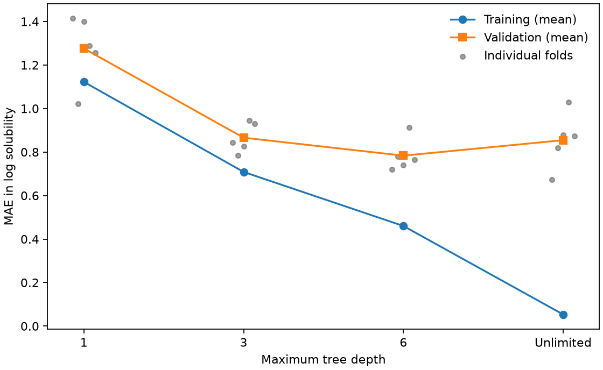

# 交叉驗證與過擬合 {#sec-cross-validation}

## 決策樹愈長愈深，訓練誤差一直下降，該在哪一層停下來？ {#開場問題}

停在「沒看過的骨架」上誤差最小的那一層。決策樹每多一層，就能把訓練分子分得更細；分得太細時，連少數樣本特有的雜訊也學了進去，訓練誤差繼續下降，新骨架的預測卻反而變差，這種現象稱為**過擬合**（overfitting）。舉例來說，如果想預測新骨架的溶解度，可以先留出一批骨架做最後測試，再用其餘資料比較不同樹深，看哪一層在未參與訓練的骨架上預測值離實測值最近。

## 核心概念

做五折**交叉驗證**（cross-validation）時，先把開發資料分成五組，每次拿四組訓練、留一組驗證，五組輪流當驗證組。這樣每個分子會參與四次訓練，但輪到驗證它的溶解度時，用的是一棵沒看過它的樹。每種樹深因此都會有五個驗證分數。比較不同樹深時要沿用同一套五組分子，否則驗證分子本身的難易差異，可能會被誤當成模型的進步。

哪些分子該分在同一組，要看下一輪打算預測哪一類分子。假如訓練集中有一個苯環衍生物，驗證集裡的分子只比它多一個甲基，這時的驗證分數反映的是「預測熟悉系列取代物」的能力。如果下一輪打算探索新骨架，就要換一種分組方式。本例用 Murcko 骨架分組，骨架字串相同的分子歸在一起。讀分數時要記得，所有無環分子的骨架都是空字串，所以即使化學性質差很多，它們也只算同一組。

樹深是一種**超參數**（hyperparameter），也就是訓練前由我們設定、而不是模型自己學出來的參數。它限制每一條分支最多能依序問幾個問題。深度一的樹只能針對一個描述符設一道門檻，兩邊各給一個溶解度預測；深一點的樹，可以在其中一邊再問分子量或極性表面積是否落在某個範圍。

分支切得越細，每個葉節點裡用來估計溶解度的分子通常就越少。這時候學到的差異，可能反映真正的化學關係，也可能只是這一小批樣本剛好長這樣。模型在訓練資料上兩種都記得住，所以光看訓練分數分不出來，要看驗證分數才知道。

## 動手做

我們從 MoleculeNet 讀入 ESOL 的 1,128 筆實測水溶解度 [@delaney2004esol]。預測目標是以 mol/L 表示的溶解度取常用對數。輸入是 RDKit 從結構算出的四個描述符：分子量、估計的 logP、拓撲極性表面積和可旋轉鍵數，計算時都用不到溶解度。

資料的安排分成兩層。先依骨架留出 113 筆做最終測試，再把 DeepChem 分出的訓練集和驗證集合併，得到 1,015 筆開發資料。選樹深時，只在這 1,015 筆裡輪流訓練與驗證；樹深定案後，才用全部 1,015 筆訓練最後的模型。

[下載本節 notebook](../../notebooks/ch10/10-03-cross-validation.ipynb){.btn .btn-sm .btn-outline-primary}　[在 Colab 開啟](ch10/10-03-cross-validation.ipynb)

程式先建好五組索引，再用深度 1、3、6 和不限深度的樹逐一計算。

```python
for fit, hold in folds:
    assert set(groups[fit]).isdisjoint(groups[hold])
    tree = DecisionTreeRegressor(max_depth=depth, random_state=42)
    tree.fit(X_dev[fit], y_dev[fit])
    fold_scores.append((mean_absolute_error(y_dev[fit], tree.predict(X_dev[fit])),
                        mean_absolute_error(y_dev[hold], tree.predict(X_dev[hold]))))
```

這個迴圈每一圈處理一折：`assert` 那一行先確認訓練組和驗證組沒有共用任何骨架，只要有一個骨架同時出現在兩邊，程式就會停下來，提醒我們回頭檢查分組。接著訓練一棵樹，最後把這一折的訓練 MAE 和驗證 MAE 一起存起來。開發集和最終測試集之間也做了同樣的檢查。實務上如果在試算表裡重新排序，結構、描述符、實測值和骨架欄必須整列一起移動；只排其中一欄的話，就算筆數都對，分數也已經沒有意義。

{fig-alt="訓練 MAE 隨樹加深而下降，五折驗證 MAE 在深度 6 最低，不限樹深後又升高。各折驗證點分布在平均線兩側。"}

樹深從 1 增加到 3 時，五折平均的訓練 MAE 從 1.1223 降到 0.7084，平均驗證 MAE 也從 1.2761 降到 0.8659。也就是說，樹雖然變複雜了，對沒看過的骨架反而預測得更準。從深度 6 改成不限深度，情況就不同了：平均訓練誤差從 0.4601 降到 0.0535，平均驗證誤差卻從 0.7833 升到 0.8545。如果只看訓練成績，就看不出這一步已經過擬合。

圖中每個灰點代表一折。以深度 6 為例，五折的驗證 MAE 大約落在 0.72 到 0.91 之間，換句話說，留下來驗證的骨架不同，估出的平均誤差也會不同。這個範圍描述的是「不同驗證組之間的差異」，不能當作下一個分子的誤差上下限。另外，五棵樹的訓練資料大半重疊，各折分數也不像五次獨立實驗那樣彼此無關。

如果某一折表現特別差，值得回頭看看那一折的骨架大小、極性範圍或溶解度分布。假如這些分子剛好代表下一輪想合成的化合物，這一折就應該單獨報告，因為用整體平均蓋過它，選分子的人就看不到他最關心的情況。

本例事先決定用各折 MAE 的簡單平均來選樹深，所以選中深度 6。把這個設定固定下來，用全部開發資料重新訓練一次，再預測一開始留出的 113 筆測試資料，得到 MAE 0.7417。它比內部五折的平均稍低，這並不矛盾：最後這棵樹看過的訓練資料比較多，測試分子的組成也和五折都不一樣，只是光憑這兩個數字，分不出哪個因素影響較大。要特別注意的是，如果看了測試結果之後又回頭改成深度 5，或另外挑描述符，這 113 筆就已經參與了選擇；下次要報告新模型的表現時，就需要另外留一批沒參與過決策的資料。

小型研發專案往往只有幾十筆實驗。如果分子只來自兩個化合物系列，分成五折也不會憑空多出三個獨立系列。團隊想預測系列內下一個取代物，和想跨到第三個系列，需要留出的分子也不一樣，所以驗證方式要配合實際能留出的組數。報告時列出各折的分子數和骨架組成，實驗者才看得出這些驗證分子和手上的候選物有多接近；只給一個算到小數點後四位的平均值，讀者很難判斷。

## 重點整理

- 測試集留到最後才用，選樹深時只在開發集內輪流訓練與驗證，而且各種樹深要用同一套折次。
- 訓練誤差繼續下降、骨架驗證誤差卻回升時，再加深就只是在記訓練資料。
- 各折分數的差距反映的是驗證組的組成不同，和單一分子的預測區間是兩回事。

## 小練習

深度 6 的五個驗證折大小不同，請改用「每個開發分子權重相同」的方式合併五折 MAE，並比較它和每折等權平均差多少。

提示：從每組驗證索引 `hold` 讀出筆數，配上同一折的驗證 MAE；先想一想，一折的平均誤差要乘上什麼，才能還原這一折的誤差總和。

## 延伸閱讀

想確認分組交叉驗證怎麼決定每組資料進出驗證折，可以閱讀 scikit-learn 的說明；想了解樹深和葉節點的關係，可以對照決策樹文件中的停止條件。[GroupKFold 文件](https://scikit-learn.org/stable/modules/generated/sklearn.model_selection.GroupKFold.html) · [DecisionTreeRegressor 文件](https://scikit-learn.org/stable/modules/generated/sklearn.tree.DecisionTreeRegressor.html)

本例依骨架字串定義群組，並以官方 loader 取得原始量測。[RDKit Murcko scaffold 文件](https://www.rdkit.org/docs/source/rdkit.Chem.Scaffolds.MurckoScaffold.html) · [DeepChem MoleculeNet 文件](https://deepchem.readthedocs.io/en/latest/api_reference/moleculenet.html)
