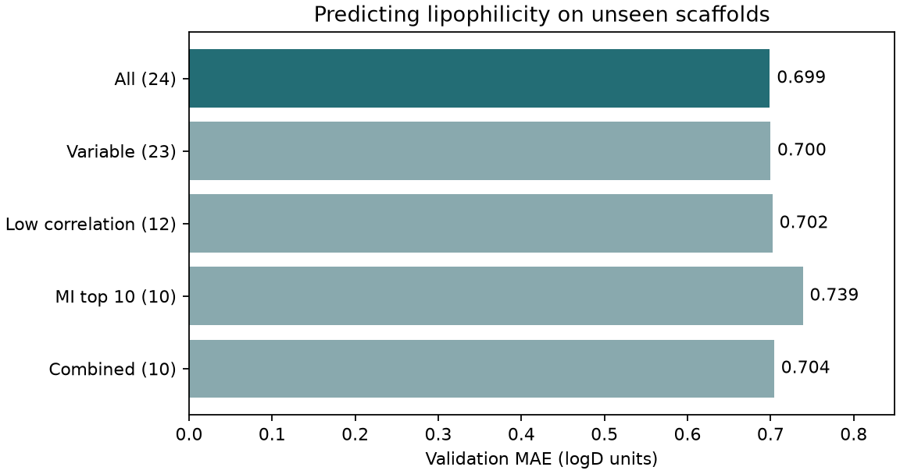

# 特徵選擇 {#sec-feature-selection}

## 分子量和重原子分子量幾乎一起變動，預測親脂性時，兩欄都值得留嗎？ {#開場問題}

通常留一欄就夠，但要省掉哪一欄，得看刪掉之後預測誤差有沒有變差。如果只是把一批分子按大小排序，用分子量或重原子分子量，排出來的順序幾乎一樣；可是放進模型預測親脂性時，一欄有沒有用，還要看其他欄位已經提供了哪些資訊。**特徵選擇**（feature selection）就是從候選描述符中挑出一部分來建模。做法是先在訓練集訂好取捨規則，再用同一批驗證分子比較刪除前後的誤差。

## 核心概念

**過濾法**（filter method）根據每一欄自己的統計量，或欄與欄之間的關係來篩選特徵。最簡單的一步是檢查哪些欄位根本沒有變化：如果訓練分子的自由基電子數全是零，模型就無從學到「自由基電子數增加」會帶來什麼差別，這欄可以直接拿掉。

下一步是找出彼此重複的欄位。分子量包含氫的質量，重原子分子量則不算氫，兩個數字不一樣，卻幾乎同步升降。我們可以用訓練集的**皮爾森相關係數**（Pearson correlation coefficient，$r$）來衡量兩欄有多接近直線關係，數值介於 −1 到 1，絕對值越接近 1 越像。這裡取絕對值，是因為「一欄越大、另一欄越小」同樣表示兩欄在描述同一件事。刪掉高度相關的欄位可以讓模型更精簡，不過高相關本身並不代表模型一定會過擬合。

上面兩種篩法都用不到實測值。**互資訊**（mutual information，MI）則衡量一個描述符和預測目標之間有多少關聯。舉例來說，按計算出的親脂程度把分子分成幾組，如果各組的實測親脂性分布明顯不同，就表示這欄帶有和目標有關的資訊，即使兩者不是直線關係也一樣。MI 是逐欄評分的，所以可能把好幾個反映分子大小的描述符都排在前面，也可能漏掉要搭配另一欄才有用的特徵。

除了過濾法，還有**包裝法**（wrapper method），直接用模型的驗證表現比較不同的特徵組合；以及**嵌入法**（embedded method），在擬合模型的過程中順便選欄。要記得，MI 排名靠前只說明這一欄和觀測值有關；想知道移除它會損失多少預測精度，還是要實際比較模型。

選欄這一步也要小心資料洩漏。如果把訓練、驗證、測試三組合在一起才估計 MI，測試標籤就已經參與了選欄，之後就算把測試分子移出訓練集，這個影響也消不掉。用全部分子算相關矩陣雖然用不到標籤，等於還是根據「將來才會看到的結構」決定保留哪些描述符。所以正確的順序是先依骨架切分，只用訓練集篩選特徵，再從驗證集和測試集取出相同的欄位。做交叉驗證時，各折的訓練分子不同，也要各自重新選欄。

## 動手做

[下載本節 notebook](../../notebooks/ch10/10-04-feature-selection.ipynb){.btn .btn-sm .btn-outline-primary}　[在 Colab 開啟](ch10/10-04-feature-selection.ipynb)

MoleculeNet 的 Lipophilicity 收錄了 4,200 個化合物在 pH 7.4 下的辛醇／水分布係數對數（logD）。分布係數比較的是化合物在兩相中的總濃度，所以可解離的分子，分布情形會隨量測時的 pH 改變。模型的輸入欄位 MolLogP 是從結構算出來的，預測目標 logD 則來自實驗。我們關閉標籤標準化，讓 MAE 也以 logD 單位表示。訓練、驗證與測試集各有 3,360、420 與 420 個分子。[@wu2018moleculenet]

我們事先列出 24 個常用的 RDKit 描述符，這樣即使套件改版，也查得到當時輸入了哪些性質。這批描述符包括分子質量、計算的親脂性、**拓撲極性表面積**（TPSA）、鍵結拓撲指標和環數等。程式逐個分子計算，並確認每個描述符都是有效的數值。如果某個結構無法解析，程式會停下來列出這個分子，以免只刪了特徵那一列，標籤卻還照原順序讀，造成錯位。如果研究資料裡真的有缺值，要先約定什麼時候排除分子、什麼時候補值，並保持每一列和標籤的對應。

```python
variable = X_train.columns[VarianceThreshold().fit(X_train).get_support()].tolist()
corr = X_train[variable].corr().abs()
decorrelated = []
for name in variable:
    if all(corr.loc[name, other] <= 0.90 for other in decorrelated):
        decorrelated.append(name)
```

這段程式分兩步。第一行用 `VarianceThreshold()` 去掉變異數為零、也就是在訓練集裡完全沒有變化的欄位。這裡刻意不先把所有欄位標準化再用 0.1 當門檻，因為標準化後，凡是有變化的欄位變異數都接近一，門檻就失去意義；用零當門檻只會刪掉常數欄，也不必煩惱質量和計數的單位不同。

接下來的迴圈按預定順序逐欄檢查：只要某一欄和任何一個「已經保留」的欄位相關係數絕對值 $|r|$ 超過 0.90，就跳過它。之所以只和已保留的欄位比，是為了避免某一欄只因為像一個已經被刪掉的欄位，就跟著被刪。

從結果來看，訓練集裡的自由基電子數都是常數，刪掉之後剩 23 欄。分子量和重原子分子量的 $r$ 高達 0.9987，因為分子量排在前面，程式保留了它；如果實驗室習慣用重原子分子量，也可以把它排到前面，只要在評估之前訂好並記下順序。刪掉高度相關的欄位後剩 12 欄。接著分別從 23 欄和 12 欄出發，用訓練分子的 logD 計算 MI，其中環數、氫鍵供體數這類整數計數設為離散欄位。兩種排名各取前十名，就能看出先去除相關欄位會怎麼影響最後的組合。

{#fig-feature-selection fig-alt="五條橫條比較同一批驗證分子的 logD 平均絕對誤差，括號標出各法使用的欄數。全部 24 欄的誤差最小，單靠互資訊取十欄的誤差最大。"}

@fig-feature-selection 的每一列都使用相同的**隨機森林**（random forest）設定和同一批驗證分子。全部 24 欄的 MAE 為 0.6990，去掉常數後為 0.6996，去常數再去相關後為 0.7022。直接用 MI 取十欄是 0.7387，依序去常數、去相關、再按 MI 取十欄則是 0.7041。

這些數字怎麼讀？前兩個的微小差距，是因為刪掉一欄後，演算法分裂時檢查欄位的順序變了，即使固定亂數種子，長出來的樹也未必完全相同，並不表示常數欄藏有預測訊息。最後兩種方法用的欄數一樣，差別在於挑中了哪些性質：串接法保留了 MolLogP、環數和 TPSA 等描述符，而單看 MI 排名，看不出選中的欄位之間有多少資訊彼此重複。

我們事先訂好的規則是選驗證 MAE 最小的模型，這次選中全部 24 欄，在保留的測試集上得到 MAE 0.6752。如果每個分子最多只能算十個描述符，就該比較兩種十欄模型的驗證誤差，再考量串接法省下的那一點誤差，和實驗本身能分辨的 logD 差異、計算成本相比，是否值得。數字報到小數點後第四位，是為了方便重跑時對照；只切分一次的差距，還不足以說明哪一種方法在其他資料上也會比較好。

## 重點整理

- 常數欄、彼此重複的欄、和標籤關聯弱的欄各有不同的刪除理由，留下欄位清單才能回頭看保留了哪些化學資訊。
- 互資訊排名只用訓練標籤計算；驗證集用來比較方法，測試集留給已經選定的模型。
- 比較欄位數時，要一起報告同一批驗證分子上的誤差，因為同樣十欄的模型表現可能不同。

## 小練習

把串接法保留的描述符從十個減為五個，看驗證集的 MAE 改變多少。

提示：沿用 notebook 的訓練集排名 `ranking` 和 `forest()`，取前五欄重新擬合，再用五欄模型的驗證 MAE 減去 `scores["Combined"]`。

## 延伸閱讀

scikit-learn 的說明分別示範不看標籤的變異數過濾和單變量選擇，並列出迴歸目標可用的評分函式。[特徵選擇文件](https://scikit-learn.org/stable/modules/feature_selection.html)

官方的資料洩漏範例示範，若在切分前先選特徵，即使隨機標籤也可能得到看似良好的分數。[scikit-learn 常見陷阱](https://scikit-learn.org/stable/common_pitfalls.html#data-leakage)
