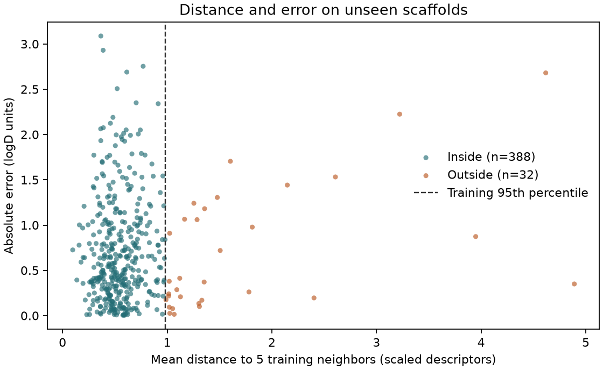

# 模型適用範圍（Applicability Domain） {#sec-applicability-domain}

## 模型替新分子估出 logD，怎麼知道訓練資料裡有沒有性質相近的分子可供參照？ {#開場問題}

量一量新分子和訓練分子有多遠，再和訓練分子彼此之間的距離比較。做法是先用同一組描述符表示所有分子，算出訓練分子到近鄰的距離通常是多少；如果新分子到最近幾個訓練分子的距離超出這個範圍，就把它標記出來。這套判斷依據稱為**模型適用範圍**（applicability domain，AD），指的是在某個用途下，哪些輸入有足夠的資料支持預測。舉例來說，一個只用芳香族小分子訓練的模型，遇到一個長鏈的胜肽，距離就會很遠。至於距離遠的預測是不是比較容易失準，要另外用一批沒參與建模、已有實測值的分子來檢驗。

## 核心概念

MoleculeNet 的 Lipophilicity 收錄的是 pH 7.4 下的辛醇／水分布係數對數（logD）。同一個分子換了 pH，結構距離仍然是零，但可解離基團的帶電比例可能改變，量到的 logD 也就可能不同。所以讀預測值時，要先確認量的是什麼性質、條件是否相同。OECD 的**定量結構活性關係**（QSAR）驗證原則要求模型界定適用範圍，可以從化學結構、物化性質或作用機制著手，並沒有規定所有模型都用同一個距離門檻。[@wu2018moleculenet]

哪些分子算近鄰，取決於用了什麼描述符。只看分子量和極性表面積的話，兩個數值相近的分子，即使原子連接方式不同，也可能被當成近鄰；改用結構指紋比較局部的原子環境，找出的近鄰就可能不一樣。各欄的尺度也有影響：分子量的數值通常比氫鍵供體數大得多，直接把各欄的差值平方相加，距離幾乎只反映分子量。所以本例先用訓練集的平均值和標準差把每一欄標準化，讓「相差一個標準差」在每一欄都有相同的份量；不過，各欄對 logD 的實際影響仍可能不同。

除了近鄰距離，常見的方法還有槓桿值和主成分分析。線性模型的**槓桿值**（leverage）反映一個分子在描述符空間中離訓練資料的中心有多遠，可以用含截距欄的訓練設計矩陣算出新分子的槓桿值；如果欄位之間共線，就要考慮矩陣的秩。Williams 圖把槓桿值和標準化殘差畫在一起，但殘差要有實測值才算得出來，所以還沒量過的候選物只能先看槓桿值。

**主成分分析**（principal component analysis，PCA）則是把多個描述符濃縮成少數幾個綜合方向，把訓練資料畫在二維平面上，再看新分子落在哪裡。要注意前兩個主成分之外還有資訊，所以一個點落在橢圓裡，只說明它在這兩個方向上不突出。這幾種方法都來自同一批描述符，就算讓它們多數決，也要另外驗證投票是否真的讓判斷更好。

## 動手做

[下載本節 notebook](../../notebooks/ch10/10-05-applicability-domain.ipynb){.btn .btn-sm .btn-outline-primary}　[在 Colab 開啟](ch10/10-05-applicability-domain.ipynb)

我們用 MoleculeNet 的骨架切分（scaffold split），得到 3,360 個訓練分子、420 個驗證分子和 420 個測試分子。預測用的是六個 RDKit 描述符：分子量、計算的 MolLogP、拓撲極性表面積、氫鍵供體數、受體數和可旋轉鍵數，由隨機森林（random forest）用這六欄預測 logD。找近鄰時也用同一組描述符，先標準化再計算距離。因為模型和距離共用同一套表示法，將來如果更換描述符或重新擬合標準化，這裡的門檻也要跟著重算。驗證集留給小練習用；本例的規則在看測試標籤之前就已經固定。

門檻是這樣定的：對每一個訓練分子，找出訓練集裡另外五個離它最近的分子，取這五個歐氏距離的平均。這裡有個細節要留意。如果把訓練矩陣當成新資料傳進去，找到的第一個鄰居很可能就是分子自己，把這個零距離算進去，會低估訓練分子彼此之間的距離。scikit-learn 的 `kneighbors()` 在不傳入查詢矩陣時，會自動排除樣本本身。

```python
nn = NearestNeighbors(n_neighbors=5).fit(X_train)
train_dist = nn.kneighbors()[0].mean(axis=1)
threshold = np.quantile(train_dist, 0.95)
dist, neighbors = nn.kneighbors(X_test)
test_dist = dist.mean(axis=1)
inside = test_dist <= threshold
```

這幾行依序做了四件事：用訓練分子建立近鄰搜尋、算出每個訓練分子到五個鄰居的平均距離、取第九十五百分位數當門檻，最後替每個測試分子算出到五個訓練鄰居的平均距離，小於或等於門檻的就記為「範圍內」（`inside`）。在這種寫法下，如果另外兩個不同的樣本描述符完全相同，它們之間的距離仍然可能是零；遇到這種情形，要回頭看分子結構，才分得出是重複收錄，還是描述符區分不了這兩個分子。

把訓練分子的平均近鄰距離從小排到大，第九十五百分位數是 0.9819。替測試分子找近鄰時，只在訓練資料裡找。如果把測試分子也放進資料庫，同一批送測的新系列彼此很接近，就會掩蓋「整個系列其實離訓練資料很遠」這件事。這個門檻描述的是訓練資料分布得多密集，和新分子預測正確的機率無關；如果未來的候選物集中在不同的骨架，落在範圍內的比例也可能差很多。

{#fig-domain-distance fig-alt="散佈圖的橫軸是測試分子到最近五個訓練分子的平均距離，縱軸是預測的絕對誤差。垂直虛線分隔範圍內的 388 點與範圍外的 32 點。"}

@fig-domain-distance 的縱軸是預測值和實測值之差的絕對值。門檻內有 388 個測試分子，也就是**涵蓋率**（coverage）為 92.4%，意思是有這麼多比例的分子被判定在範圍內；這些分子的 MAE 為 0.7079 個 logD 單位。門檻外有 32 個，MAE 為 0.7070。從結果來看，門檻確實標出了缺乏相似訓練樣本的分子，但門檻外只有 32 筆，而且兩組的平均誤差幾乎一樣。所以報告時要把範圍內外的筆數和誤差都列出來；只報範圍內的誤差，讀者就看不出排除了多少分子，也不知道被排除的預測是否真的比較不準。

圖中最右邊的分子是測試集第 219 列（從零開始算），到五個近鄰的平均距離為 4.8904，遠高於門檻。模型預測 logD 為 2.150，實測為 1.800，相差約 0.350。在量測之前，我們就已經知道它離訓練資料很遠，最近的訓練分子在第 3144 列。用 notebook 的 `test.ids` 和 `train.ids` 取出兩者的結構，就能比較哪些描述符相近、哪些官能基不同。至於 0.350 這個誤差，是量測之後才知道的，沒辦法拿來估計下一個遠距分子會差多少。

那麼這個標記該怎麼用？假設要替一批還沒合成的候選物安排量測順序，如果只保留範圍內的分子，訓練資料中罕見的分子就更難進入後續實驗。如果目標本來就是找新骨架，距離特別遠反而可以成為優先補資料的理由。報告時可以把預測值、這個分子的近鄰距離、門檻和訓練集中最近的結構並排列出，讓做實驗的人自己判斷。如果想回答「這個分子的預測可能差多少」，就要用保留資料估算誤差，或像下一節那樣建立預測區間。

## 重點整理

- 量測的 pH、輸入的描述符和距離的定義都會影響適用範圍，新分子和訓練分子必須用同一套規則表示。
- 用訓練分子定門檻時要排除分子自己；預測新分子時，鄰居一律只從訓練集找。
- 報告適用範圍時，把涵蓋率、範圍內外的筆數和兩組誤差一起列出，因為遠離訓練資料的點也可能預測得準。

## 小練習

把門檻從訓練距離的第九十五百分位數降到第九十百分位數，看驗證集的涵蓋率和範圍內 MAE 怎麼變。

提示：用 `scaler.transform` 轉換驗證分子的六個描述符，再用現成的 `nn` 和模型計算距離與誤差；把 `np.quantile` 的 `0.95` 改成 `0.90` 得到第二個門檻，兩個門檻套用在同一批分子上。

## 延伸閱讀

查詢訓練近鄰時，是否傳入查詢矩陣會影響樣本本身能不能入選。[scikit-learn 的 NearestNeighbors 文件](https://scikit-learn.org/stable/modules/generated/sklearn.neighbors.NearestNeighbors.html#sklearn.neighbors.NearestNeighbors.kneighbors)

OECD 的第三項原則說明為什麼應界定模型可以合理預測的化學結構與性質範圍。[OECD 的 QSAR 驗證原則](https://www.oecd.org/content/dam/oecd/en/topics/policy-sub-issues/assessment-of-chemicals/oecd-principles-for-the-validation-for-regulatory-purposes-of-quantitative-structure-activity-relationship-models.pdf)
