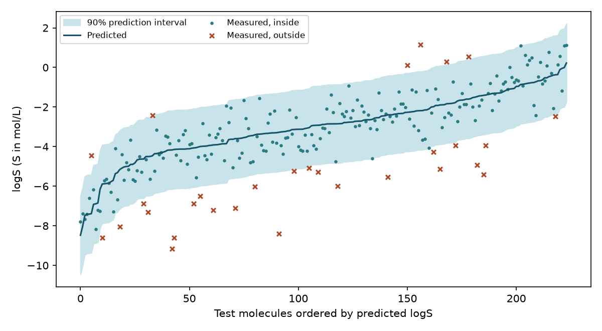

# 預測區間：Conformal Prediction {#sec-conformal-prediction}

## 模型預測一個分子的 logS 是 −3.5，能據此判斷它的水溶解度夠高嗎？ {#開場問題}

光看 −3.5 還不夠，要同時知道實驗需要多高的溶解度，以及這個預測可能偏多少。假設每公升水溶液至少要溶解 $10^{-4}$ 莫耳，門檻就是 logS = −4。同樣預測 −3.5，如果可能的範圍是 −3.7 到 −3.3，整段都高於門檻，可以放心排進下一輪；如果範圍是 −6 到 −1，就連能不能達標都說不準。**共形預測**（conformal prediction）就是用已有實測值的分子估計模型的誤差，替新分子算出這樣一個範圍，單位和預測值相同。

## 核心概念

**分割共形預測**（split conformal prediction）先用一批分子訓練模型，再用另一批已有實測值的分子決定區間要多寬，這第二批分子稱為**校正集**（calibration set）。對每個校正分子，計算實測值和預測值之差的絕對值 $s_i=|y_i-\hat y_i|$，稱為絕對殘差；高估或低估兩個對數單位，都記作 2。有了這些殘差，就能估計模型在預測類似來源的新分子時，上下各要留多寬，才能涵蓋預定比例的實測值。

為什麼不能直接用訓練分子的殘差？因為模型已經記住了訓練分子的答案，殘差會偏小，區間就會太窄。所以選模型、調超參數、挑描述符都要在訓練階段完成，模型定案之後才動用校正集。

具體的算法是這樣：假設校正集有 $n$ 個分子，我們願意錯過的比例是 $\alpha$（例如要涵蓋九成，$\alpha$ 就是 0.1）。把殘差由小排到大，取第 $k=\lceil(n+1)(1-\alpha)\rceil$ 個當作半徑 $q$，新分子的區間就是 $[\hat y-q,\hat y+q]$，也就是預測值上下各加減 $q$。

為什麼用 $n+1$？可以想像下一個分子的答案剛剛揭曉，把它的殘差和 $n$ 個校正殘差放在一起排序。如果校正分子和新分子是**可交換的**（exchangeable），大致上就是說它們像是從同一批資料隨機抽出來的，那麼新分子的殘差落在 $n+1$ 個名次中任何一個的機會都相同，取一個夠高的名次，就能控制錯過它的機會。有同分時，剛好落在區間邊界上的實測值也算在區間內。這個推理不需要假設殘差呈常態分布。如果校正分子太少，算出來的名次會超過 $n$，這時為了守住保證，只能給出無限寬的區間。[@lei2018conformal]

這裡保證的是**邊際涵蓋率**（marginal coverage）。涵蓋率就是實測值落在區間內的比例；「邊際」的意思是平均而言：把校正集和下一個分子的抽樣都考慮進去，新實測值落入區間的機率至少是 $1-\alpha$。換句話說，九成是對一大批分子的平均承諾，不是對某一瓶化合物的承諾。

舉例來說，如果資料裡大多是溶解度中等的分子，極難溶的只占少數，那麼即使整體涵蓋率接近九成，漏掉的分子也可能集中在極難溶的那一群。如果實驗室打算合成一系列新的含氟骨架，就要先確認校正資料能不能代表這個系列。像骨架切分那樣刻意留出的新系列，不一定符合隨機抽樣下的覆蓋保證。

## 動手做

[下載本節 notebook](../../notebooks/ch10/10-06-conformal-prediction.ipynb){.btn .btn-sm .btn-outline-primary}　[在 Colab 開啟](ch10/10-06-conformal-prediction.ipynb)

我們沿用 Delaney 的水溶解度資料 ESOL。目標是把實測水溶解度 $S$ 換成 mol/L 之後取常用對數，logS 差 1 就是差十倍。從 DeepChem 讀入時要關掉標籤標準化，這樣模型輸出、校正殘差和圖上的實測值才都保有「對數單位」的意義。如果模型在標準化後的尺度上預測，卻拿原始 logS 去減它的輸出，算出的半徑就沒辦法用來判斷溶解度。[@delaney2004esol]

資料共有 1,128 筆紀錄。我們先用 RDKit 把 SMILES 轉成保留立體化學的正規 SMILES；同一個結構出現多次時，取實測值的中位數，每個結構只留一筆。得到的 1,117 個分子，用固定種子隨機分成 670 個訓練、223 個校正和 224 個測試分子。這樣可以避免同一個結構同時出現在兩組，但相似的骨架仍可能分在不同組。也就是說，本例觀察的是「從這批已知資料裡隨機留出分子」時區間的表現；如果要預測的是全新骨架，或明年才展開的專案，測試資料的安排也要跟著改。

模型用半徑二、長度 1,024 位元的 Morgan 指紋，搭配 200 棵樹的隨機森林預測溶解度。設定確定之後，才拿校正集做預測、算出絕對殘差，再用下面的函式決定半徑。

```python
def radius(scores, alpha):
    k = ceil((len(scores) + 1) * (1 - alpha))
    return np.sort(scores)[k - 1] if k <= len(scores) else np.inf

q = radius(scores, 0.10)
pred = model.predict(X[test])
covered = np.abs(y[test] - pred) <= q
```

`radius` 函式把殘差排序後取第 $k$ 小的那一筆；如果 $k$ 超過殘差的筆數，就傳回無限大。以這次為例，要涵蓋九成，223 筆殘差要取第 202 小的那筆，因為程式的索引從零開始，所以寫成 `k - 1`。這裡取的是指定名次上實際存在的殘差，和一般計算百分位數時，可能在相鄰兩筆之間做線性內插的做法不同。最後一行則檢查每個測試分子的實測值是否落在區間內。

{#fig-conformal-esol fig-alt="測試分子依預測 logS 從低排到高，色帶在預測線上下各延伸 1.982 個對數單位。圓點為落在色帶內的實測值，叉號為超出上下界的實測值。"}

這次的半徑是 1.982，區間全寬是 3.965 個對數單位。@fig-conformal-esol 的橫軸是預測值的排名，不是按實測值排序。在同一個橫軸位置往上看，就能直接比較那個分子的實測值和預測線。叉號在色帶上方，表示模型把分子估得太難溶；在色帶下方，表示估得太易溶。兩種錯誤都會降低涵蓋率，但對實驗的影響剛好相反：合成名額有限時，估得太易溶會把難溶的化合物送進候選清單，估得太難溶則可能讓原本合適的分子落選。

224 個測試分子中，有 194 個實測值落在區間內，涵蓋率是 86.6%。換一份校正集，第 202 小的殘差可能不同；換一批測試分子，落在區間內的比例也可能改變。要提醒的是，如果看了區間外的 30 筆之後才決定加寬區間，這批測試分子就參與了調整，得另外找一批分子來評估調整後的涵蓋率。

除了涵蓋率，區間有多寬也同樣重要。半徑接近兩個對數單位，換回原始濃度，上下界分別接近點預測的一百倍和百分之一。即使涵蓋率達標，這麼寬的區間也可能跨過許多實驗門檻。

## 實驗上的考量

假設實驗要配 100 µmol/L 的水溶液，換成 log S，門檻就是 −4。模型預測 −3.5，看起來配得出來，但區間下限是 −5.48、上限是 −1.52，配得出來和配不出來都有可能。這個範圍是從校正集的預測誤差估出來的，拿來安排實驗之前，要先查原始資料是在什麼介質、幾度下量測的。如果下一道試驗指定了緩衝液、pH 和溫度，而原始條件對不上，最直接的做法是在預定條件下實際量一次溶解度，看濃度能不能達標。

## 重點整理

- 校正集只用來估計已經定案的模型有多少誤差，不能拿來選模型。
- 九成是平均的涵蓋率，報告時要同時列出涵蓋筆數、分母和區間寬度。
- 篩選候選物時，拿區間的上下界和實驗門檻比較；區間跨過門檻時，就需要實驗來回答。

## 小練習

沿用同一組訓練、校正與測試分子，把目標涵蓋率從 90% 改成 80%，算出新的區間全寬和實際涵蓋筆數，並說明變窄的區間為什麼不會多涵蓋原本漏掉的分子。

提示：只要把 `radius(scores, 0.10)` 的 `0.10` 改成 `0.20`，點預測保持不變，再用絕對殘差和新的半徑比較。

## 延伸閱讀

Lei 等人以分割共形預測說明有限樣本的覆蓋條件，可對照原文演算法的排序步驟。[Distribution-Free Predictive Inference for Regression](https://doi.org/10.1080/01621459.2017.1307116)

Delaney 的論文說明溶解度模型的資料與目標性質。[ESOL 原始論文](https://doi.org/10.1021/ci034243x)
