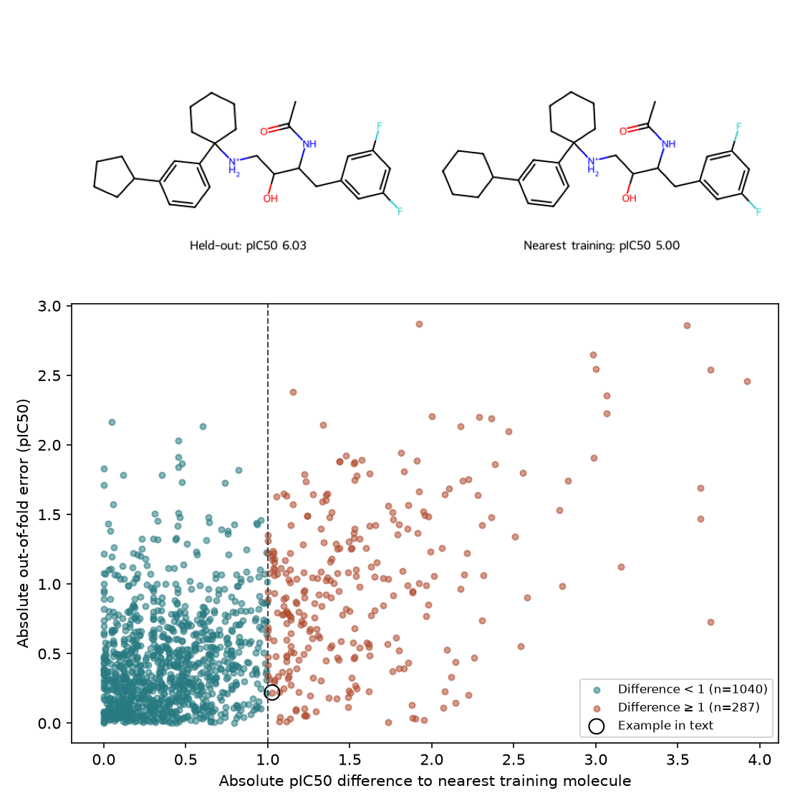

# 活性懸崖為什麼讓模型失準 {#sec-activity-cliffs}

## 訓練資料裡明明有個結構很像的抑制劑，為什麼新分子的活性還會估錯十倍？ {#開場問題}

因為結構很像，不保證活性也很像。兩個分子的指紋可能只差幾個位元，抑制同一種蛋白的能力卻差了十倍以上，這種結構相似、實測活性相差很大的分子對，稱為**活性懸崖**（activity cliff）。我們可以把結構和活性想成一張地形圖：兩個分子在水平方向隔多遠，由所選的結構表示法決定；高低則是某個實驗量到的活性。遇到懸崖時，水平只走了一小步，高度卻差了一大截。[@maggiora2006cliffs]

模型如果把附近幾個化合物的活性當作參照，常會低估這種落差。所以找到一個相似的已知抑制劑之後，還要看兩者差在哪個位置，以及那個位置對抑制作用有多重要。

## 核心概念

要從資料中找出候選懸崖，得先定義「結構多像」和「活性差多少」。結構用半徑二、1,024 位元的 Morgan 指紋表示，相似度用前面介紹過的 Tanimoto 相似度。活性則用分子對人類 β-分泌酶 1（BACE-1）的半抑制濃度 $\mathrm{IC}_{50}$，以 mol/L 代入 $-\log_{10}(\mathrm{IC}_{50})$ 得到 pIC₅₀，數字越大表示所需濃度越低。舉例來說，pIC₅₀ 從 6 增加到 7，所需濃度就從 1 µM 降到 0.1 µM。

本節把相似度至少 0.60、而且 pIC₅₀ 相差至少 1（也就是濃度差十倍）的分子對，列為候選懸崖。這兩個門檻是這次盤點的約定，指紋長度、手性設定或標籤的換算方式一改，清單也可能跟著變。

要檢查模型遇到懸崖時錯多少，得先分清楚「預測的當下已經知道哪些活性」。如果一對抑制劑都在測試集，就算活性差十倍，模型在訓練時也沒見過其中任何一個。本例模擬剛拿到一個新結構的情況：先替每個測試分子找出訓練集中最像它的已知抑制劑，等模型預測完，才用實測值看兩件事：最近鄰的活性和它差多少？模型又估錯了多少？MoleculeACE 也另外報告了懸崖化合物上的預測表現，但它定義分子對和評估的流程與這裡不同，兩邊的分數要分開看。[@vantilborg2022cliffs]

反過來，一個分子預測誤差很大，也不一定是因為它在活性懸崖上。離訓練資料很遠的分子，身邊就算沒有懸崖，也可能預測失準。相反地，一個化合物可能和某個鄰居活性差很多，卻又和另一個帶有相同取代基的已知化合物很接近，模型如果認得這處差異，還是可能估得準。所以紀錄裡要留下配對的兩個結構、各自的測值和資料分組，以及揭曉測值之前的模型預測；只留一欄「此分子是懸崖」，日後很難回頭追查。

## 動手做

[下載本節 notebook](../../notebooks/ch10/10-07-activity-cliffs.ipynb){.btn .btn-sm .btn-outline-primary}　[在 Colab 開啟](ch10/10-07-activity-cliffs.ipynb)

我們從 DeepChem 載入 BACE 迴歸資料，使用實測的 pIC₅₀。這份資料是 Subramanian 等人從不同文獻彙整的人類 BACE-1 抑制劑；同名的分類資料只分有活性和無活性，看不出兩個抑制劑的效力差幾倍，所以這裡用迴歸版。即使有實測數值，也要留意量測條件：標的蛋白雖然相同，各篇文獻的底物、反應條件和濃度單位仍可能不同。因此這裡只把符合門檻的配對稱為「候選」懸崖。[@subramanian2016bace]

資料的整理和切分是這樣做的。先把正規 SMILES 相同的紀錄合併，用該結構 pIC₅₀ 的中位數當作標籤；SMILES 保留原資料已經指定的立體化學。接著按骨架（環系和連接環系的部分）分成五折，同一個骨架只會出現在同一折。每次拿四折訓練隨機森林，剩下的一折就模擬模型還沒見過的骨架。等每個分子都輪流當過一次測試資料，再把這些**折外預測**（out-of-fold prediction）放在同一張圖上。

有些分子骨架名稱不同，局部原子環境卻很相似，例如只替換了環上的一個原子。這種「骨架不同、但仍有近鄰」的情形，正是我們要另外找鄰居的原因。每一折都把測試分子的指紋和該折所有訓練指紋比較，找出相似度最高的那個；同分時依正規 SMILES 排序取第一個，讓結果可以重現。找近鄰只需要結構，五折都完成之後，才用實測活性算下面的差值。

```python
delta = np.abs(y - y[nearest])
error = np.abs(y - pred)
near = similarity >= 0.60
agree = near & (delta < 1.0)
cliff = near & (delta >= 1.0)
```

用白話說，`delta` 是測試分子和它最近鄰的實測活性差多少，`error` 是測試分子的實測值和模型預測差多少。`near` 標出有夠像的近鄰的分子，再依活性差是否達到 1，分成「和鄰居一致」（`agree`）與「候選懸崖」（`cliff`）兩組。如果模型直接拿最近鄰的實測值當預測，`delta` 和 `error` 會一模一樣；本例用 100 棵樹的隨機森林，參考了多個訓練分子，所以兩者可以不同。

{#fig-cliff-bace fig-alt="上方兩個結構在末端分別接五員碳環、六員碳環。下方散佈圖的橫軸是測試分子與最近訓練鄰居的 pIC₅₀ 絕對差，縱軸是模型的絕對誤差。只畫相似度至少 0.60 的測試分子，垂直虛線位於十倍濃度差，黑圈標出文中個案。"}

資料中有 1,513 個不同的結構，分屬 671 個骨架，全部折外預測的 MAE 為 0.595 個 pIC₅₀ 單位。其中 1,327 個分子找到夠像的近鄰，再按和近鄰的活性差分組：1,040 個相差不到十倍，MAE 為 0.441；另外 287 個相差至少十倍，MAE 為 0.988。從結果來看，候選懸崖這一組的平均誤差大了一倍多，但 @fig-cliff-bace 散佈圖虛線右側仍有許多點貼近橫軸，表示其中不少分子還是預測得很準。另有 186 個分子找不到夠像的近鄰，沒有畫在圖上，但有計入整體 MAE。

圖中黑圈標出的，是符合懸崖門檻、而且相似度最高的那一對。看上方兩張結構式的左端，測試分子的苯環接了一個五員碳環，訓練鄰居接的則是六員碳環。在本節的指紋設定下，兩者亮起的位元完全相同，相似度為 1，因為位元只記錄某種局部環境「有沒有出現」，不會逐一記下環裡有幾個相似的碳。

測試分子的實測 pIC₅₀ 是 6.027，鄰居是 5.000。如果直接照抄鄰居的測值，會低估 1.027 個對數單位。隨機森林預測 5.806，離實測值只差 0.221，在這個分子上比照抄鄰居更接近答案。不過兩個分子的輸入完全相同，模型其實沒有辦法分辨兩個環的差別。

這張圖的橫軸和縱軸都用到了測試分子的實測活性，所以它適合用來分析已經量過的分子；對下一批還沒量的分子，我們無法事先知道它會落在虛線哪一側，也不能據此認定某個取代基造成了全部的活性差異。新結構剛畫好時，比較實際的做法是找出幾個相近的訓練分子，看看它們的活性是否一致、量測條件是否相近，再查候選物上改動的位置有沒有先例。如果要依模型預測決定是否合成，這些參考資料可以一起交給實驗同事。

## 實驗上的考量

圖中一個抑制劑帶五員環，另一個帶六員環。用本節的 Morgan 指紋比較，相似度是 1，實測 pIC₅₀ 卻分別是 6.027 和 5.000，換算下來，後者達到半數抑制所需的濃度約為前者的十一倍。環上多一個碳，效力真的會差這麼多嗎？可以先確認兩個樣品的立體化學，再看兩筆實驗用的酵素、底物濃度和試驗方法是否一致。如果條件不同或紀錄不全，就在同一批試驗裡替兩個化合物各量一條濃度反應曲線，重複量測後再比較。只有當兩條曲線的差距大過各自重複量測的變動，才值得進一步追查環的大小對活性的影響。

## 重點整理

- 懸崖是兩個分子之間的關係，要先寫清楚用了什麼指紋、相似度門檻，以及同一個標的的活性尺度。
- 每個測試分子只在同一折的訓練資料裡找最近鄰，先完成預測，再用測值分組檢查誤差。
- 整體誤差和懸崖組的誤差回答不同問題，報告時要列出各組的分子數。

## 小練習

沿用同一組折外預測，把「結構夠像」的門檻從 0.60 提高到 0.70，活性差仍用十倍，比較兩組剩下的分子數和 MAE，並想一想為什麼門檻改變後分數變好，並不代表模型進步了。

提示：把 `near` 那一行的 `0.60` 改成 `0.70`，再重建 `agree` 和 `cliff` 兩個遮罩，不必重新訓練隨機森林；沒通過新門檻的分子就不再列入比較。

## 延伸閱讀

BACE 原始研究交代實驗測值的來源與模型評估設計，可以對照哪些比較需要相同蛋白與實驗條件。[Subramanian 等人，JCIM](https://doi.org/10.1021/acs.jcim.6b00290)

Maggiora 的短文解釋分子表示與活性地形的關係；MoleculeACE 則展示如何分開評估已知懸崖化合物上的預測表現。[Maggiora，JCIM](https://doi.org/10.1021/ci060117s) · [van Tilborg 等人，JCIM](https://doi.org/10.1021/acs.jcim.2c01073)
