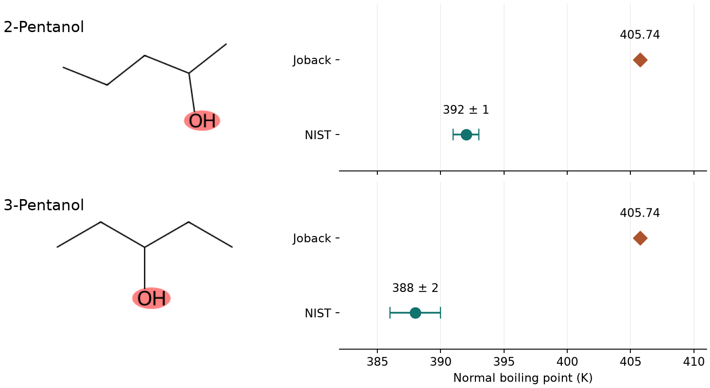

# 為什麼研究者需要可解釋的模型 {#sec-why-interpretability}

## 兩瓶戊醇得到完全相同的預測沸點，實驗時可以把它們當成同一種溶劑嗎？ {#開場問題}

還不行，要先弄清楚模型為什麼給出一樣的數字。2-戊醇和 3-戊醇都有五個碳，只是羥基接的位置不同。把它們代入 Joback 與 Reid 的常壓沸點公式，兩瓶都算出 405.74 K。把計算過程攤開來看，原因就很清楚：公式只數了幾個甲基、幾個亞甲基和幾個羥基，沒有記下羥基離碳鏈末端多遠。[@joback1987groups]

這就是研究者需要模型**可解釋性**（interpretability）的理由。有時候下一步的決定，剛好取決於模型看不到的那個差別；這時知道模型為什麼給出同樣的數字，比多抄兩位小數有用得多。

## 核心概念

從 2-戊醇碳鏈的一端開始數，兩端各有一個甲基（CH₃），中間有兩個亞甲基（CH₂）和一個連著 OH 的 CH。把分子拆成事先定義好的結構單元，再依每種單元出現的次數估算性質，這種做法稱為**基團貢獻法**（group-contribution method），也叫群貢獻法。基團不一定是有名稱的官能基，一個帶著特定數目氫的碳也可以算一組。每一組怎麼辨認、用哪一欄參數，都要依所選的模型和性質而定。

Joback 的常壓沸點公式是 $T_b = 198.2 + \sum_g n_g b_g$。也就是說，先數出分子裡每一種基團有幾個（$n_g$），乘上那種基團的係數（$b_g$），全部加起來，再加上常數 198.2。係數是根據已知化合物的資料估出來的，常數和每一項貢獻的單位都是 K。如果要估的是熔點，常數和係數也要整組換掉。[@joback1987groups]

這個公式可以幫我們分清兩個常被混在一起的問題。第一個是「為什麼模型給 2-戊醇這個數字」，只要逐項對照結構和係數，就能從頭驗算一次。第二個是「羥基移動一個位置，樣品的沸點會變多少」，這要看兩種純物質在同一壓力下的量測，而公式就算每一項都加對了，也可能看不出差別。研究者可以反過來利用這一點：挑一對**模型認為相同、結構上確實不同**的化合物，檢查模型遺漏的資訊會不會影響手上的決定。

如果換成輸入分子指紋的樹模型，預測也許能把兩個分子分開，但我們很難把某一次預測直接讀成一張加總表。這時只能事後估算模型對哪些特徵比較敏感，再把指紋位元對回原子環境。讀這類解釋時要先問清楚：這個特徵是「在整批分子中常被模型用到」，還是「對眼前這個分子的預測影響很大」？一個罕見的片段可能只出現在少數分子中，對那些分子很要緊，放到全體平均裡卻不顯眼。基團貢獻法剛好是一個容易驗算的起點，因為「某一瓶戊醇」和「一整批有機物」這兩個問題，在它身上分得很清楚。

## 動手做

[下載本節 notebook](../../notebooks/ch11/11-01-why-interpretability.ipynb){.btn .btn-sm .btn-outline-primary}　[在 Colab 開啟](ch11/11-01-why-interpretability.ipynb)

我們先在 RDKit 中畫出 2-戊醇（`CC(O)CCC`）和 3-戊醇（`CCC(O)CC`）。讀第一個 SMILES 時，括號裡的氧接在第二個碳上；第二個 SMILES 的氧則接在第三個碳上。程式會辨認非環狀、飽和碳上各有幾個氫，以及連在飽和碳上的醇羥基，再確認每個重原子都剛好歸進一個基團。

這裡只寫了兩種戊醇會用到的四種規則。遇到這四種定義涵蓋不到的原子時，程式會停下來。這是刻意的設計：如果把漏掉的那一組當成零，最後照樣會算出一個溫度，讀者卻不知道那是少算了一塊的結果。

| 公式裡的一項 | 2-戊醇的個數 | 3-戊醇的個數 | 每個基團的沸點係數（K） |
|---|---:|---:|---:|
| 非環狀 CH₃ | 2 | 2 | 23.58 |
| 非環狀 CH₂ | 2 | 2 | 22.88 |
| 非環狀 CH | 1 | 1 | 21.74 |
| 醇 OH | 1 | 1 | 92.88 |

程式中的 `groups[name][1]` 就是表格的最後一欄。以甲基為例，兩個甲基合計 47.16 K；四種基團的貢獻加起來是 207.54 K，再加上兩個分子共用的常數 198.2 K，就得到圖中的橘色菱形。

```python
def boiling_point(counts):
    return 198.2 + sum(n * groups[name][1] for name, n in counts.items())
```

這個函式做的事就是上面的公式：對每一種基團，把「個數 × 係數」加總，再加上 198.2。

OH 的係數雖然是表中最大的，但 92.88 K 並不是「在任何分子上加一個羥基，沸點就升這麼多」。實際上用 OH 取代碳上的一個氫時，那個碳帶的氫數也跟著改變，所以要替整個新結構重新分組計算。

{#fig-pentanol-groups fig-alt="左側以粉紅色圈出兩條五碳鏈上的氧；右側兩個橘色菱形都在 405.74 K，綠色圓點分別在 392 K 和 388 K，帶有 NIST 彙整值的誤差棒。"}

@fig-pentanol-groups 右邊的綠點取自 NIST Chemistry WebBook。2-戊醇的彙整值是 392 ± 1 K，3-戊醇是 388 ± 2 K，圖中的誤差棒照錄兩筆資料所列的 ± 值。從結果來看，模型對兩者都估得偏高，也反映不出兩個彙整值之間約 4 K 的差距。回到左圖，RDKit 明明畫得出兩個不同的結構，差別是在我們把結構壓縮成一排基團個數之後才消失的。所以換一種 SMILES 寫法也補不回這個位置資訊；要讓模型有機會區分這對異構物，輸入就得包含鄰近結構或整條鏈的位置資訊，再用實測資料確認改動是否有效。[NIST 的 2-戊醇資料](https://webbook.nist.gov/cgi/cbook.cgi?ID=C6032297&Mask=4) · [NIST 的 3-戊醇資料](https://webbook.nist.gov/cgi/cbook.cgi?ID=C584021&Mask=4)

這個方法也可以反過來用。假設要訓練一個溶劑性質模型，可以把依結構估算的沸點放進特徵表，當作一個以 K 為單位的**分子描述符**（molecular descriptor）。當下游模型倚重這一欄時，我們能一路追回是哪幾種基團把估值推高；特徵表裡也要註明這一欄是計算值。要記得，兩種戊醇如果只提供這一欄，下游模型收到的輸入仍然一模一樣。

較大的分子往往同時帶好幾個官能基，這時除了檢查有沒有漏算，還要留意這些基團彼此靠得很近時，是否已經超出參數適用的範圍。也有研究另外為環境相關的性質估計基團參數，並分析它們的不確定性。一般來說，每種性質都要用為它估出的係數：適用於純物質沸點的那一欄，不能直接拿去預估毒性；如果樣品是混合液，還要交代組成，以及模型怎麼處理成分之間的作用。[@hukkerikar2012gc]

如果這張表要交給負責選配方的同事，最好把「估算的常壓沸點」和「同壓力下的實測沸點」分成兩欄，各自註明來源。日後補上新的量測時，同事就能回頭比較哪一類結構特別容易估高，也不會把先前算出的 405.74 K 誤當成一筆能驗證模型的實驗資料。

## 實驗上的考量

如果打算根據這幾 K 的差距挑選溶劑，可以先點開 NIST 連結看個別的量測，確認樣品身分和壓力，避免把減壓沸點和常壓沸點混在一起。要複測的話，就用已確認純度的兩種樣品，在相同壓力下用同一套溫度量測設備比較，並記下壓力和溫度的變動範圍。

## 重點整理

- 基團定義、個數和係數都攤得開，我們才能從結構重算一次預測。
- 2-戊醇和 3-戊醇的位置差異還在結構式裡，是到了基團計數這一步才消失的。
- 把估算的物性當成下一個模型的特徵時，記下它的來源、單位，以及哪些結構得到同一個值。

## 小練習

把羥基移到碳鏈末端得到 1-戊醇（`CCCCCO`），用同一組參數算出它和 2-戊醇的預測沸點差多少 K，並指出是哪幾種碳的個數改變了。

提示：用 `group_counts()` 分別列出兩者的基團，以「1-戊醇減去 2-戊醇」為方向，相同的項目可以先消去。

## 延伸閱讀

[Joback 與 Reid 的基團貢獻方程式與參數表](https://doi.org/10.1080/00986448708960487) · [環境性質的基團貢獻模型與不確定性](https://doi.org/10.1021/ci300350r) · [RDKit 子結構比對介面](https://www.rdkit.org/docs/source/rdkit.Chem.rdchem.html)
