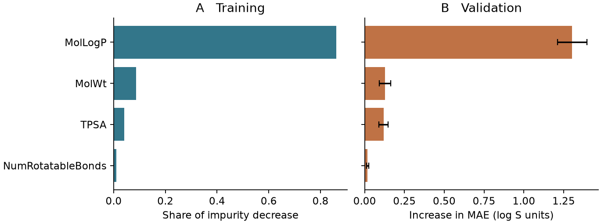

# 特徵重要性（樹模型、permutation importance） {#sec-feature-importance}

## 模型預測水溶解度時，最倚賴哪一欄分子資料？

在這個例子裡，答案是 MolLogP。判斷方法很直接：把某一欄打亂，看模型錯得多厲害。我們先讓模型預測一次 ESOL 驗證集的水溶解度，再把每個分子的 MolLogP 換成表中別列的值。模型拿到的資料一樣多，但分子和 MolLogP 的配對亂掉了，平均絕對誤差就從 0.769 增加到約 2.073 個 log S 單位；換成打亂可旋轉鍵數，誤差只增加 0.019。這種用打亂前後的分數差，來衡量模型有多依賴每一欄的做法，叫作**置換重要性**（permutation importance）。

## 核心概念

樹模型本身也會回報一種**特徵重要性**（feature importance）。回想 @sec-decision-trees，一棵迴歸樹會問「這個分子的 MolLogP 是否小於某個值？」，如果分開之後，兩邊各自的實測 log S 比原來集中得多，這一刀就切得好。我們用每個節點內的平方誤差來衡量性質有多分散，再比較切分前後減少了多少。

靠近根部的一刀可能影響幾百筆資料，末端的一刀可能只影響幾筆，所以要依到達該節點的樣本數加權。把同一棵樹裡用到某一欄的所有降幅加起來，就知道這一欄在建樹時幫了多少忙。scikit-learn 的隨機森林會把所有樹的結果彙整、正規化，存成 `feature_importances_`，在本例中四欄加起來等於 1。[@breiman2001forests]

這個數字該怎麼讀？假如 MolLogP 占了 0.86，意思是森林把約 86% 的重要性分給了這一欄。它描述的是「建樹時這一欄被用得多重」，既不是預測正確的比例，也不會告訴我們 MolLogP 偏高的分子會得到偏高還是偏低的 log S。至於模型遇到訓練時沒見過的骨架還用不用得到這一欄，就要看保留資料上的誤差。

置換重要性則是在樹已經長好之後才算的。驗證集有 113 筆，每次只把其中一欄的 113 個值重新排列，其他描述符和實測溶解度都留在原列。這樣每一欄原有的數值範圍和分布都保留下來，只是打散了欄與欄之間原本的搭配：模型看到某個大分子的分子量時，旁邊的 MolLogP 可能來自一個小分子。所以這個做法能告訴我們模型多依賴原本的配對；至於「把這個分子的某個官能基換掉，溶解度會增加多少」，就要靠實驗或其他方法回答。

## 動手做

[下載本節 notebook](../../notebooks/ch11/11-02-feature-importance.ipynb){.btn .btn-sm .btn-outline-primary}　[在 Colab 開啟](ch11/11-02-feature-importance.ipynb)

我們從 ESOL 的 1,128 筆結構出發，用 RDKit 計算四欄資料：MolLogP 估計分子在辛醇和水之間的分配，MolWt 是分子量，TPSA 是拓撲極性表面積，NumRotatableBonds 是可旋轉鍵數，四欄都能直接從結構算出。要預測的 log S 則來自實驗，也就是以 mol/L 表示的水溶解度取十為底的對數。我們關掉 DeepChem 預設的目標值轉換，讓後面報的誤差都直接以 log S 為單位。[@delaney2004esol]

依分子骨架切分後，902 筆用來訓練隨機森林，113 筆做驗證，其餘 113 筆留作測試。先做個比較：如果每個驗證分子都填入訓練集實測值的中位數，**平均絕對誤差**（mean absolute error，MAE），也就是預測平均偏離實測值多少，是 1.744。森林替每個分子給出不同的預測後，MAE 降到 0.769。確認模型確實比只猜同一個數字準，接下來才值得問它靠哪些欄位做到的。

```python
result = permutation_importance(
    model, X_valid, y_valid, scoring="neg_mean_absolute_error",
    n_repeats=30, random_state=42)
```

這段程式對驗證集的每一欄各打亂 30 次，每次都記下 MAE 的變化，最後彙整成平均值和標準差。

要看「用到某一欄」的具體例子，可以挑森林裡的第一棵樹。它的根節點先問 MolLogP 是否小於或等於 2.770：左側訓練資料的平均 log S 是 −1.750，右側是 −4.923，兩側分別有這棵樹抽到的 589 和 313 筆樣本（重複抽中的分子會重複計數）。右側平均比左側低了約三個對數單位，這一刀確實把溶解度拉開了。我們還可以沿著左右兩條路往下看，下一刀又用了哪一欄。

不過這只是一棵樹的切法，整座森林的占比則把其他 119 棵樹也算了進去。所以 2.770 是這棵樹選的切點，不是分子從可溶變成難溶的通用界線。

置換後的誤差可以這樣想像：在資料表旁邊加兩欄，一欄是「原本的預測」，一欄是「打亂後的預測」。每個驗證分子只有一個實測 log S，兩種預測都和這個實測值相減、取絕對值，再對整張表平均。打亂之後，有些列會變準，有些列會變差，所以即使最後 MAE 增加了，也不表示 113 個分子都朝同一個方向受影響；想知道某一個分子的情形，要回到它自己那一列看。

還有一個正負號的細節。scikit-learn 把評分函數設計成「分數越高越好」，所以這裡傳入的是負的 MAE。假設原本 MAE 是 0.769，打亂一欄後變成 1.000，傳回的重要性就是原分數減新分數，也就是 −0.769 減 −1.000，得到正的 0.231。反過來，如果打亂後碰巧預測得更準，就會得到負值。也就是說，正負號只代表置換後誤差變大或變小，和分子本身溶解度的高低無關。

{#fig-esol-permutation fig-alt="左右並排的橫條圖都以 MolLogP 最長、可旋轉鍵數最短。右圖分子量與極性表面積的平均誤差增幅相近，誤差線範圍重疊。"}

讀 @fig-esol-permutation 時，可以沿著同一列左右對照，但兩張圖的橫條長度不能直接比，因為單位不同。左圖 MolLogP 的 0.860 是占比；右圖的 1.304 則是打亂 30 次後，平均多出來的 log S 誤差。分子量和極性表面積在左圖相差約兩倍（0.087 對 0.041），在右圖卻只差 0.009 個 log S 單位（0.128 對 0.119）。

右圖的誤差線是同一個驗證集上 30 次置換的標準差，它告訴我們光是換一種打亂順序，結果就會變動多少。至於換一批骨架重做，排名會不會一樣，這張圖就沒有估計了。

另外，有些欄位很容易互相取代。舉例來說，如果資料表同時有分子量和重原子數，森林切分時用其中一欄就夠了，另一欄分到的重要性就可能偏低；驗證時單獨打亂一欄，模型也還能從另一欄讀到分子大小的資訊。還有一種情況是某一欄的取值很多，樹在訓練時有很多切點可以試，比較容易挑到看起來很好的分裂。這些都會影響圖上「重要」兩個字的意思。如果想決定能不能省略某個描述符，最可靠的做法是把它拿掉、重新訓練和驗證；本節的森林從頭到尾都保有四欄。

## 重點整理

- 分裂重要性記錄建樹時每一欄減少了多少誤差，置換重要性記錄打亂一欄後模型的分數掉了多少。
- 本例打亂 MolLogP 的代價最大；分子量和極性表面積在兩張圖上的差距不同，兩種數字不能互相換算。
- 單欄置換會打散描述符之間的搭配，如果其他欄位帶有類似資訊，它們可能彼此替代。

## 小練習

把 MolWt 和 TPSA 當成一組，用同一個列順序一起打亂，固定種子 42 做 30 次，看 MAE 平均增加多少，並和圖中兩欄分開打亂的增幅相加比較，想一想兩者是否必須相等。

提示：用 `np.random.default_rng(42)` 產生列索引。每一輪都從原本的 `X_valid.copy()` 開始，讓同一個分子的分子量和極性表面積一起移到新的列上。

## 延伸閱讀

[scikit-learn 的置換重要性教學](https://scikit-learn.org/stable/modules/permutation_importance.html) · [Breiman 的隨機森林原始研究](https://doi.org/10.1023/A:1010933404324) · [Delaney 的 ESOL 資料與模型](https://doi.org/10.1021/ci034243x)
