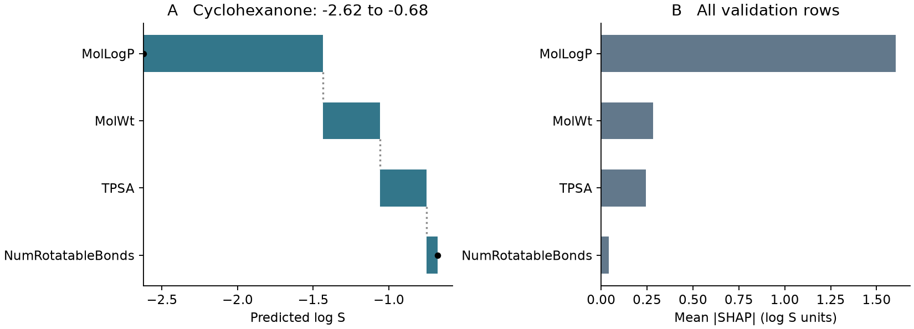

# SHAP {#sec-shap}

## 為什麼模型給環己酮的水溶解度，比背景分子的平均預測高？

差距大部分來自 MolLogP 這一欄，它分到的貢獻是把預測往上推 1.188 個 log S 單位。同一個隨機森林預測環己酮的 log S 為 −0.677，對我們選的 32 個背景分子則平均預測 −2.623，兩者差了 1.946。這個差距可以拆給模型用的四個描述符，其中 MolLogP 分到 +1.188，分子量分到 +0.375。**SHAP**（SHapley Additive exPlanations）就是用來拆解單筆預測的方法，每一欄分到的數字稱為 **SHAP 值**（SHAP value）：正值表示和背景相比，這一欄把該分子的預測往上推，負值則是往下拉。[@lundberg2017shap]

## 核心概念

要算一個描述符的貢獻，得先決定模型「還不知道這一欄」時要怎麼預測。模型每次都需要四個數字，沒辦法直接把表格挖空。所以我們從訓練集隨機選 32 列當作**背景**（background），用背景分子的值補上未知的欄位，再把 32 次預測取平均。

舉例來說，假如只知道環己酮的分子量，就把這 32 列的 MolWt 都換成環己酮的 98.145，其他三欄保留各背景分子原本的值，算出 32 個預測再平均。假如連分子量都還不知道，四欄就全部保留背景值，這時的平均預測稱為**基準值**（base value），也就是拆解的起點。

那麼多知道一欄，平均預測會變多少？答案和揭露的順序有關。如果先給分子量、再給 MolLogP，森林裡有些樹可能已經依分子量選好了分支；反過來先給 MolLogP 再給分子量，多知道分子量造成的變化就可能不同。**Shapley 值**（Shapley value）的做法是考慮所有可能的揭露順序，每一種順序都記下某一欄加入前後的平均預測差，再對所有順序取平均。這樣就不必任選一個順序，也不會把兩欄共同造成的影響，全部歸給碰巧排在後面的那一欄。

四欄全部換成環己酮的數值時，32 列變得一模一樣，森林自然給每一列相同的預測。用 $f(x)$ 表示模型預測、$\phi_0$ 表示基準值、$\phi_j(x)$ 表示第 $j$ 欄的 SHAP 值，就有 $f(x)=\phi_0+\sum_j\phi_j(x)$。換句話說，基準值加上所有欄位的 SHAP 值，剛好等於模型對這個分子的預測。能夠這樣逐項加回去，是因為每一種揭露順序都從同一個起點走到同一個終點，沿途的差加總起來都是同一個數。

這條等式裡沒有用到實測溶解度，所以在送樣做實驗之前就能算出來。也就是說，SHAP 拆解的是「模型怎麼得到這個數字」，不管預測準不準都一樣。

## 動手做

[下載本節 notebook](../../notebooks/ch11/11-03-shap.ipynb){.btn .btn-sm .btn-outline-primary}　[在 Colab 開啟](ch11/11-03-shap.ipynb)

這裡重建 @sec-feature-importance 用的模型：DeepChem 依骨架切分 ESOL，隨機森林只用訓練集的 902 筆資料學習，目標值保留原本的 log S 單位。接著固定亂數種子 42，不重複地抽 32 筆訓練資料當背景，再對 113 筆驗證資料逐筆計算。背景取自訓練集，是為了讓所有驗證分子都有同一個比較起點；實測值則留到預測完成後才拿來對照，挑背景和算貢獻時都沒有用到。[@delaney2004esol]

```python
rng = np.random.default_rng(42)
background = X_train[rng.choice(len(train), size=32, replace=False)]
```

這兩行建立一個固定種子的亂數產生器，再從訓練集的列編號中不重複地抽出 32 個，取出對應的描述符當作背景。

四欄各有「用待解釋分子的值」和「保留背景值」兩種狀態，所以總共只有 16 種組合。notebook 裡的 `explain` 先算好這 16 種組合的平均預測，再依四欄的 24 種排列順序，計算每次加入一欄的差。本例把所有可能性都算完了，所以結果是精確的；這裡的「精確」是指在這 32 個背景分子和這套補值規則下，沒有略過任何組合。

如果改用有數百欄的分子指紋，組合數會隨欄數呈指數成長，沒辦法全部算完。分析樹模型時，可以改用專為樹設計的演算法，但一樣要先指定未知欄位怎麼處理，才知道基準值代表的是哪一群分子。

{#fig-esol-shap fig-alt="環己酮的瀑布圖從 −2.62 往右走到 −0.68，MolLogP 的一段最長。右邊四根橫條從零起算，MolLogP 的平均絕對貢獻約為 1.60 個 log S 單位。"}

我們可以用實際數字看看揭露順序造成的差別。四欄都取背景值時，平均預測是 −2.623；只換上環己酮的 MolLogP，平均變成 −1.817，這一步往上走了 0.806。換一條路從頭來：先只換上環己酮的分子量，得到 −2.494；在這個基礎上再把 MolLogP 換成環己酮的值，平均預測來到 −1.078。同樣是加入 MolLogP，這次卻往上走了約 1.42 個 log S 單位（差值由未取位的數值算出，和表面上兩個數相減會有千分位的出入）。把這兩種情形和其他所有順序都算進去平均，才得到圖上的 +1.188。

這也說明了為什麼要分清「描述符的值」和「這個值分到的貢獻」。環己酮的 MolLogP 是 1.520，這個數字直接由結構算出；換一個模型，或讓同一個模型改和另一群背景比較，1.520 都不會變。會變的是圖上橫條的長度，以及它往左還是往右延伸。

@fig-esol-shap 左圖是一張**瀑布圖**（waterfall plot），讀法是從最上方的黑點出發：MolLogP 讓位置往右移 1.188，分子量再推高 0.375，極性表面積和可旋轉鍵數各推高 0.310 和 0.073。沿著每一段的終點往下一列讀，最後一個黑點落在 −0.677。圖上哪一欄畫在前面只影響閱讀順序，因為每一段的長度都已經是 24 種順序的平均。環己酮的實測 log S 是 −0.600，預測低了 0.077；這個差距是預測誤差，要另外看，不屬於圖中的第五項貢獻。

右圖的橫條則都從零開始。為了概括 113 筆驗證資料，我們先把每個分子的 SHAP 值取絕對值，再對同一欄取平均。如果不取絕對值，某一欄對一半分子往上推、對另一半往下拉，平均起來就會互相抵消。所以右圖呈現的是「這一欄通常能讓預測移動多少」，方向則要回到左圖這類單筆解釋才看得到。

MolLogP 在右圖的平均移動量是 1.603 個 log S 單位，上一節打亂它所增加的驗證 MAE 則是 1.304。前者以背景的平均預測為起點，後者要和實測值比較才算得出來，兩者衡量的東西不同，所以即使排名一樣，數字也不必相同。

最後還有一個容易忽略的選擇。把環己酮的分子量放到另一個分子的三欄資料旁邊，拼出來的四個數字，不一定對應得到真實存在的結構。本例用的**干預式**（interventional）SHAP 允許這樣補值：同一個背景列裡保留的欄位仍然一起移動，但它們和已經指定的欄位之間原本的關聯會被打散。

如果只想和分子量相近的小分子比較，可以另選一組背景，這時問題就變成「模型為什麼對這個分子的預測和這群小分子不同」。環己酮的四個描述符沒變，森林的預測也一樣，但起點和每一欄分到的差額都可能改變。換句話說，SHAP 值永遠是相對於某一組背景而言的。

## 重點整理

- SHAP 值要連同背景和補值規則一起讀；本例的基準值是 32 個訓練分子的平均預測。
- 基準值加上四欄的 SHAP 值會剛好等於模型預測，預測和實測之間的誤差要另外算。
- 單筆 SHAP 值有方向；跨分子平均前先取絕對值，可以比較各欄的影響幅度，但看不到方向。

## 小練習

把背景改成分子量不超過 150 的訓練分子，看環己酮的 MolLogP 貢獻是否還是正值；以種子 42 從符合條件的列中不重複抽 32 列，重算基準值和四項貢獻，並用它們的總和說明預測和解釋各有什麼改變。

提示：先用 `X_train[:, 1] <= 150` 篩選背景候選列，重新建立亂數產生器，再呼叫 `explain(X_valid[[row]], light)`，其中 `light` 是新抽出的 32 列。

## 延伸閱讀

[Lundberg 與 Lee 提出 SHAP 的原始論文](https://papers.nips.cc/paper/7062-a-unified-approach-to-interpreting-model-predictions) · [原論文預印本 DOI](https://doi.org/10.48550/arXiv.1705.07874) · [SHAP 官方文件的精確枚舉解法](https://shap.readthedocs.io/en/latest/generated/shap.ExactExplainer.html)
