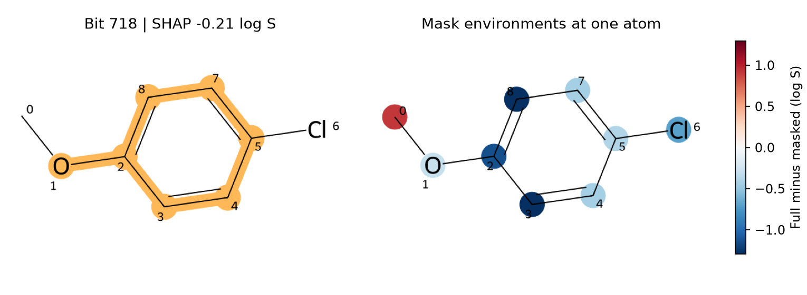

# 把解釋對回化學結構（指紋位元與子結構、原子貢獻） {#sec-fingerprint-attribution}

## 一個指紋位元把預測溶解度往下拉，該在結構式上圈出哪裡？ {#開場問題}

要圈出分子中所有打開這個位元的原子環境，而且可能不只一處。以對氯苯甲醚為例，苯環的一端接甲氧基、另一端接氯，從兩個對稱的環碳分別往外數兩個鍵，得到的環境都會打開第 718 號位元。模型讀到的只是一個 1，結構式上卻要標出兩處。所以就算算出這個位元讓預測降低了多少，光看這個數字，也分不出是哪一側的環碳造成的。

## 核心概念

Morgan 指紋從每個原子出發，記下它本身以及周圍一圈、兩圈的局部環境，再把每種環境的識別碼對應到固定長度向量中的某一格。這裡用半徑 2、長度 1,024 的二元指紋，每一格只有 0 或 1。相同的環境在兩個位置出現，對應的那一格還是只記 1。不同的環境也可能碰巧落在同一格，這稱為**雜湊碰撞**（hash collision）。因此拿到一份「重要位元」名單時，要連同產生指紋的參數和原本的分子一起看；同一個編號換一套指紋設定，或換到另一個分子上，對應的環境都可能不同。

接下來的目標值是實測水溶解度 log S，也就是以 mol/L 表示後取常用對數。我們用**嶺迴歸**（Ridge regression）學出每個位元的係數，再以訓練分子為背景，計算 @sec-shap 介紹的單筆 SHAP 值。對線性模型來說，SHAP 值有一個可以手算的公式：如果缺少某個特徵時，就用它在背景中的平均值補上，那麼第 $j$ 格的 SHAP 值就等於 $w_j(x_j-\bar{x}_j)$。

這個公式的三個符號是這樣讀的：$w_j$ 是模型學到的係數，$x_j$ 是這個分子在該格的 0 或 1，$\bar{x}_j$ 則是訓練集中打開這一格的分子比例。也就是說，一格的貢獻取決於「這個分子和背景平均差多少」乘上「模型多看重這一格」。程式用的正是這種以背景平均補值的定義；如果改用其他位元的狀態來推估缺少的特徵，就要另外計算。

另一種讀法是直接問：模型對某個原子周圍的結構有多敏感？本節沿用**相似度圖**（similarity map）的做法，先用完整的指紋預測 log S，再把所有涵蓋某個原子的環境遮掉；如果其他環境還能打開同一格，那一格就保留。完整指紋的預測值減去遮罩後的預測值，就是本節所說的**原子貢獻**（atom contribution）。正值表示保留這些環境時，模型預測的溶解度比較高。相鄰的原子可能共用同一個環境，逐一遮掉時會重複算到，所以各原子的貢獻加起來，並不會剛好還原出預測值。[@riniker2013maps]

## 動手做

[下載本節 notebook](../../notebooks/ch11/11-04-fingerprint-attribution.ipynb){.btn .btn-sm .btn-outline-primary}　[在 Colab 開啟](ch11/11-04-fingerprint-attribution.ipynb)

我們從 ESOL 收錄的 1,128 筆紀錄讀取實測值，同一個正規 SMILES 的紀錄先取平均，得到 1,117 個結構，再隨機分成 893 個訓練分子和 224 個測試分子。對氯苯甲醚分在測試集，所以模型訓練時沒看過它的量測值。模型的輸入只有分子指紋，測試集的均方根誤差約為 1.30 個 log S 單位。這一節想追查的是模型從哪裡讀到了什麼訊息，所以即使某筆預測有明顯的落差，也一樣值得攤開來看。[@delaney2004esol]

呼叫 RDKit 的指紋產生器時，我們同時要求它留下一份「位元來源表」，表中每一筆都是「中心原子編號、半徑」。半徑為 0 時只有原子本身；半徑為 2 時，要沿著鍵把兩步以內屬於這個環境的原子和鍵都標出來。如果每一格只取第一筆來源，對稱的環境就會少畫一份，也容易漏掉同一格收進不同結構的情形。

```python
info = rdFingerprintGenerator.AdditionalOutput()
info.CollectBitInfoMap()
x = gen.GetFingerprintAsNumPy(mol, additionalOutput=info)
bit_info = info.GetBitInfoMap()
phi = (x - X_train.mean(axis=0)) * model.coef_
```

前四行產生對氯苯甲醚的指紋 `x`，並把位元來源表存進 `bit_info`。最後一行就是上面的公式 $w_j(x_j-\bar{x}_j)$：把這個分子的指紋減去訓練集的平均，再乘上每一格的係數，一次算出所有位元的 SHAP 值 `phi`。

{#fig-fp-atom-regions fig-alt="對氯苯甲醚左右並列。左圖合併標示以環碳 3 與 8 為中心的兩個半徑 2 環境。右圖甲氧基端的甲基碳 0 呈紅色，環碳 3 與 8 都呈深藍色，色條單位為 log S。"}

@fig-fp-atom-regions 左圖挑的是：在這個分子裡出現不只一次、半徑大於零的位元中，SHAP 絕對值最大的那一格。來源表裡有兩筆：`(3, 2)` 和 `(8, 2)`。兩個環境都打開第 718 格，所以圖上雖然塗了兩片區域，預測裡只算一次 −0.210。這個數字是相對於訓練背景算出來的；如果係數不變，但換一批更常出現這個環境的分子當背景，第 718 格是 1 就沒那麼特別，分到的數字也會跟著變。

挑哪一格來畫，還有一個容易忽略的選擇。如果條件改成「分子裡有出現就好」，絕對值最大的是第 322 格，SHAP 值為 −0.774，來自碳 2、半徑 1 的環境。對照左圖找到 2 號碳，再沿一條鍵找它的鄰居，可以看到接甲氧基的環碳和氧都在這一圈裡，氯則離得比較遠。報告時，寫成「以連接甲氧基的環碳為中心的一圈」，會比直接替它取一個官能基名稱更精確。

如果想知道第 322 格在其他分子上是否也對應同樣的局部結構，可以從訓練集挑出打開這一格的分子，逐一查看它們的中心原子、半徑和原子種類。只看對氯苯甲醚這一張圖，還不足以替整個資料集裡的這一格命名。

右圖中，環碳 3 的原子貢獻是 −1.293 個 log S 單位。意思是說，模型看得到和環碳 3 有關的環境時，預測比遮掉這些環境後低了 1.293。對稱位置的環碳 8 也是深藍色，因為單獨遮住它的環境，會得到同樣的差值。這兩個數字都是比較遮罩前後的預測，每次都牽涉好幾個位元；左圖的 −0.210 則只是第 718 格相對於訓練背景的 SHAP 值，兩者的比較基準不同。讀者可以打開 `occurrences[718]`，看看兩個環境有沒有共用某些原子，再用 `mask_atom(i)[718]` 確認自己選的位置。

最後，把圖上的數字和整筆預測對照一次。訓練背景的平均預測為 −3.048，對氯苯甲醚的預測為 −3.892，實測則是 −2.780。從背景到預測差了 −0.844 個 log S 單位，要把所有位元的 SHAP 值都加進去才對得上。有些位元在這個分子上是 0，卻仍然有貢獻，例如訓練分子常帶有某種環境，而這個分子沒有。這樣的貢獻應該留在數值表裡，只是結構式上沒有實際的位置可以圈。

## 實驗上的考量

模型把對氯苯甲醚的 log S 低估了約 1.11。如果想藉此追查甲氧基或氯取代的影響，可以找只在該位置差一個取代基的真實分子，確認兩者的量測溫度和測定方式一致後，再比較溶解度。要記得，遮掉環境只是產生另一個模型輸入，實驗上沒辦法把圖中的藍色區域單獨拿出來量。

## 重點整理

- 查一個 Morgan 位元時，要保留它所有的中心原子和半徑，因為同一格可能指向好幾處。
- 位元的 SHAP 值以訓練背景為起點，原子貢獻則和同一分子的完整預測比較，兩者的基準不同。
- 位元為 0 也可能有 SHAP 貢獻，所以結構圖適合定位出現過的環境，完整的帳要看數值表。

## 小練習

把對氯苯甲醚的位元分成「出現」和「未出現」兩組，各自加總 SHAP 值再加回基準值；如果只留下能在結構式上圈出的那一組，預測會往哪個方向偏、差多少 log S 單位？

提示：用 `x == 1` 和 `x == 0` 分別篩選 `phi`，兩組都保留正負號。

## 延伸閱讀

[Riniker 與 Landrum 的相似度圖研究](https://doi.org/10.1186/1758-2946-5-43) · [RDKit 產生 Morgan 指紋與輸出位元來源的範例](https://www.rdkit.org/docs/GettingStartedInPython.html#explaining-bits-from-fingerprints) · [RDKit 相似度圖介面](https://www.rdkit.org/docs/source/rdkit.Chem.Draw.SimilarityMaps.html)
