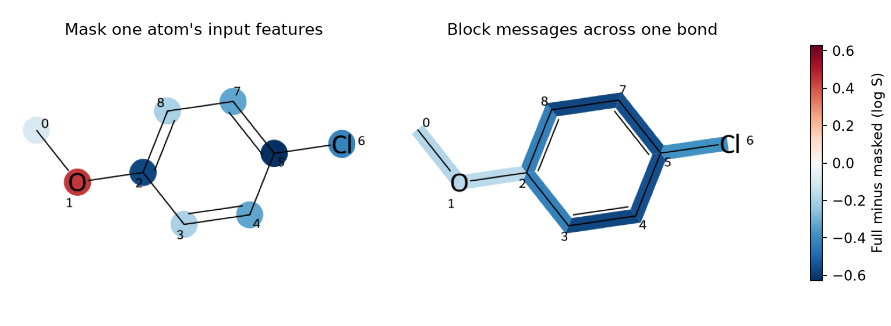

# 圖神經網路的解釋 {#sec-gnn-explanations}

## 把對氯苯甲醚的氧遮住，圖模型還會給它相同的溶解度嗎？ {#開場問題}

不會，預測會變低。在本節訓練的**圖神經網路**（graph neural network，GNN）裡，遮去醚氧的輸入特徵後，對氯苯甲醚的預測 log S 從 −2.24 降到約 −2.68。這裡保留了氧所在的位置和兩條鍵，讓模型沿著原本的分子圖重新算一次，只改變它能讀到的原子資料。兩次預測相差約 +0.44 個 log S 單位，這個數字量到的是「這個模型對這次改動的反應」。

## 核心概念

把對氯苯甲醚畫在紙上，醚氧的左右兩邊各有一個碳：甲氧基那一端是甲基，另一端接苯環，兩個碳的元素相同，芳香性不同。我們把元素、芳香性和形式電荷寫成每個原子的特徵向量，再沿著化學鍵把特徵傳給相鄰的原子。輪到醚氧時，模型同時讀它自己的資料和兩個碳傳來的資料；輪到甲基碳時，收到的就只有氧傳來的資料。這種依照相鄰關係更新原子表示的方法，稱為**訊息傳遞**（message passing）。

這裡只傳一輪。每個位置把自己的特徵和鄰居特徵的總和接成一列，經過同一層可學習的權重和非線性函數，再把所有位置的輸出加總，就得到整個分子的預測。所以把氧的特徵全部改成零，會同時改變氧本身和兩個相鄰碳的計算，不過氧的位置還是收得到碳傳來的訊息。

另一種改法是只阻斷氧和甲基碳之間的那條鍵：兩個原子都保留原本的特徵，只是彼此收不到對方的訊息。換句話說，這兩種改動雖然都貼著同一個氧，傳進模型的資料卻不一樣。

想知道哪一個位置的資料會影響預測，最直接的方法是每次遮一個原子或一條鍵，量兩次預測差多少。如果想問的是「最少要保留哪些特徵和連線，才足以維持原本的預測」，就要同時考慮一組原子和鍵，**GNNExplainer** 就是針對這個問題設計的。它固定已經訓練好的模型，學一組遮罩，決定哪些連線和節點特徵要保留，同時兼顧「預測不要偏離原本太多」和「保留的範圍越小越好」。[@ying2019gnnexplainer]

所以 GNNExplainer 保留下來的區域，代表這組資訊足以重現答案；遮罩權重本身沒有「讓 log S 升高幾個單位」這種正負意義。本節實作的是逐一遮罩，好處是每個數字怎麼來都能直接檢查。

## 動手做

[下載本節 notebook](../../notebooks/ch11/11-05-gnn-explanations.ipynb){.btn .btn-sm .btn-outline-primary}　[在 Colab 開啟](ch11/11-05-gnn-explanations.ipynb)

這裡沿用 @sec-fingerprint-attribution 的 ESOL 資料和切分，893 個訓練分子各有一筆實測 log S，以 mol/L 為濃度單位。模型接收的是原子和它們的相鄰關係，沒有用 Morgan 指紋。[@delaney2004esol]

為了能追蹤一條鍵在預測中傳了什麼，我們刻意用很簡單的設計：每個原子把同一份特徵傳給所有鄰居，沿單鍵和雙鍵傳出的訊息也用同一組權重。輸入中只明確寫進了原子的芳香性，鍵級和立體化學都沒有另外編碼。所以如果兩個結構只差在這些被省略的資訊上，這個模型就分不出來。

訓練時，程式用所有訓練分子「預測減實測」的差距來更新權重，所以單一原子不需要有自己的「實測溶解度」。這次在事先設定的 300 次迭代上限停止，採用當時的權重；224 個測試分子的均方根誤差為 0.93 個 log S 單位。從測試集挑出對氯苯甲醚，完整分子圖的預測是 −2.24，比實測的 −2.78 高約 0.54。後面的圖都固定這組權重，每改一次輸入就重新預測一次，不需要重新訓練。

```python
full = predict(mol)
atom_delta = np.array([full - predict(mol, hide_atom=i) for i in range(mol.GetNumAtoms())])
bond_delta = np.array([full - predict(mol, hide_bond=j) for j in range(mol.GetNumBonds())])
```

這三行先算出完整分子的預測 `full`，接著對每個原子各遮一次、算出「完整預測減遮罩後預測」，存成 `atom_delta`；最後一行對每一條鍵做同樣的事，存成 `bond_delta`。

{#fig-gnn-masks fig-alt="左圖對氯苯甲醚的醚氧 1 呈紅色，接甲氧基和氯的環碳 2、5 呈藍色。右圖則為鍵著色，環上對稱位置顏色相同，醚氧兩側的鍵呈較淡的藍色。"}

先看 @fig-gnn-masks 左圖的氧 1，再到右圖找從甲基碳 0 連到氧 1 的那條短線。左圖的氧是紅色，表示完整預測比氧特徵歸零後的預測高。右圖這條鍵的差值卻是 −0.183，也就是阻斷它以後，預測從 −2.24 升到約 −2.06。如果不確定正負方向，可以把完整預測寫在紙上，再減去圖上的差值，得到的就是遮罩後的預測。從結果來看，對同一個醚，問「看得到氧的特徵嗎」和問「甲基和氧能互相傳訊嗎」，這組權重給出的反應方向剛好相反。

再看苯環。連接甲氧基的環碳是 2，連接氯的環碳是 5，沿著環從 2 走到 5 有兩條對稱的路徑。圖中的環碳 3 和 8 雖然編號不同，遮掉各自的特徵後，差值都約為 −0.205。程式也把整個分子的原子編號倒過來，用同一個模型再做一次完整預測，確認輸出沒有改變。對這個架構來說，編號只是方便我們在圖上指認位置；如果換個編號預測就變了，就要回頭檢查特徵和連線在建立時是否還對得上。

那麼色尺上的數字要多大才算大？要看用途。如果只是想在同一張圖上找出模型最敏感的位置，比較各位置差值的絕對值就可以了。如果想據此預測改造後的實測溶解度，就還要考慮整個測試集的誤差，以及這個分子本身的預測落差。測試集的均方根誤差描述的是許多完整分子的平均表現，沒辦法直接拆成某一條鍵的誤差範圍。

這個小模型還有一個地方可以檢查。因為最後一層把每個位置的輸出加總，所以可以印出「氧這一列最後交了多少」；但遮住氧的輸入時，兩個鄰居的輸出也會跟著變。兩種算法都會產生一個貼在氧上的數字，回答的卻是不同的問題。讀別人的結構熱圖時，可以先找方法段落裡的動詞：作者是加總模型的輸出、比較遮罩前後的預測，還是最佳化一組能重現答案的遮罩？光看到一個紅色圓圈，還不足以決定要不要保留這個氧。

## 實驗上的考量

如果想知道拿掉對位的氯之後溶解度會怎樣，實際上拿得到的對照分子是苯甲醚。遮掉氯原子的特徵，圖上仍然留著一個接在環上的位置，這和苯甲醚的輸入並不相同。比較好的做法是把兩個完整的結構都送進模型，再查兩者的實測值和量測溫度，看看預測的趨勢在同條件的量測中是否也看得到。

## 重點整理

- 遮住一個原子的特徵，它傳給鄰居的資料也會改變；阻斷一條鍵，只會切斷兩端之間的訊息。
- 逐一遮罩可以讀出預測變化的方向和大小，標回結構時要說明遮了什麼、怎麼相減，以及單位。
- GNNExplainer 找的是能維持原預測的一組連線和特徵，判讀時要一起看保留範圍和重現原預測的程度。

## 小練習

比較「把對氯苯甲醚的氯特徵歸零」和「直接改成苯甲醚（`COc1ccccc1`）重新預測」，哪一種讓預測 log S 升得比較多？列出兩者和完整對氯苯甲醚的預測差，並說明哪一個能實際送測。

提示：用 `GetSymbol()` 找出氯的原子編號，傳給 `hide_atom`；再把苯甲醚的 SMILES 交給 `Chem.MolFromSmiles()` 後預測。兩次都用同一組權重。

## 延伸閱讀

[Gilmer 等人的分子訊息傳遞框架](https://proceedings.mlr.press/v70/gilmer17a.html) · [GNNExplainer 原始研究](https://doi.org/10.48550/arXiv.1903.03894) · [PyTorch Geometric 的 GNNExplainer 文件](https://pytorch-geometric.readthedocs.io/en/latest/generated/torch_geometric.explain.algorithm.GNNExplainer.html)
