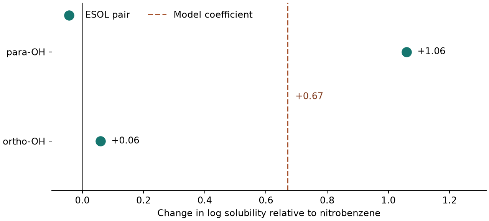

# 解釋的限制：相關不等於因果 {#sec-limits-of-explanations}

## 模型說帶有酚羥基的分子較易溶於水，把羥基接到硝基苯上就會有同樣的效果嗎？ {#開場問題}

要看羥基接在哪裡，以及在什麼條件下量。我們用 ESOL 的實測溶解度建一個只辨認酚羥基的模型，它會把所有帶酚羥基的分子一律往上調約 0.67 個對數單位。但拿硝基苯和它的兩個衍生物逐一比較，羥基接在硝基隔壁時，資料表上只高出 0.06；移到對面，卻高出 1.06。[@delaney2004esol]

也就是說，模型的係數說明的是「模型怎麼算出預測」。實驗要回答的則是另一個問題：固定母體結構和量測條件，只在指定位置換基，溶解度差多少？這個差異能不能重現？

## 核心概念

把水溶解度 $S$ 以 mol/L 表示、取常用對數，記為 $\log S$。我們先讓模型只讀一個特徵 $x$：如果苯環這類芳香環上的碳直接接著中性的 OH，$x$ 就填 1，否則填 0。所以乙醇雖然也有羥基，但它的氧接在飽和碳上，這一欄仍填 0。

用有截距的最小平方法估計 $\widehat{\log S}=a+bx$，模型就只會給出兩種預測。$x=0$ 時，最佳的 $a$ 就是這組分子實測 $\log S$ 的平均；$x=1$ 時，最佳的 $a+b$ 是另一組的平均。兩式相減，係數 $b$ 剛好等於兩組平均的差。換句話說，只要看過這兩群分子的平均，就能把這個模型完整解釋清楚。

問題在於，把訓練表某一列的 0 改成 1，並沒有對應到一個具體的新分子。如果原本是硝基苯，芳香環上有鄰、間、對三種位置可以接羥基；如果原本是乙醇，根本沒有可以替換氫的芳香碳。

另一個問題是兩組分子的組成。含酚羥基的那組，可能有大小不同的骨架、不同數目的環或其他極性基團；不含酚羥基的那組，連烷烴和醇都一起算進去了。所以就算每個量測值都準確，兩組平均相減時，比較的結構差異也遠遠不只一個羥基。這正是「相關不等於因果」在這裡的意思。用 SHAP 拆解更複雜的模型時也是如此：預測拆得再細，也不會因此多出另一瓶樣品的量測值。

要把問題縮小，可以像 @sec-matched-molecular-pairs 那樣固定骨架、只改一處，再把母體和衍生物的實測值相減。這樣至少知道差異出在哪個位置，也能把「模型認為有酚羥基比較易溶」改寫成一個可以檢驗的假設，例如：「在同一批固定 pH 的介質中，把硝基苯對位的 H 換成 OH，平衡溶解度會上升。」

如果還想說明為什麼會上升，就要再設計能區分機制的比較。多一個 OH 可能改變分子和水的作用，也可能改變解離的比例或固體的堆積方式；只量一個溶解度，很難把這幾種影響分開。

## 動手做

[下載本節 notebook](../../notebooks/ch11/11-06-limits-of-explanations.ipynb){.btn .btn-sm .btn-outline-primary}　[在 Colab 開啟](ch11/11-06-limits-of-explanations.ipynb)

我們用 DeepChem 的 `load_delaney()` 讀入 ESOL 的 1,128 筆結構和未標準化的水溶解度，先依正規 SMILES 留出硝基苯、鄰硝基苯酚、間硝基苯酚和對硝基苯酚四筆。這四個化合物是專門用來檢查取代位置的，所以只用來比較位置效應。剩下的 1,124 筆用來估計係數。整個比較都用資料中的實測值，沒有拿 ESOL 原論文的預測值當答案。[@delaney2004esol]

```python
model = LinearRegression().fit(train[["OH"]], train["logS"])
coefficient = model.coef_[0]
```

第一行用「有沒有酚羥基」這一欄去擬合 logS，第二行取出係數 $b$。

從結果來看，有 1,036 筆不帶酚羥基，平均 $\log S$ 是 −3.109；另有 88 筆帶酚羥基，平均是 −2.438。後者減前者得到 +0.671。換回原本的濃度，$10^{0.671}$ 約為 4.7，這是兩組**幾何平均濃度**的比值。如果同事據此寫下「替下一個候選分子加上羥基，溶解度可以提高 4.7 倍」，可以先請他在結構式上圈出打算改的位置。模型從頭到尾只讀到一個 0 或 1，沒辦法替他在苯環上選位置。

{#fig-nitrophenol-comparison fig-alt="橫軸是相對硝基苯的 logS 變化。鄰位綠點在 +0.06、對位在 +1.06；模型給兩種位置的變化都是 +0.67，位於兩點之間。"}

在 @fig-nitrophenol-comparison 上，兩個綠點都以同一筆硝基苯為零點，它的 $\log S$ 是 −1.80。鄰位衍生物是 −1.74，換算成濃度比約 1.15；對位衍生物是 −0.74，濃度比約 11.5。直接比較兩個衍生物，對位的實測濃度大約是鄰位的十倍。它們的分子式相同，也都只有一個酚羥基，正好讓我們看到模型少了「位置」這項資訊。反過來說，就算某一對剛好落在虛線上，也只表示這一對的實測差和係數接近，羥基係數還是不能當成任何位置都適用的換基效果。

怎樣的複測比較有說服力？可以把母體和兩個衍生物各自獨立配樣，每一輪量測都同時放入三種化合物，並打亂量測順序。如果第一天只做鄰位、第二天才做對位，儀器校正或樣品處理的批次差異，就會和位置效應混在一起。每一輪先算出「衍生物減母體」的 $\Delta\log S$，再看多輪之間的變動有多大。如果鄰位的 0.06 比獨立複測之間的變動還小，就先報告現有的精度能分辨多大的差異。至於用同一瓶上清液連續進樣三次，只能確認分析讀值穩不穩定，看不到從配樣到平衡這段過程的變動。

同一輪量測還有一個容易忽略的細節。鄰位和對位的兩個差值都以同一瓶硝基苯為基準，如果那一瓶的濃度配錯了，兩個綠點會一起移動。不過兩點之間的距離不受影響，因為兩個對數差值相減時，母體那一項剛好抵消。所以「對位比鄰位高多少」和「兩個位置相對母體是否都提高」，要確認的量測並不完全相同。記下每個樣品的原始濃度、批號和重複次數，會比只留兩個倍數更方便追查。另外，同一個母體出現在好幾個配對裡，也只算量了一次母體，不要當成多次獨立量測。

## 實驗上的考量

ESOL 的結構和濃度欄沒有逐筆記錄量測時的 pH，所以從圖中兩點推算不出各有多少比例的酚已經解離。複測時，可以在同一溫度和緩衝液中，加入過量樣品讓它達到平衡，確認不同取樣時間的濃度已經穩定，並記下終點 pH、樣品的物態和取樣方式。如果想主張差距來自解離，可以另外在幾個控制好的 pH 下比較兩種異構物的溶解度曲線，再配合獨立測得的酸解離常數來判讀；只在單一 pH 下重現十倍差，支持的是「這個條件下有差異」。[OECD 水溶解度試驗指引](https://doi.org/10.1787/9789264069589-en)

## 重點整理

- 二元特徵的線性係數就是兩組平均的差，可以完整解釋模型怎麼預測。
- 取代位置要講清楚：同樣是硝基苯，鄰位和對位換成 OH 的實測差值很不一樣。
- 同條件的複測能檢查一個結構改動的效果；想知道背後的機制，還要量能區分不同解釋的量。

## 小練習

從留出的四筆資料取出間硝基苯酚，算出它相對於硝基苯的 $\Delta\log S$ 和濃度比，放到圖上的虛線旁比較，說明它是否支持「酚羥基在每個位置效果都一樣」，並提出一項複測時要控制的條件。

提示：在 `held` 中用 `keys["meta"]` 和 `keys["Parent"]` 查值，算「衍生物減母體」，再用 10 的差值次方換回濃度比。

## 延伸閱讀

[Delaney 的 ESOL 原始研究](https://doi.org/10.1021/ci034243x) · [DeepChem 的 MoleculeNet 資料介面](https://deepchem.readthedocs.io/en/latest/api_reference/moleculenet.html) · [配對分子分析的結構比較方法](https://doi.org/10.1021/ci900450m)
