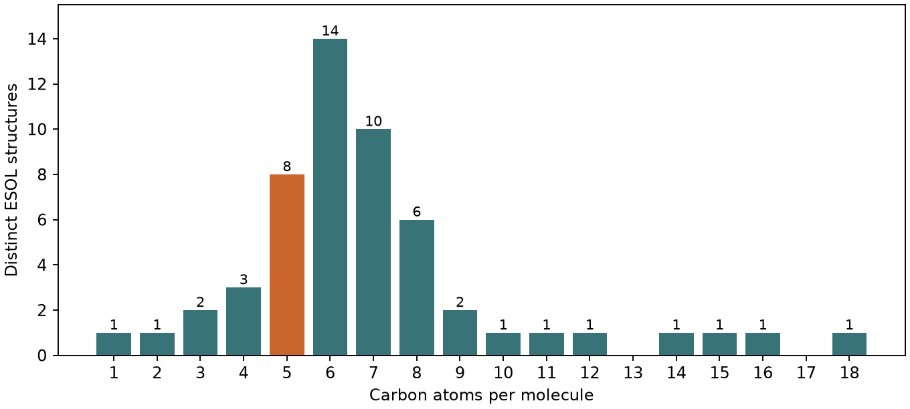

# 為什麼研發現場總是資料不夠 {#sec-small-data}

## 手上有一千多筆水溶解度，想比較兩種五碳醇時，有幾筆真的用得上？ {#開場問題}

真正用得上的，只有個位數。MoleculeNet 的 ESOL 水溶解度資料集有 1,128 列，但如果只要飽和、非環的五碳單醇，用結構逐一篩選後只剩 8 個不同的結構。問題再問得窄一點，例如固定直鏈、只移動羥基的位置，這 8 個裡又只有一部分能拿來對照。[@delaney2004esol; @wu2018moleculenet]

研發裡常說的**小數據**（small data）問題，就出在這個分母上。資料庫裡收了很多量過的物質，可是能回答眼前這個問題的量測，往往只有寥寥幾筆。

## 核心概念

假設你手上有一瓶 2-戊醇，打算評估同系列的溶劑。如果目的是估計一批新溶劑的水溶解度，含酮、醚、酯的物質都可以納入模型。但如果問題變成「同樣是五個碳加一個羥基，把羥基從第二個碳移到第三個碳，影響有多大」，最直接的對照就是 3-戊醇。另一瓶樣品就算分子量相同，只要碳骨架也跟著變了，量到的差值就很難單獨歸給羥基的位置。所以第一步是先把要比較的兩個結構畫出來，再看手邊的資料能支持哪一種說法。

專案紀錄裡的「一筆」，其實也有好幾種意思。同一瓶溶液連續讀三次，看的是讀值穩不穩定；同一種醇重新配三瓶樣品，則連配製時的差異也算進去了。這兩種重複量測都不會多出新的碳骨架。反過來說，兩種不同化合物各量一次，可以比較它們的讀值，卻看不出重做一次流程時數值會浮動多少。

換句話說，「有幾種結構可以比」和「量測的重複性有多好」要用兩種方式計數。要估計重複性，就保留每一次量測的樣品與批次編號；要盤點結構，就把相同結構算成一種。這兩個分母最好分開記。

還有一種缺口，光看結構表是看不出來的：單位。同樣叫做「水溶解度」，有人記 g/L，有人記 mol/L，也有人已經取過常用對數。ESOL 的實測欄是 $\log_{10}(S/\mathrm{mol\,L^{-1}})$，如果原始值是質量濃度，要先用各自的分子量換成莫耳濃度，再取對數；沒有原始單位，就沒辦法可靠地換算。就算單位一致，兩瓶樣品的溫度和量測方法是否相同，也要回到來源確認。從這個角度來看，公開資料很適合用來盤點有哪些結構，至於能不能支撐一個精細的實驗差值，就要另外判斷。

## 動手做

[下載本節 notebook](../../notebooks/ch12/12-01-small-data.ipynb){.btn .btn-sm .btn-outline-primary}　[在 Colab 開啟](ch12/12-01-small-data.ipynb)

這一節只做盤點，不訓練模型，所以三個資料子集都可以一起用。DeepChem 載入 ESOL 後，程式從每一列讀出 SMILES，交給 RDKit 轉成正規 SMILES（canonical SMILES）。同一個分子從鏈的兩端開始寫，會得到兩個不同的字串；轉成一致的寫法之後，才能拿來數「有幾種不同結構」。原始資料集仍然保留著，需要時可以用原來的 SMILES 回頭找量測列。輸入裡已經標明的立體化學會保留，表上沒有註明的立體中心則不另外補上。

```python
structures = {Chem.MolToSmiles(Chem.MolFromSmiles(s))
              for part in (train, valid, test) for s in part.ids}
```

這兩行把訓練、驗證、測試三個子集裡的每一個 SMILES 都轉成正規寫法，再放進一個**集合**（set）裡；集合會自動去掉重複的字串。照這套規則，1,128 列整理成 1,117 個不同的結構字串。少掉的 11 列只表示有幾列落到同一個字串上，至於它們是不是同一瓶樣品的複測，從這裡還看不出來。

接著，我們對每個分子問同樣的幾個問題。分子必須只有一個相連的部分，免得把鹽的另一個成分也算進碳鏈；原子只能是中性的碳和氧，整個分子恰好一個氧，而且氧上帶一個氫；最後排除環和多重鍵。這些條件允許支鏈，所以直鏈醇和支鏈醇都會被選進來。

為什麼要特別看氧上有沒有氫？因為五碳醇和某些醚的分子式相同，光數元素個數分不出兩者。舉例來說，乙醇和二甲醚都是 C₂H₆O，差別就在氧上有沒有接氫。

{#fig-small-data-alcohols fig-alt="橫軸是碳數，縱軸是不同結構數。五碳有八種，六碳有十四種，七碳有十種；十碳以上數個組別僅有一種或沒有。"}

到了 @fig-small-data-alcohols，分母已經縮到 54 個不同結構。六碳組最多，有 14 個；五碳組有 8 個。要注意，這張圖數的是資料庫收了多少種，跟化學上可能存在的異構物數目、哪種醇比較易溶，都是不同的問題。想知道某根柱子裡有哪些分子，可以在 notebook 讀取 `alcohols`，裡面每一筆只保留 SMILES 和碳數。

接下來怎麼分組，要看你想問什麼。如果要比較羥基位置，就把同碳數的分子依碳骨架再分組；如果要比較直鏈長度，就要跨柱子去找同樣以末端羥基結尾的分子。

以五碳組為例，`CCCCCO`、`CCCC(C)O`、`CCC(O)CC` 分別是 1-、2-、3-戊醇，三個都是同樣的五碳直鏈。開頭那個羥基位置的問題，現在就能圈出適合的兩列來回答。其餘五個帶有碳支鏈，一樣是有用的資料，只是要換個問法。例如 `CC(C)(C)CO` 和 1-戊醇一樣在末端帶羥基，但有一個碳連著四個碳鄰居；把這兩個配成一對，問的就是「固定末端醇基，改變碳鏈分支」。讀圖讀到這裡，原本的八個結構已經變成可以交給同事確認的分子名稱和配對理由。

回到自己的專案。如果庫存表裡有兩種樣品，實驗表卻只記了一種，可以把「有料、未量」和「已量、有數字」分成兩欄。試過卻低於定量下限的樣品，也要另外標出方法和下限，因為空白、低於下限和測得零是三種不同的情況。下一輪排樣時，有了這幾欄，就知道該買新樣品、補量手上的樣品，還是換一種能量到更低濃度的方法。

最後看圖的右側。十二碳組只有一個結構，十三碳組在表上沒有符合條件的記錄。如果想找一系列相鄰碳數的直鏈醇，中間缺一瓶，那一對就無法直接比較；把兩端各再量一次可以估計複測差異，卻補不出中間那一瓶的溶解度。反過來，如果你想確認兩次讀值的差是否大過量測波動，多找一瓶不同碳數的醇也幫不上忙，這時需要的是重複量測。同一張圖能指出哪裡缺資料，至於該補哪一瓶，還是要回到實驗問題來決定。

## 實驗上的考量

挑出一對五碳醇後，先查原記錄裡的溫度、濃度單位、樣品純度，以及相分離後怎麼取樣。如果資料只留下彙整後的數值，可以先拿它當選樣依據，再在同一溫度下分別配製、平衡和複測。把每次配製的結果都留下來，之後才能判斷兩種結構的差異，和操作本身的波動相比有多大。

## 重點整理

- 想比較羥基位置，要先固定碳骨架；分子式相同只是第一道篩選。
- ESOL 的 1,128 列裡，依本節規則只找到 54 個飽和非環單醇結構，其中 8 個有五個碳。
- 「有幾種結構可比」和「量測重複性多好」要用兩種方式計數。

## 小練習

如果你的專案只研究含六到八個碳的飽和非環單醇，請算出這個範圍包含本節 54 個單醇結構中的幾個、占幾成，並想一想這個比例能不能告訴你某一個醇量過幾次。

提示：在 `counts` 上同時設定碳數的上下限；分母用不同單醇結構的數目。

## 延伸閱讀

[Delaney 的 ESOL 水溶解度模型與資料](https://doi.org/10.1021/ci034243x) · [DeepChem 的 MoleculeNet 資料載入說明](https://deepchem.readthedocs.io/en/latest/api_reference/moleculenet.html) · [RDKit 的分子讀寫與 canonical SMILES](https://www.rdkit.org/docs/GettingStartedInPython.html)
