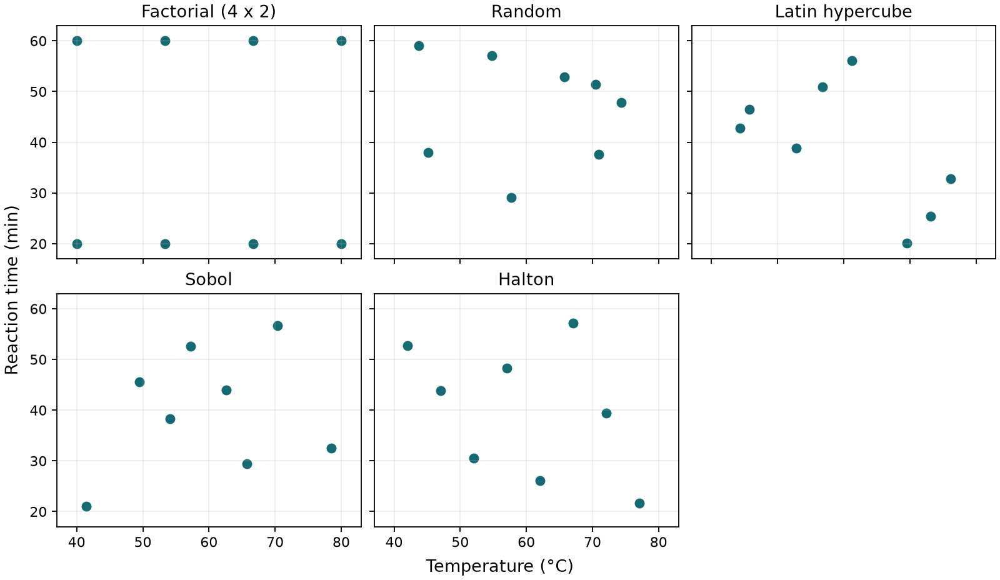

# 實驗計畫法（DoE）：如何安排第一批實驗 {#sec-experimental-design}

## 想知道升溫有沒有用，和想先摸清整段操作範圍，八組反應該排得一樣嗎？ {#開場問題}

不一樣，排法要跟著問題走。如果同事問的是「延長反應時間之後，升溫還有沒有同樣的效果」，就該在短時間和長時間各安排一組相同的溫度對照。如果連哪一段溫度、時間值得細看都還不知道，把第一批條件散布到整個範圍會更有幫助。兩種排法都用掉八個名額，量完後能回答的問題卻不同。

**實驗計畫法**（design of experiments，DoE）要決定的，就是哪幾組量測放在一起，才能回答手上的問題。很多實驗室的第一批條件是憑經驗、想到哪做到哪；把排法事先寫下來，就能少做一些「做完才發現比不了」的實驗。

## 核心概念

先寫下要量什麼。假設每一批都用同一種分析方法測產率，可以調的是反應溫度和反應時間，其他條件先固定。溫度、時間叫作**因子**（factor），每個因子實際設定的數值叫作**水準**（level）。如果改做溶劑篩選，水和乙醇也是兩個水準，但它們屬於類別。把兩者編成 0 和 1 方便計算，0.5 卻對應不到一款定義清楚的溶劑；如果真正能調的是乙醇在水中的體積分率，就把分率和配製方式直接寫進計畫。因子怎麼定義，決定了哪些排列真的做得出來。

想比較效應，最直接的做法是**全因子設計**（full factorial design），把預定水準的所有組合都做一遍。例如選四個溫度，每個溫度都做 20 分鐘和 60 分鐘兩次，剛好八組。量完後，在每個溫度下都能比較延長 40 分鐘帶來的差異；如果這個差異隨溫度改變，就有理由進一步檢查溫度與時間的**交互作用**（interaction）。

要注意這八組沒有重複。同一瓶樣品重讀兩次，可以檢查儀器讀值；如果想知道重新配製、反應、取樣之後產率會差多少，就要預留名額另做獨立重複。

因子一多，組合數會長得很快。六個因子各取高、低兩個水準，就有 64 組。如果第一輪只想找出值得追查的因子，可以考慮**部分因子設計**（fractional factorial design），只挑一部分經過安排的組合來做。省下名額的代價，是有些效應會共用同一項對照，事後分不開，所以排表前要先想好哪些交互作用就算混在一起也能接受。

如果研究已經縮小到兩三個連續因子，想知道最佳條件是不是落在中間，可以改用**反應曲面設計**（response surface design）。舉例來說，中央合成設計在因子組合之外，另外排了軸點和中心點，讓資料有機會看出曲率。排的時候要先確認軸點沒有超出反應器的操作範圍。

## 動手做

[下載本節 notebook](../../notebooks/ch12/12-02-experimental-design.ipynb){.btn .btn-sm .btn-outline-primary}　[在 Colab 開啟](ch12/12-02-experimental-design.ipynb)

另一種常見情況是，還不打算假設產率如何隨溫度變化，只希望第一輪多看幾個地方。這時候可以照「條件分布得怎麼樣」來挑方法。expdoe-dk 把隨機、拉丁超立方、Sobol、Halton 與 D-optimal 都列為初期設計的選項，另外也描述了參數範圍、步距和不可用的組合。下面把這些選法放回同一張反應工作表來看。[expdoe-dk 中文說明與混合因子範例](https://github.com/517justin/expdoe-dk/blob/main/README_zh.md)

| 手上的問題或條件 | 可考慮的設計 | 排好後要注意什麼？ |
|---|---|---|
| 需要一組簡單的比較基準 | 隨機抽樣（random） | 每次從允許範圍抽取。點數少時可能擠在一起，留下整片空白。 |
| 希望每個連續因子的高、中、低區段都有代表 | 拉丁超立方抽樣（Latin hypercube sampling，LHS） | 若要取八點，就把每一軸分成八個等寬區段，各取一次。每一軸單獨看都有涵蓋，兩軸配成的局部區域仍可能空著。 |
| 想在連續空間鋪點，之後還可能擴充 | Sobol 或 Halton 低差異序列 | Sobol 適合選 8、16、32 這類二的次方點數，序列才會保持平衡。Halton 可以依名額逐點接續；維度較高時要看看點有沒有排成條帶，可以改用擾亂序列。 |
| 能做的候選有限，而且已指定要估的模型 | D-optimal 設計 | 從可行的候選中挑一組，讓設計矩陣的資訊行列式盡量大。模型如果新增交互作用，原本為主效應挑的名單也要重看。 |

先替一批還沒開做的反應排表。假設溫度可以在 40–80 °C 調整，反應時間可以在 20–60 分鐘調整，兩者暫時都能連續設定。有八個名額時，我們用四乘二的全因子、隨機、LHS、Sobol 和 Halton 各排一張表，也就是同一份預算的五種備選方案。這個練習只有預定的操作條件，還沒有產率欄，所以判讀時先看哪些條件可以互相比較。為了讓每種取點規則都看得清楚，notebook 直接用 NumPy 和 SciPy 產生設計點。

```python
points = qmc.LatinHypercube(d=2, seed=42).random(8)
temperature, time = physical(points).T
```

第一行在邊長為 1 的正方形裡取八個點，第二行由 `physical` 把它們換回 °C 和分鐘。在 LHS 表裡，40 到 45 °C 之間有一個名額，45 到 50 °C 也有一個，依此類推；時間軸也照同樣的規則，但最低溫可以配到較長的時間。

拿全因子表來對照會更清楚。把手指放在 20 分鐘那一列，往上移到 60 分鐘，就能找到同一溫度的另一筆。LHS 表裡通常找不到這種成對的位置，換來的是兩條時間線之間也有量測。

{#fig-doe-molecule-design fig-alt="五幅散點圖共用溫度與時間座標。全因子圖在四個溫度各放一高一低兩個時間點；隨機圖有幾點靠近，其餘三圖在兩軸上分布較均勻。"}

把 @fig-doe-molecule-design 的每一軸各切成八段來數。固定種子 42 的隨機設計只用到六個溫度區段、五個時間區段；LHS、Sobol 和 Halton 這次都用滿了八個溫度區段和八個時間區段，只是八對條件的位置各不相同。

那麼，占滿最多格的方法就最好嗎？要看問題。如果目標是檢查升溫效果會不會隨時間改變，全因子留下的成對比較仍然很有價值。反過來，全因子只量最短和最長兩個時間，就算兩端的產率相近，也看不出中途有沒有經過高點。決定用哪張表之前，先試著指出其中哪幾筆會用來回答你的問題。

## 實驗上的考量

如果加熱槽每次只能設定到整數溫度，就在排表時把步距列進去。連續取點之後才逐一四捨五入，可能讓原本不同的條件撞在一起。如果某些溫度不能搭配太長的反應時間，先剔除這些禁用組合，再看實際名單的涵蓋範圍。最後才排執行順序：要是低溫全在第一天做、高溫全在第二天做，兩天之間的批次差異就可能和溫度效果混在一起。比較穩當的做法是在可行範圍內隨機安排順序，並在每一批穿插同一個對照條件。

## 重點整理

- 想比較因子效應或交互作用，先標出哪些條件能成對比較；想看曲率，就要在範圍內多放幾個水準。
- 想廣泛看過連續條件，可以拿隨機抽樣當基準，再比較 LHS、Sobol 和 Halton 的點分布。
- 數值步距、禁用組合、跨日批次和獨立重複，都會影響一張設計表到了實驗室還能回答什麼。

## 小練習

假設設備規定溫度超過 65 °C 時，反應時間不能超過 45 分鐘，請算出全因子、LHS 和 Sobol 三張表各剩幾組可做，再提出一組在可行範圍內仍能比較短、長時間下升溫效果的安排。

提示：先把設計點換成物理單位；溫度和時間兩個條件都嚴格超過門檻才剔除。重新挑對照時，試著在兩個溫度下各排一短一長兩種相同的時間。

## 延伸閱讀

[expdoe-dk 的初期設計與可行性限制](https://github.com/517justin/expdoe-dk/blob/main/README_zh.md) · [NIST 實驗設計選擇指南](https://www.itl.nist.gov/div898/handbook/pri/section3/pri3.htm) · [SciPy 準蒙地卡羅抽樣方法](https://docs.scipy.org/doc/scipy/reference/stats.qmc.html)
