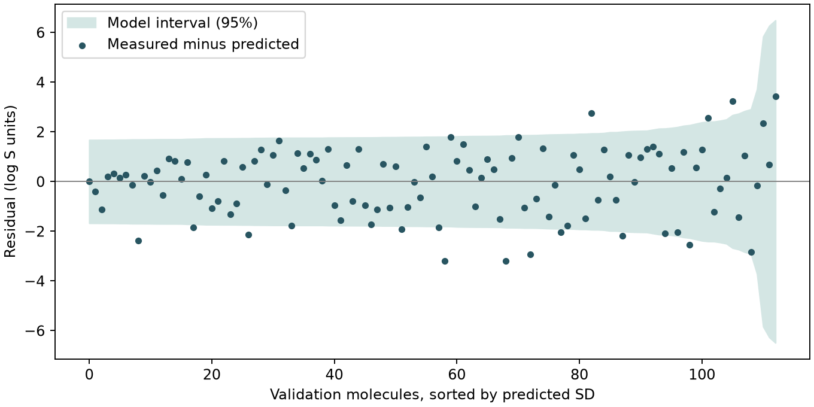

# 不確定性：模型有多少把握 {#sec-uncertainty}

## 模型估蔗糖的水溶解度是 −2.65 log S，我們可以拿這個數字直接決定配多少溶液嗎？ {#開場問題}

還不行，因為同一個模型也告訴我們它對這個數字很沒把握。本節用 32 筆 ESOL 資料擬合**高斯過程迴歸**（Gaussian process regression，GPR），蔗糖的預測平均值是 −2.646 log S，預測標準差卻高達 3.309 log S。也就是說，模型自己給出的可能範圍非常寬。

相比之下，另一個驗證分子的預測平均值也在 −2 左右，標準差只有 0.854 log S。所以要根據預測做實驗時，除了比較兩個平均值，也要看這些區間過去能包住多少個沒參與擬合的實測值。

## 核心概念

先把每個分子想成空間中的一個點。我們用 RDKit 算出親脂性 MolLogP、分子量和拓撲極性表面積 TPSA，這三個數字決定了分子在描述符空間裡的位置。高斯過程替一整群可能的「結構到溶解度」曲線指定機率分布；任選一組輸入點，對應的函數值會服從聯合常態分布。

兩個點的函數值會不會一起變動，由**核函數**（kernel）決定。本例用的是**徑向基底函數**（radial basis function，RBF）：在標準化後的空間裡，兩點距離愈近，模型就預設它們的函數值關係愈密切。這個常態假設放在函數值上，分子量、MolLogP 或 TPSA 本身的分布不必是常態。

訓練分子的量測值，會把不合理的曲線排除掉。如果候選分子附近有很多已量過的點，模型對它的估計通常比較集中；離所有已知結構都很遠時，手上的量測能提供的約束就少。不過，「附近」是由我們給模型看的那幾欄決定的。兩個結構就算取代位置不同，只要這三欄數值相近，模型也會把它們當成近鄰；換句話說，模型可能在自己熟悉的座標附近給出很窄的區間，卻錯過描述符沒有記下的結構差異。

另一個問題是：同一個分子再量一次，讀值會不會變？我們把看不到的平均關係記成 $f(x)$，一筆觀測寫成 $y=f(x)+\varepsilon$。本例的 `WhiteKernel` 讓每筆新觀測都帶有獨立、變異數相同的雜訊，所以 `predict(..., return_std=True)` 傳回的標準差包含兩部分：模型對函數還不夠了解的部分，以及模型估出來的觀測散布。後者就算在某一帶補了很多分子，也不會消失。

要提醒的是，這個雜訊量是從訓練資料估出來的，描述符漏掉的結構差異也可能被算進去。想知道儀器本身的重複性，還是要對同一個樣品做重複量測。

## 動手做

[下載本節 notebook](../../notebooks/ch12/12-03-uncertainty.ipynb){.btn .btn-sm .btn-outline-primary}　[在 Colab 開啟](ch12/12-03-uncertainty.ipynb)

用 DeepChem 讀入 ESOL，保留原本以 mol/L 為基準的常用對數溶解度（log S）。先依骨架切分資料，固定亂數種子 42，從訓練集裡不重複抽出 32 列。接著用這 32 列算出三個描述符的平均值與標準差，之後的驗證分子也用同一組尺度換算。剩下的訓練資料不加入這個小樣本模型，測試集也不參與這次的檢查。[@delaney2004esol; @wu2018moleculenet]

為什麼要換算尺度？舉例來說，如果把分子量改用 kg/mol 記錄，座標之間的距離就會因為單位而改變。先把每一欄換成「離訓練平均有幾個標準差」，所有分子就能用同一套距離規則比較。

核函數寫成 `ConstantKernel() * RBF() + WhiteKernel()`，三個部分各管一件事：前面的常數控制函數變動的幅度，RBF 的長度尺度決定要走多遠才算不相似，白雜訊項則估計觀測散布。`fit` 只用 32 筆訓練量測來估計這些參數。另外設了一個很小的 `alpha=1e-8` 加在訓練矩陣的對角線上，用來穩定數值運算。`normalize_y=True` 會在擬合時調整目標值的尺度，預測時 scikit-learn 再把平均值和標準差都換回原本的 log S 單位。

```python
mu, sd = gp.predict(X_valid, return_std=True)
y = valid.y.ravel()
error = np.abs(y-mu)
inside = error <= 1.96 * sd
```

這四行先讓模型對每個驗證分子給出平均值 `mu` 和標準差 `sd`，再算出實測值和預測平均的絕對差 `error`，最後逐筆判斷這個差有沒有落在 1.96 個標準差之內，結果存成真假值的陣列 `inside`。

| 驗證分子 | 預測平均值（log S） | 預測標準差（log S） | ESOL 實測（log S） |
|---|---:|---:|---:|
| 5,6,7,8-四氫-2-萘酚 | −2.003 | 0.854 | −1.990 |
| 蔗糖 | −2.646 | 3.309 | 0.790 |

表中這兩列，分別是驗證集裡預測標準差最小和最大的一筆，正好用來看清兩者的差別。第一列的預測和量測只差約 0.013 log S，但標準差 0.854 是揭曉答案之前模型給出的數字，不會因為這次猜得很接近就變成 0.013。第二列的平均值比實測低了約 3.436 log S，超過一個標準差，卻仍落在平均值加減 1.96 個標準差之內。

只看兩筆還說不準區間可不可信，要把整批結果攤開來看。

{#fig-gp-residual-band fig-alt="橫軸是按預測標準差排序的驗證分子，綠色色帶代表正負 1.96 個標準差，向右逐漸加寬。散點是殘差，有十五個散點落在色帶外。"}

@fig-gp-residual-band 的縱軸是「實測減預測」。點在零線上方，表示實際比預測更易溶；在下方，則是模型把水溶解度估得太高。每個點都有自己的色帶寬度。最右邊的蔗糖雖然落在帶內，但區間寬到很難拿來設定配製濃度；色帶較窄的地方，也有點落在外面。如果只問「有沒有猜中」，很容易把「區間很寬所以包住了結果」和「平均值很準」混為一談。

那麼整體表現如何？在單筆預測服從模型給定的常態分布、並把估出的核參數當作固定值的前提下，平均值加減 1.96 個標準差大約對應 95% 的預測區間。實際數一數這 113 筆驗證記錄，有 98 筆落在區間內，**涵蓋率**（coverage）約 86.7%，比名目上的 95% 低。

涵蓋率要和誤差、區間寬度一起看。整批的平均絕對誤差是 1.109 log S，回答的是「平均差多遠」。如果把所有區間都畫得更寬，涵蓋率可能會上升，預測平均值卻一點也沒變。所以報告模型時，涵蓋率、區間寬度和驗證分子的來源最好一起交代。如果想用另外保留的校準資料來決定區間寬度，可以接著讀 @sec-conformal-prediction。

表裡的數字還可以換回實驗室的單位來讀。以四氫萘酚為例，0.854 乘上 1.96，得到區間半寬約 1.67 log S。換回 mol/L 時，要對上下兩個端點分別取十的次方，1.67 本身不是可以直接加減的莫耳濃度。這樣算下來，即使是驗證集中標準差最小的這一筆，往任一側的濃度倍率也約有 47 倍。

這個範圍夠不夠用，要回頭看實驗要分辨的是十倍、百倍，還是更小的溶解度差異。如果只看 log S 圖最左端那條細細的色帶，很容易忽略這一點。

## 實驗上的考量

蔗糖的區間雖然包住了實測值，卻橫跨好幾個濃度數量級。如果要配製接近飽和的溶液，先查同一溫度下的量測來源，或是在可量測的濃度範圍內實際測一次。重複配製之間的變異也要另外記下來，之後才能拿來對照模型估出的雜訊是否合理。

## 重點整理

- 預測標準差會隨描述符、核函數和訓練點的位置而變，它描述的是模型的把握程度。
- 本例的白雜訊項讓預測區間包含新觀測的散布，但儀器誤差還是要靠重複量測來估。
- 113 筆驗證資料中有 98 筆落在名目 95% 區間內，同時還要看區間是否窄到足以支持實驗決定。

## 小練習

固定這個模型和驗證集，把區間改成預測平均值加減一個標準差，算出有幾筆量測落在裡面、占多少比例，並想一想平均絕對誤差會不會跟著改變。

提示：沿用 `error` 和 `sd` 來計數，分母仍然是全部的驗證分子。

## 延伸閱讀

[scikit-learn 的高斯過程迴歸](https://scikit-learn.org/stable/modules/gaussian_process.html) · [WhiteKernel 的觀測雜訊定義](https://scikit-learn.org/stable/modules/generated/sklearn.gaussian_process.kernels.WhiteKernel.html) · [Rasmussen 與 Williams 的高斯過程迴歸章節](https://gaussianprocess.org/gpml/chapters/RW2.pdf)
