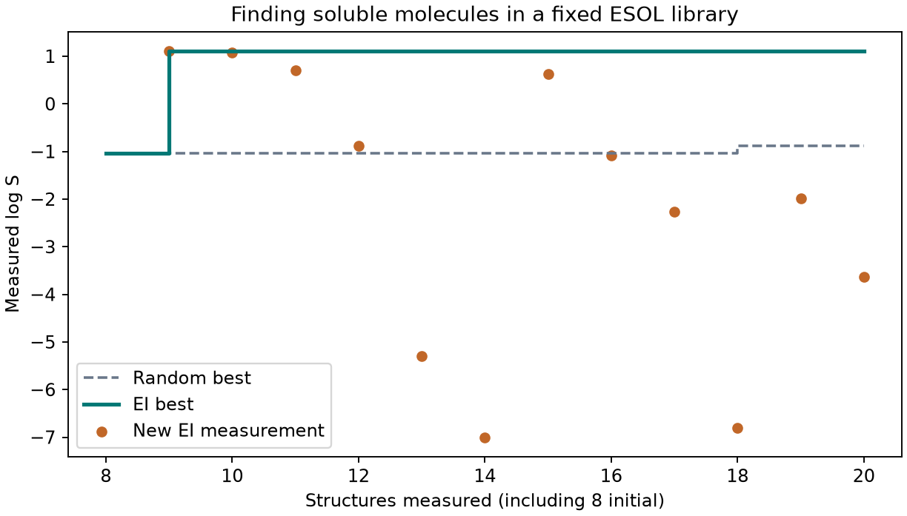

# 貝氏最適化：下一個實驗該做什麼 {#sec-bayesian-optimization}

## 已經量了八個分子的溶解度，第九個要挑誰？ {#開場問題}

挑「預期能改善最多」的那一個。如果目標是在二十個名額內找到最容易溶於水的分子，可以先替每個候選估兩件事：它有多少機會超過手上的紀錄，以及超過的話大概能好多少。把這兩件事合在一起，就能排出下一個該量的分子；等它的實測值回來，再替其餘候選重新排名。

這是**貝氏最適化**（Bayesian optimization）的一種做法。在這次的 ESOL 算例裡，前八個分子的最佳實測 log S 是 −1.04，第九個名額給了 N,N-二甲基乙醯胺。比起憑直覺一個一個試，這種做法讓每一次實驗都有一個寫得出來的理由。

## 核心概念

先把「好」寫成可以比較的量。本節的 S 是以 mol/L 表示的水溶解度，log S 是它的常用對數，所以 −1 比 −2 高，對應的莫耳溶解度是後者的十倍。要挑戰的紀錄，只取目前已經量過的分子。如果題目換成「雜質濃度愈低愈好」，可以先把目標乘上負一，再沿用同樣的最大化程式；如果是要把黏度調到某個範圍內，則要先定義偏離範圍的代價。

我們用高斯過程（Gaussian process，GP）當**代理模型**（surrogate model），也就是用來代替真實實驗、先猜猜看結果的模型。輸入由分子結構算出的描述符，模型替每個候選給出預測平均值 $\mu$ 和標準差 $\sigma$。

接著假設某個候選的 log S 服從這個預測分布，記為 $Y$，已量到的最高值記為 $b$。如果將來量到 $Y>b$，改善量就是 $Y-b$；如果量得更低，手上的舊紀錄還在，改善量算零。把這個量取平均，就得到**預期改善量**（expected improvement，EI），也就是 $E[\max(Y-b,0)]$，單位和目標相同。兩個候選即使預測平均一樣，只要分布寬度不同，EI 也會不同。[@jones1998ego]

像這樣把預測分布換成「下一步該挑誰」的分數，這類規則稱為**取樣函數**（acquisition function）。算完 EI，只要把候選名單依分數排序就好。EI 只考慮高於紀錄那一側的可能結果，模型實際偏差多少，還是要等實驗做完才知道。

有一點很容易被忽略：如果新分子量出來遠低於預期，紀錄雖然沒變，這筆低值仍然會改變高斯過程對附近結構的看法。所以下一輪要用新資料重新建模，只更新紀錄、沿用舊排名，就浪費了剛拿到的資訊。

## 動手做

[下載本節 notebook](../../notebooks/ch12/12-04-bayesian-optimization.ipynb){.btn .btn-sm .btn-outline-primary}　[在 Colab 開啟](ch12/12-04-bayesian-optimization.ipynb)

從 Delaney 的 ESOL 水溶解度資料開始。用 DeepChem 載入原始目標值，把正規 SMILES 相同的實測 log S 取平均，1,128 筆紀錄就對應到 1,117 個結構。[@delaney2004esol]

為了能在筆電上反覆練習，我們先用固定種子從這批結構抽出 128 個，當作「買得到的分子清單」，抽的時候不看溶解度。再用另一個種子抽八個當起點，其餘 120 個暫時只知道結構。每選定一個編號，程式才從資料表取回那個分子的實測值。也就是說，整段搜尋過程是用已有的量測資料「重播」一次實驗。

有了名單，就能替所有候選算出分子量、估計的 logP、拓撲極性表面積和可旋轉鍵數。分子量和鍵數的數值範圍差很多，所以先依名單中各欄的平均和標準差調整尺度，再用這四個座標之間的距離衡量分子有多相近。高斯過程每一輪都用同一個 Matérn 核，以已經揭曉的溶解度重新算平均和變異。所以第九次和第二十次選點雖然用的是同一種模型，得到的預測分布並不相同。

下面的函式一次替整份候選名單算出 EI。`norm.cdf(z)` 是標準常態分布的累積機率，`norm.pdf(z)` 是對應位置的機率密度。

```python
def expected_improvement(mu, sigma, best):
    gain = mu - best
    z = np.divide(gain, sigma, out=np.zeros_like(gain), where=sigma > 0)
    return np.where(sigma > 0, gain * norm.cdf(z) + sigma * norm.pdf(z),
                    np.maximum(gain, 0.0))
```

`gain` 是預測平均比紀錄高出多少，`z` 把它除以標準差。最後一行分兩種情況：標準差大於零時套用 EI 的公式；標準差等於零時，模型把所有機率都放在同一個預測值上，直接取預測平均超出紀錄的部分，沒超出就是零。這個邊界情況也可以用來檢查公式的方向有沒有寫反。

{#fig-bo-esol-path fig-alt="兩條紀錄從八個分子的 −1.04 出發。EI 在第九個升到 1.11 後持平，之後有幾個橘點低於 −5；隨機抽取到第十八個才略為上升。"}

先看 @fig-bo-esol-path 的第一個橘點。量之前，N,N-二甲基乙醯胺的預測平均是 −0.970，只比紀錄高 0.070 個 log S 單位；模型估計的標準差約 0.963，把各種可能的改善幅度都算進去，得到 EI 0.420。揭曉後，實測值是 1.110，這次真正的改善量是 2.150。這裡的 0.420 是選點的理由，儀器要量的溶解度是另一回事，兩者要分開記錄。

這筆溶解度在化學上代表什麼，也值得多看一眼。國際化學品安全卡把 N,N-二甲基乙醯胺列為可與水互溶；1.110 是 ESOL 給這個結構的紀錄，我們在這裡用它重播資料表的排名。如果要報告新樣品在特定條件下的飽和濃度，就要回到原始測定方法，確認對互溶液體採用了什麼定義。[N,N-二甲基乙醯胺國際化學品安全卡](https://chemicalsafety.ilo.org/dyn/icsc/showcard.display?p_card_id=0259&p_lang=en)

接著挑到的 2-吡咯烷酮，實測是 1.070，只比紀錄低 0.040，所以橘點和階梯幾乎疊在一起，階梯卻沒有再往上升。到了第十四個分子，實測 log S 低到 −7.000。回頭看那一輪的選點紀錄，模型給它的平均是 −2.366，標準差卻有 2.373，右尾仍有一小部分超過當時的紀錄。

從這裡可以看出，EI 只是在當時剩下的候選裡比高低，排第一不代表值得抱很大的期待。如果每做一次實驗要花一週，團隊可以事先訂好「達到多少溶解度就停」，不必為了把預算花完而繼續量。

同樣從八個分子開始，隨機抽樣在二十個名額用完時，找到的最佳 log S 是 −0.876。兩條線回答的是「各自帶回來最好的樣品是哪一個」，橘點回答的是「這一個名額量到了什麼」。如果專案要交付的是所有新分子的溶解度預測，就要另外保留一批不參與選點的結構來計算預測誤差，光看這張階梯圖還判斷不了 GP 的預測準不準。在 @sec-exploration-and-exploitation，我們會讓不同策略從多組起點出發，看看一開始就抽到好分子的影響有多大。

## 實驗上的考量

日本獅王的牙膏配方研究，從十筆已知資料出發：研究員試作模型提出的配方，量黏度和彈性模數，再把結果加進下一輪。他們報告在十六次試作後，找到了同時符合兩項目標的配方。這個例子的候選是各成分的用量組合，是否達標要看兩項實測物性；本節「愈大愈好」的單一分數要套用過去之前，得先把預定的質地定義清楚。[獅王研發案例與試作流程](https://www.lion.co.jp/ja/rd/digital/case-toothpaste-development/)

## 重點整理

- EI 以已量到的最佳值為基準，把超越紀錄的機率和幅度一起算進選點分數。
- 每揭曉一筆就重新建模，就算新分子沒有刷新紀錄，它的量測結果也要留下來。
- 比較搜尋成績時，兩種策略要從相同起點出發，起始的量測也要算進預算。

## 小練習

把總預算縮成十二個分子，沿用種子 42，算出兩種策略找到的最佳實測 log S 相差多少，並換算成莫耳溶解度差了幾倍。

提示：`campaign` 回傳的第一個物件記錄了初始值和各輪的最佳值；對數的差取十的次方，就能換回倍數。

## 延伸閱讀

[Jones 等人提出以預期改善量挑選下一次評估的位置](https://doi.org/10.1023/A:1008306431147) · [Delaney 的水溶解度資料與模型](https://doi.org/10.1021/ci034243x)
