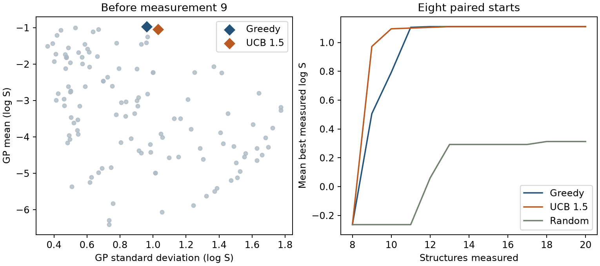

# 探索與利用的平衡 {#sec-exploration-and-exploitation}

## 兩個分子的預測溶解度只差一點，該先測較高的，還是較沒把握的？ {#開場問題}

兩種選法都說得通，關鍵是事先把取捨寫成規則。我們可以把「差一點」和「沒把握」都換成 log S 單位來比較。在 @sec-bayesian-optimization 的同一批候選中，模型對 N,N-二甲基乙醯胺的預測平均較高，對 2-吡咯烷酮的預測則稍微分散一些。

如果只照預測平均排名，第一個名額會給前者。如果願意為「多一點未知」花一次量測，就可以替預測較分散的候選加分；加得夠多，後者就會排到前面。等量測結果回來，再算這個決定花了幾個名額才拿到想要的樣品。

## 核心概念

照目前最有希望的預測去量，叫作**利用**（exploitation）。舉例來說，手邊已經有一個親水性不錯的小分子，模型也從同系列的量測學到了結構和溶解度的關係，這時去試模型看好的下一個成員，就有根據。

**探索**（exploration）則是願意把一些名額花在不熟悉的候選上。模型在這些地方可能估得太低，也可能估得太高。如果選點程式每次都只把最高平均值送進實驗室，其他地方就很少有機會用實測值修正原本的看法。實驗做久的人應該都有這種經驗：一直在熟悉的配方附近微調，很難碰到真正的突破。

一個方便調整兩者比重的規則是**信賴上界**（upper confidence bound，UCB）。我們用 $a(x)=\mu(x)+\kappa\sigma(x)$ 計分，挑分數最大的候選；$\mu$ 是高斯過程的預測平均，$\sigma$ 是它對未知函數值給的標準差。把權重 $\kappa$ 設成零，就是只看預測平均，稱為**貪婪選取**（greedy selection）；把它調高，標準差大的候選就會多拿一些加分。本節的 1.5 是實驗前就訂好的權重。至於最後選出的分子實際落在哪裡，要用沒參與選點的量測來檢驗。

UCB 和上一節的 EI 都在挑下一個分子，但比較的基準不同。EI 看的是預測分布有多少超過目前的紀錄，所以手上已經有一個特別好的樣品時，許多候選的 EI 都會變小。UCB 只問「平均加上探索加分有多高」，公式裡沒有扣掉紀錄。兩種分數都以 log S 為尺度，但 EI 等於 0.4 和 UCB 等於 0.4 意思不同。所以跨規則比較時，我們看的是各自選到的分子最後量到多少，而不是把兩種分數排在同一張表上。

## 動手做

[下載本節 notebook](../../notebooks/ch12/12-05-exploration-and-exploitation.ipynb){.btn .btn-sm .btn-outline-primary}　[在 Colab 開啟](ch12/12-05-exploration-and-exploitation.ipynb)

本節可以單獨執行。程式從 ESOL 的 1,117 個不重複結構，重新抽出和上一節相同的 128 個，保留分子量、估計的 logP、極性表面積和可旋轉鍵數四欄，沿用上一節的高斯過程。八個起始分子的實測溶解度先交給模型；其他候選的正規 SMILES 和描述符可以拿來排序，實測值則留在原始紀錄裡，等被選中才揭曉。[@delaney2004esol]

這樣安排的好處是，兩種策略從同一個起點出發時，第一次走岔只會是取樣規則造成的。走岔之後，兩邊學到的資料就可能不同了。

```python
seen = np.random.default_rng(42).choice(len(smiles), 8, replace=False)
left = np.setdiff1d(np.arange(len(smiles)), seen)
mu, sigma = fit_gp(seen).predict(X[left], return_std=True)
```

第一行用種子 42 從清單中抽出 8 個不重複的編號，當作已經量過的起點 `seen`；第二行把清單裡其餘的編號整理成 `left`；第三行用起點建好的模型，替 `left` 裡的每個候選算出預測平均 `mu` 和標準差 `sigma`。

讀這段程式時要特別注意索引。`mu` 和 `sigma` 對應的是剩下的 120 個候選，兩個陣列的第一筆都是 `left[0]` 指向的分子。找到最大分數的位置 `j` 之後，要用 `left[j]` 才能回到分子清單。如果直接把 `j` 當成分子編號，有時會取到已經量過的結構；就算剛好抽到新的，它的實測結果也和原本的選點理由對不上。

{#fig-ucb-esol fig-alt="左圖藍色菱形略高於橘色，橘色略靠右。右圖的藍橘兩條線早期有落差，到二十個名額時都達到 1.11；灰綠色隨機線在下方。"}

@fig-ucb-esol 的左圖完全沒有用到候選的實測值。點愈靠左，表示模型對它的估計愈集中；愈靠上，表示預測溶解度愈高。

想像在圖的上方放一把水平的尺，慢慢往下移，第一個碰到的點就是貪婪選取的結果。如果改用 UCB，分數相同的點滿足 $\mu=a-\kappa\sigma$，尺就要改成往右下方傾斜，愈靠右的點愈有機會先碰到尺。從這個畫法也看得出來，權重調高時，最右邊的點也要平均值跟得上才會勝出；如果它的平均值低很多，標準差的加分可能還是追不上。

在種子 42 的起點上，兩個菱形剛好很接近。藍點 N,N-二甲基乙醯胺的 $\mu=-0.970$、$\sigma=0.963$；橘點 2-吡咯烷酮的 $\mu=-1.041$、$\sigma=1.031$。兩者的標準差只差約 0.068 個 log S 單位，乘上 $\kappa=1.5$ 後能補回約 0.102，比兩者平均值相差的 0.071 還多，所以橘點超前。名單有上百筆時，這樣的推算只能解釋這兩個分子誰先誰後，全場誰最高分，還是要靠 notebook 替當輪每個候選都算一次。

揭曉紀錄後，兩個分子的實測 log S 分別是 1.110 和 1.070，都比模型當初預測的平均高了約兩個 log S 單位。所以這一回不管先量哪一個，都能刷新原本 −1.040 的紀錄。

可是只看這一個起點，很容易下太早的結論，不管是「選有把握的最好」還是「選沒把握的也行」。起始的八個分子是從清單抽出來的，如果一開始就抽到很容易溶於水的分子，後面能改善的空間自然比較小；如果兩種策略各抽各的起點，更難說清楚高出的紀錄有多少來自規則本身。

所以右圖改用八個預先列好的種子。每個種子都跑貪婪、UCB 和隨機抽取三條路徑，三者共用同一組起始八筆資料，每一輪只揭曉一個剩下的分子。計算時，先在每條路徑上取「截至該輪的最高**實測值**」，再把八個數字取平均。

這個順序很重要。如果把所有起點混在一起挑一個最高值，回答的就變成「八次嘗試中最幸運的那次做得如何」，其餘七次都沒算進來。從結果來看，算到二十個名額時，貪婪和 UCB 在每一組的最高實測值都是 1.110，隨機抽取的八組平均則是 0.313。如果專案在更早的輪次就得交樣品，就讀那個預算對應的縱座標，第二十個名額的結果要到那時才拿得到。

也可以翻開 notebook 印出的八個期末紀錄來看。隨機組裡，有的起點最後也找到了 1.110，有的到預算用完都還低於零。0.313 是八次的平均，清單裡不一定有哪個分子的溶解度剛好等於它；真要交樣品時，請回到那一次路徑的分子編號和原始紀錄。

## 實驗上的考量

這兩個候選都是小分子醯胺，但一個是開鏈的三級醯胺，另一個是帶 N–H 的環狀醯胺。四欄描述符把這些差異壓縮成幾個數字，GP 的標準差也就跟著取決於選了哪幾欄。如果要依兩者 0.040 的實測 log S 差距排優先順序，可以先在相同溫度和測定條件下複測，確認這個差距比重複量測的變動大。

## 重點整理

- 貪婪策略挑預測平均最大的候選；UCB 把標準差乘上權重、加回平均後再比較。
- 比較策略時，候選清單、初始量測、模型和預算都要固定，每組起點都要有成對的結果。
- 兩條搜尋路徑就算最後打平，中間的輪次也可能帶回不同的樣品。

## 小練習

沿用左圖的起點，把權重改成 0.5，找出哪個分子會拿到第九個名額，並和權重 1.5 時選出的分子比較。

提示：用同一組 `mu`、`sigma` 重新計分，再用 `left` 把最大值的位置對回 SMILES。

## 延伸閱讀

[scikit-learn 高斯過程迴歸的平均與標準差介面](https://scikit-learn.org/stable/modules/generated/sklearn.gaussian_process.GaussianProcessRegressor.html) · [Delaney 的 ESOL 研究](https://doi.org/10.1021/ci034243x)
