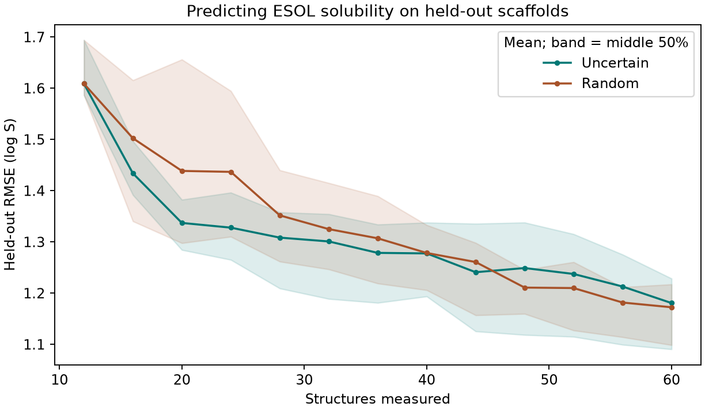

# 主動學習（Active Learning） {#sec-active-learning}

## 下一批只能量四個分子，怎麼挑才有助於預測其他分子？ {#開場問題}

一個可以檢驗的選法，是把名額留給模型目前最拿不準的結構。我們從十二個已知水溶解度的分子開始，每一輪再選四個，揭曉量測值後重新建模；另外留一批不同骨架的分子，從頭到尾不讓模型挑，專門用來檢查預測有沒有變準。

像這樣讓模型根據已經拿到的資料，主動決定接下來要量哪些分子，稱為**主動學習**（active learning）。在有限的預算下值不值得這樣挑，要看它比起同樣名額的隨機抽樣，能少掉多少預測誤差。

## 核心概念

在 @sec-bayesian-optimization，我們關心的是能不能帶回一個溶解度高的樣品。這一節要交付的東西換成了預測模型：下週拿到一批新結構時，希望能合理估計整批的溶解度。

這兩個任務對同一個分子的看法可能不同。舉例來說，一個非常疏水的候選，量了大概也刷新不了最高溶解度，卻可能補上訓練集裡很少出現的區域。就算量到的 log S 很低，只要這個數字讓其他分子的預測變準，這次量測就達到了目的。

本節用的是**不確定性抽樣**（uncertainty sampling）。高斯過程根據已量到的結構與性質，替每個候選給出平均和標準差，每一輪直接取標準差最大的四個。這個標準差會受描述符、核函數，以及目前量過哪些分子影響。如果兩個分子在我們選的描述符上很接近，模型可能很有把握，實際溶解度卻因為晶體或解離狀態而差很多。換句話說，「挑到模型最拿不準的地方」和「真的讓之後的預測進步最多」，要分開檢驗。

手上有完整資料時，很容易在試做之後才發現「第十輪成績最好」，再回頭宣布應該在第十輪停下來。為了讓比較有意義，我們事先固定總預算六十個分子、每輪四個，兩種規則都走完十二輪，再回頭用保留的資料計算各輪誤差。

計分用的是**均方根誤差**（root mean squared error，RMSE）：把每個測試分子的預測值和實測 log S 相減、平方，對全部測試分子取平均，再開平方根。分數愈低，表示在這批分子上的預測愈接近量測紀錄。因為先平方，很大的預測偏差會占比較重的分量。

## 動手做

[下載本節 notebook](../../notebooks/ch12/12-06-active-learning.ipynb){.btn .btn-sm .btn-outline-primary}　[在 Colab 開啟](ch12/12-06-active-learning.ipynb)

先整理 ESOL 的 1,128 筆水溶解度紀錄。同一個正規 SMILES 有多筆紀錄時，先在 log S 尺度上取平均，得到 1,117 個不重複的結構。這次不用前兩節的 128 個候選小清單，而是依分子骨架分組，把 893 個分子放進可以查詢的候選池，另外 224 個留作測試。程式會確認兩邊沒有共用的 Murcko 骨架。[@delaney2004esol; @bemis1996frameworks]

骨架不同的分子，還是可能有相同的官能基。所以這種切法考的是「預測一個沒參加選點的骨架」，兩邊的局部化學環境仍可能有重疊。

分好之後，分子量、估計的 logP、極性表面積和可旋轉鍵數的尺度，只用候選池的結構來決定；換算測試分子時，也沿用候選池的平均和標準差。訓練時只讀目前已選分子的實測 log S，每一輪用同一組核函數設定重新擬合。

模型在過程中可以先把測試分子的預測存起來，但不需要知道它們的實測值。等所有路徑都走完，評分程式才拿這些預測去和測試答案對照。這樣我們看得到中途的誤差怎麼變化，選點程式當時卻沒有機會拿這些誤差來調整下一批名單。

```python
left = np.setdiff1d(pool, seen)
if rule == "uncertain":
    _, sigma = model.predict(X[left], return_std=True)
    batch = left[np.argsort(-sigma, kind="stable")[:4]]
elif rule == "random":
    batch = rng.choice(left, 4, replace=False)
```

`left` 每次都從候選池 `pool` 扣掉已經揭曉的編號 `seen`。如果規則是不確定性抽樣，就先算出每個候選的標準差，`np.argsort(-sigma)` 把它們由大排到小，取前四個位置，再透過 `left` 對回分子編號；如果是隨機抽樣，就直接從 `left` 裡不重複地抽四個。

注意這裡是一口氣取四個，四個選擇用的是同一份模型，要等整批結果回來，下一輪的標準差才會更新。如果兩個很相似的候選同時排在前面，程式會兩個都選進來。改成每次只量一個、量完立刻更新的話，第二順位可能會換人，但實驗室就得等第一份結果出來，才能安排下一份樣品。

{#fig-active-esol-rmse fig-alt="兩種策略從相同的平均 RMSE 約 1.61 起步，二十個名額時不確定性抽樣較低，六十個名額時兩線相近且隨機抽樣略低，兩側陰影部分重疊。"}

@fig-active-esol-rmse 的橫軸從 12 開始，因為這十二個起始分子雖然是隨機選的，量它們一樣要花名額。兩種策略拿到同一組起始資料，第一個模型自然相同，八組起點的平均測試 RMSE 是 1.609 個 log S 單位。

到了二十個名額，不確定性抽樣的平均誤差是 1.337，隨機抽樣是 1.439，模型挑樣少了約 0.102 個 log S 單位。要記得 RMSE 是逐筆誤差平方後再算出的指標，這 0.102 說的是整批的表現，不能解讀成每個分子都預測得準了這麼多。

只看二十個名額，可能會以為兩條線的距離會愈拉愈大。但到了六十個名額，不確定性抽樣的平均 RMSE 是 1.181，隨機抽樣是 1.172，順序反過來了。也請注意，不確定性抽樣從四十四到四十八個名額時，平均誤差反而微微上升。

為什麼會這樣？每加入一批新資料，模型都會重新調整對測試分子的預測，有些點變準，有些點可能偏得更遠。這和上一節「至今找到的最高溶解度」那條階梯不同，這裡沒有前一輪的好成績可以自動保留下來。

陰影回答的又是另一個問題。每個種子用的是同一個骨架切分，但十二個起始分子不同，後面的抽樣路徑也跟著不同。帶狀區域畫的是這八條路徑中間的一半，測試集怎麼切所帶來的變動並沒有算在裡面。所以如果下週拿到的分子屬於另一個系列，這張圖還不足以估計那個系列的誤差範圍。想知道「這次新加的一批有沒有幫上忙」，可以先在同一個種子和預算下比較，再看其他種子是不是也往同一個方向變。

## 實驗上的考量

本例假設每批四個分子都能如期量完。實際排樣時，極難溶的分子可能只得到「低於偵測下限」的紀錄。這時要保留該批的樣品編號、測法、下限和無法定量的原因，記錄成「低於下限」而不是零；比較兩種策略時，也要把這次量測照實算進名額。如果可疑的結果需要重測，報告時要把獨立分子數和實際用掉的量測次數分開記。

## 重點整理

- 不確定性抽樣依目前模型給的標準差選點，成效要用保留下來的分子評分。
- 一批四個同時選，和一個一個選、逐次更新，可能得到不同的名單。
- 比較學習曲線時要對齊起點和預算，測試誤差只拿來評分。

## 小練習

在總預算六十個分子時，逐一比較同一起點下的兩種策略，數數看八個起點中有幾個是不確定性抽樣的測試 RMSE 比較低。

提示：`errors` 存著每種策略的二維陣列，每一列是一個種子，最後一欄是預算用完時的結果。

## 延伸閱讀

[DeepChem 的 MoleculeNet 資料介面](https://deepchem.readthedocs.io/en/latest/api_reference/moleculenet.html) · [Delaney 原始 ESOL 研究](https://doi.org/10.1021/ci034243x) · [scikit-learn 高斯過程迴歸文件](https://scikit-learn.org/stable/modules/generated/sklearn.gaussian_process.GaussianProcessRegressor.html)
