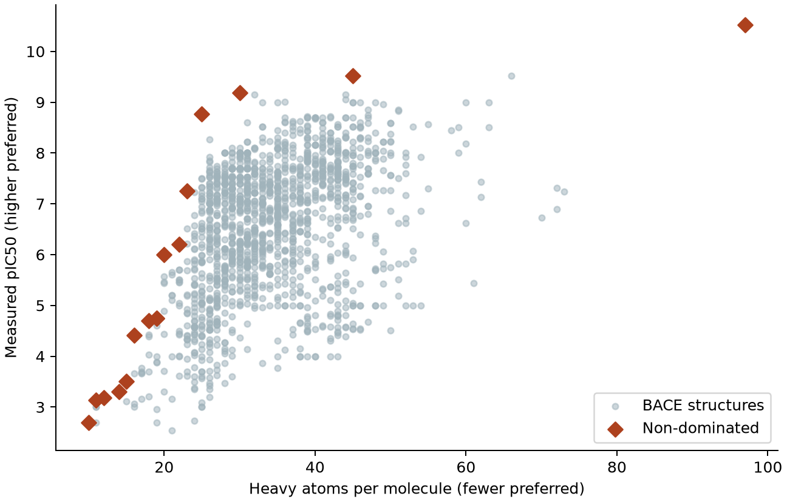

# 多目標最適化 {#sec-multiobjective-optimization}

## 想找抑制活性強、分子又小的候選物，該先留下哪幾個？ {#開場問題}

先留下那些「想再改善一項，就得犧牲另一項」的候選物。以 BACE-1 抑制劑為例，我們希望用較低的濃度就能達到一半的抑制效果，也希望分子的重原子愈少愈好。

資料裡有兩個化合物的抑制活性相同，一個有 45 個重原子，另一個有 66 個。只看這兩個目標，先留較小的那個很合理。可是活性最強的分子有 97 個重原子，它和 45 個重原子的那個各有勝場，兩個都值得留下。

## 核心概念

**多目標最適化**（multiobjective optimization）讓幾個目標各自保留原本的單位。本節的第一個目標是實測抑制活性，用 pIC50 表示：把半抑制濃度 IC50 換成 mol/L，再取負的常用對數。所以數字愈大，代表需要的濃度愈低。

第二個目標是 RDKit 從結構數出來的重原子數，也就是分子裡非氫原子的個數，我們拿它當分子大小的**代理指標**（proxy）。這個整數在量活性之前就能取得，但它不會告訴我們分子的空間形狀、合成步數或製備成本。如果實驗真正卡住的是原料價格，就要換成有報價依據的那一欄。

拿兩個分子 A、B 來比。如果 A 的 pIC50 不低於 B，重原子數也不多於 B，而且至少有一項嚴格勝出，我們就說 A **支配**（dominance）B。「至少一項」這個條件在實際資料上很重要：兩個結構若活性和重原子數完全相同，就是並列，誰也沒有支配誰。

在候選表裡逐列檢查，把所有沒被任何人支配的結構挑出來，每一個都叫做**非支配解**（non-dominated solution）。把這些解畫在同一張圖上，就得到這張表的 **Pareto 前緣**（Pareto front）。[@deb2002nsga]

前緣是相對於「有資格比較的名單」而定的。假設實驗室這一輪只測已經備料的分子，前緣的比較對象就是庫存清單。日後買進一個更小、活性又更強的新化合物，舊清單上的某個點就可能退到前緣後方。反過來，如果某一系列原料缺貨，要先從可用名單去掉整個系列，再重新計算前緣；只從舊前緣刪掉缺貨品，會漏掉原本只輸給這批缺貨品的候選物。也就是說，先決定哪些分子有資格比，再來談偏好。

## 動手做

[下載本節 notebook](../../notebooks/ch12/12-07-multiobjective-optimization.ipynb){.btn .btn-sm .btn-outline-primary}　[在 Colab 開啟](ch12/12-07-multiobjective-optimization.ipynb)

我們從 DeepChem 載入 BACE 迴歸資料集的 1,513 筆有標籤紀錄，保留原始 pIC50，不做標準化。RDKit 把每個結構轉成正規 SMILES，保留已指定的立體化學，再數出重原子數；照這個規則，1,513 筆仍然是 1,513 個結構。[@subramanian2016bace]

這一節要回答的是「已知清單裡誰支配誰」，所以可以直接用全部的實測結果，不需要訓練模型。如果手上是一批還沒量過的設計，在預測或實際量到活性之前，只能確定它們在橫軸上的位置。

```python
def dominated(row, pool):
    no_worse = (pool.heavy <= row.heavy) & (pool.pIC50 >= row.pIC50)
    better = (pool.heavy < row.heavy) | (pool.pIC50 > row.pIC50)
    return (no_worse & better).any()

front = table.loc[[not dominated(row, table) for row in table.itertuples()]]
```

函式 `dominated` 判斷某一列是否被名單裡的其他分子支配：`no_worse` 找出重原子不比它多、活性也不比它低的分子，`better` 要求至少有一項嚴格勝出，兩個條件同時成立的分子只要有一個，這一列就被支配了。最後一行逐列跑過整張表，把沒被支配的列留下來，就是前緣 `front`。

讀程式時可以拿 66 個重原子、pIC50 約 9.523 的那一列來試。第一個條件會找出所有不比它大、活性也不輸它的結構，包括它自己；第二個條件再把「自己和自己比」的情況排除。原表的 BACE_232 有 45 個重原子，和 66 個的 BACE_233 記錄了相同的 pIC50，所以 BACE_232 兩個條件都通過，BACE_233 就不會進前緣。

這個步驟要在原始數值上執行。如果先把 pIC50 四捨五入到小數一位，有些原本分得開的點會變得看起來一樣。

{#fig-bace-pareto fig-alt="灰點表示 1,513 個 BACE 分子；左上邊界以橙色菱形標出。兩個 19 重原子的分子在同一位置重疊，最右的前緣點有 97 個重原子，也是全圖最高點。"}

在 @fig-bace-pareto 的灰點中任挑一點，往左上方找，一定找得到一個橙點同時在兩項上不輸它；正上方和正左方也算。這次得到 16 個非支配結構，但圖上只有 15 個不同的橙色位置，因為有兩個分子都含 19 個重原子，原始 pIC50 也同為 4.744728，兩個都保留。如果要從並列的結構中挑一個來買，庫存量或交期就派得上用場，這個決定最好由實驗室來做，別讓程式依資料列的順序代勞。

沿著橙點往右看，從 25 個重原子的分子換到 30 個，pIC50 從 8.770 升到 9.187，多了 0.417，對應的 IC50 大約低了 2.6 倍。再從 30 個換到 45 個，多了 15 個重原子，pIC50 只多約 0.336。這是在表裡兩次更換候選物時看到的取捨。

這些點未必屬於同一個化學系列，所以兩點相減的結果，不能當成「加五個重原子會帶來多少活性」的設計規則。同樣地，圖上兩個橙點之間的空白處並沒有實測分子，也不要把那裡的位置當成已經達到的性質。

如果團隊已經決定了活性至少要多少，選擇就簡單多了。想像在圖上畫一條水平線，線以下的分子都不合格，接著只看線上和線上方的點，挑最左邊的那個。如果條件改成起始結構最多只能有 25 個重原子，就畫一條垂直線，在線左側和線上挑最高的點。這兩種做法都保留了原始單位，團隊可以回頭檢視門檻的依據。

也可以把兩項換算成一個加權分數來排序，但「一個重原子要扣多少 pIC50 才划算」得另外約定，而且換一套權重，第一名可能也跟著換。

下一輪如果要測清單以外的新分子，可以先把它的重原子數標在圖上，再看同樣大小或更小的分子目前最高達到多少活性。例如新結構也有 25 個重原子，要在這條垂直線上超過現有紀錄，實測 pIC50 就要高於約 8.770，這就給了實驗一個明確的比較數字。

當然，如果新結構有不同的骨架，活性稍低也可能值得留作下一輪修飾的起點。這時團隊在乎的是能不能開發另一個系列，這項考量不在原本畫圖的兩個目標裡，做決策時要在候選表另外寫下理由。

## 實驗上的考量

這批資料中的兩個 19 重原子候選物，連記錄下來的 pIC50 都一樣。要從中挑一個複測，可以先回查原始報告的濃度範圍、底物和實驗條件，並在同一批次放入對照抑制劑。相鄰前緣點之間如果只差一點點活性，而差距又和重複量測的變動差不多，可以一起留到下一輪比較。

## 重點整理

- 判斷支配關係時要確認每個目標的方向：兩項都不輸、至少一項更好才算支配。
- 非支配分子可以並列在同一個位置，先保留結構身分，再依實際條件挑選。
- 前緣只反映目前的候選物和目標，加上活性門檻或大小上限，就能縮成可執行的清單。

## 小練習

把活性下限從 pIC50 9.0 提高到 9.3，從全表分別找出達標的分子數和其中最小的重原子數，算算看較嚴格的門檻讓最小的合格分子多了幾個重原子。

提示：對原始 pIC50 用「大於或等於」篩選，保留所有合格的列，再對重原子欄取最小值。

## 延伸閱讀

[Subramanian 等人的 BACE-1 抑制劑資料與模型](https://doi.org/10.1021/acs.jcim.6b00290) · [Deb 等人用非支配排序做多目標搜尋的原始論文](https://doi.org/10.1109/4235.996017) · [RDKit 的分子物件與 GetNumHeavyAtoms](https://rdkit.org/docs/source/rdkit.Chem.rdchem.html#rdkit.Chem.rdchem.Mol.GetNumHeavyAtoms)
