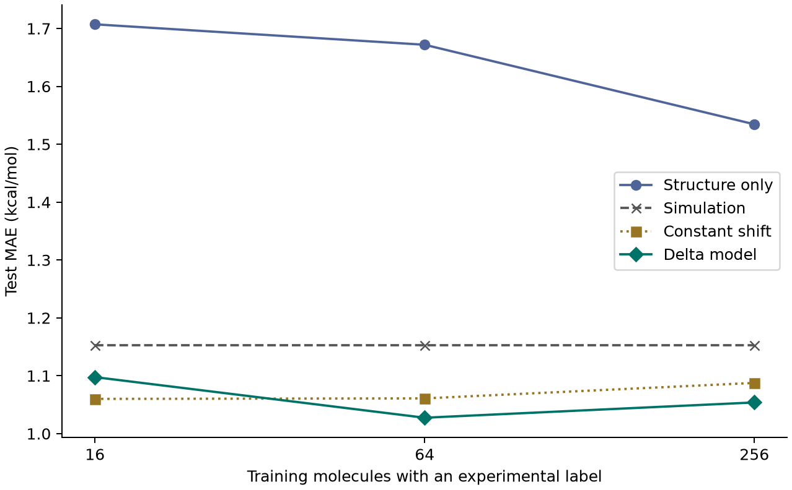

# 遷移學習的概念與用模擬資料補足（Sim2Real） {#sec-transfer-and-sim2real}

## 手上只有十幾筆實驗水合自由能，已經算過的模擬值可以怎麼用？ {#開場問題}

可以拿來當起點，再用實驗值學一個修正量。做法是把同一個分子的實驗值和模擬值配成一對，算出模擬差了多少，再用這些差值去修正其他分子的模擬結果。

以 FreeSolv 收錄的 4-甲氧基-N,N-二甲基苯甲醯胺為例，實驗水合自由能是 −11.01 kcal/mol，分子模擬得到 −9.625 kcal/mol，要把模擬值移到實驗值，修正量是 −1.385 kcal/mol。下一個分子是不是也該往下修這麼多？我們可以先用幾個已有量測的分子來估，再把另一批分子的實驗值留到最後，看看修正到底有沒有幫助。[@mobley2014freesolv]

## 核心概念

**遷移學習**（transfer learning）是把在一個來源任務學到的資訊，用到資料比較少、但和來源相關的目標任務上。舉例來說，先讓模型讀過大量分子的 SMILES，學會用一組數字表達分子結構，再拿少量有標籤的分子訓練物性預測器。如果原模型的參數不動，只把它的輸出當特徵，稱為**特徵擷取**（feature extraction）；如果讓其中幾層也跟著新任務更新，則是**微調**（fine-tuning）。想知道先前學到的東西有沒有用，可以另外訓練一個只用目標任務資料的模型，讓兩邊預測同一批新分子來比。

手上有物理模擬的時候，還有另一條路：從模擬走到實驗（simulation to reality，**Sim2Real**）。FreeSolv 的兩欄描述的都是中性小分子從氣相進入水相的自由能，單位也相同，差別在一欄來自實驗，另一欄是分子動力學模擬算出來的。

既然模擬已經替每個分子給了一個起點，我們就用有配對資料的分子，學習「實驗減模擬」的差值，預測時再把差值加回該分子的模擬值。這種學差值的做法稱為 **Δ 學習**（delta learning）。它沿用的是物理模型算出的數值，所以不需要有可以微調的神經網路參數。[@ramakrishnan2015delta]

在動用 Δ 學習之前，先問兩個更簡單的問題。第一，直接把模擬值當預測，準確度已經有多少？第二，如果模擬大致抓得到分子之間的差別，只是整批偏高或偏低，用同一個偏移量平移所有預測，能改善多少？原始模擬不需要任何實驗標籤，固定偏移只需要訓練分子的平均差值。依結構預測修正量要比這兩者更準，才值得替每個分子另外算一筆修正。

## 動手做

[下載本節 notebook](../../notebooks/ch12/12-08-transfer-and-sim2real.ipynb){.btn .btn-sm .btn-outline-primary}　[在 Colab 開啟](ch12/12-08-transfer-and-sim2real.ipynb)

從 DeepChem 的 `load_sampl()` 讀進 FreeSolv，共 642 個分子。載入器預設選的是實驗欄 `expt`，我們關掉它預設的標籤標準化，保留 kcal/mol 單位。模擬欄 `calc` 就在載入器下載的同一份原始 CSV 裡。

接著用 SMILES 把兩張表逐筆接起來，並確認每個 SMILES 只配到一筆模擬、實驗值也和原表完全一致。這一步很容易出錯：如果先依其中一欄排序，再把另一張表的數字照列貼過來，兩個看起來都合理的數字，可能其實屬於不同分子。配對正確，每個修正量的正負號才有意義。

依正規 SMILES 排序後，用固定種子 42 打散，保留 129 個完整的分子當測試。其餘 513 個作為量測候選池，分別取前 16、64、256 個，當作已經拿到實驗值的分子。換句話說，64 筆的設定包含了最先取得的 16 筆，三次評估用的也都是同一組測試分子。

公開資料其實已經全部測完了，我們只是暫時遮住大部分的標籤，重現預算有限時手上能用的資訊。測試分子的模擬值在預測時可以查，實驗值只在計分時才打開。

我們用 RDKit 把每個結構換成六項描述符：分子量、估計的 log P、拓撲極性表面積、氫鍵供體數、氫鍵受體數和可旋轉鍵數。直接預測實驗值和預測差值，用的都是同一種**嶺迴歸**（Ridge regression），每次只用當時訓練組的特徵估計平均和尺度。單純從結構預測實驗值的模型不讀模擬值。差值模型的訓練目標，以及把差值加回模擬值的順序如下，兩步的正負號要一致。

```python
residual = measured[train] - calc[train]
predictions = {
    "Structure only": fit_predict(train, measured[train]),
    "Simulation": calc[test],
    "Constant shift": calc[test] + residual.mean(),
    "Delta model": calc[test] + fit_predict(train, residual)}
```

第一行算出每個訓練分子「實驗減模擬」的差值。字典 `predictions` 裡放了四種預測：只用結構學實驗值、直接用模擬值、模擬值加上平均差值，以及模擬值加上依結構預測的差值。四種預測都針對同一批測試分子，方便放在一起比較。

{#fig-freesolv-sim2real fig-alt="比較 16、64、256 筆訓練資料。只用結構的模型誤差最高。16 筆時固定偏移的點最低，64 與 256 筆時依結構修正的菱形最低。"}

先看 @fig-freesolv-sim2real 中只有 16 筆訓練資料的情況。原始模擬的平均絕對誤差（MAE）是 1.153 kcal/mol。16 筆訓練資料的平均修正量是 −0.821 kcal/mol，把每一筆模擬都往負方向移這麼多，測試誤差就降到 1.060。如果改用六項描述符分別估計每個分子的修正量，誤差是 1.098。只從結構學實驗值的模型則是 1.707。

從這四個數字來看，兩種修正都比原始模擬好，而在資料這麼少的時候，只估一個平均偏移反而稍微準一些。想說明模擬資訊幫了多少忙，這四個數字要放在一起看。

等到有 64 筆量測資料，固定偏移的誤差是 1.061 kcal/mol，差值模型是 1.027，相差約 0.034。到了 256 筆，差值模型的誤差反而微升到 1.054。

圖上每個點都只來自這一組抽樣，連線只是方便追蹤同一種方法，所以從這張圖還看不出「第幾筆實驗開始改用差值模型一定划算」。如果要替新計畫估預算，可以在開發資料裡重抽幾次訓練組，比較同一預算下方法之間的差距和抽樣造成的變動。如果下一批換成一整個新系列的骨架，就要另外留出接近這種情境的分子來檢驗。

這個例子還有一項實際成本。差值模型遇到新分子時，需要先用同一套方法算出它的水合自由能，光有 SMILES 還給不出最後的預測。如果計算排程只能替十個候選物做模擬，這個模型能校正的就只有那十個。只用結構的模型這次誤差較高，卻可以直接用在還沒做模擬的分子上。安排下一批計算和實驗時，要先弄清楚每種預測在什麼階段才拿得到需要的輸入。

## 實驗上的考量

開場那個分子的模擬值比實驗值高了 1.385 kcal/mol（實驗值更負）。如果另一批分子也出現同方向的偏差，可以先回查實驗用的標準態、溫度和分子型態，再確認模擬的單位、力場和描述水的模型。如果兩批分子本來就是在不同條件下測的，把偏差全部歸給某個結構特徵，就會連實驗條件的差別一起算進去。

## 重點整理

- FreeSolv 的 `expt` 與 `calc` 來自不同來源，要先用結構配對，才能算出修正量。
- 把同一批測試分子留到最後，同時比較只用結構、原始模擬、固定偏移和依結構修正四種預測。
- 差值模型預測新分子時，仍然需要該分子的模擬值；模擬和實驗是兩項不同的成本。

## 小練習

用 64 筆訓練資料的差值模型預測同一批測試分子，數出有幾個分子的絕對誤差比原始模擬小，並比較修正前後絕對誤差的中位數。

提示：用同一順序的測試分子建立兩個絕對誤差陣列再逐筆比較；算中位數時要保留全部測試分子。

## 延伸閱讀

[FreeSolv 的實驗與計算水合自由能資料庫](https://doi.org/10.1007/s10822-014-9747-x) · [Ramakrishnan 等人的 Δ 機器學習研究](https://doi.org/10.1021/acs.jctc.5b00099) · [DeepChem 的 FreeSolv 載入器與欄位說明](https://deepchem.readthedocs.io/en/latest/api_reference/moleculenet.html#deepchem.molnet.load_sampl)
