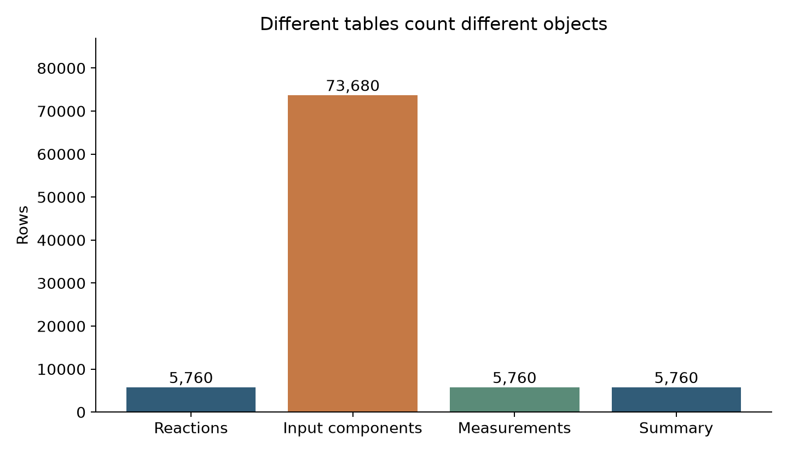

# 把實驗紀錄整理成可分析的表格 {#sec-data-silos}

## 一個反應拆成十三列，還能直接算平均產率嗎？ {#開場問題}

不能直接算，要先看這十三列各自代表什麼。如果每一列是一種投入物，同一個反應的產率就會重複出現十三次；直接取平均，組分比較多的反應就會被多算好幾次。本節用的資料共有 5,760 筆反應，展開成投入物之後卻有 73,680 列。兩個數字都沒錯，問題出在把投入物的列數當成了實驗次數。

## 核心概念

**研究資料管理**（research data management）要保存的不只是數字，還包括這個數字屬於哪一次實驗、用了哪些樣品，以及是怎麼量出來的。化合物的 SMILES 很適合表示結構，但兩次投料相同、日期不同的實驗，光看 SMILES 分不出來。所以實驗編號、樣品編號和化合物編號各有各的用途。

接手不同研究者的試算表時，第一個要問的是：「一列代表一次反應、一份樣品，還是一次量測？」確定了這件事，才能比較筆數、找出重複。

本節用的是 Perera 等人的 Suzuki–Miyaura 偶聯篩選：有機鹵化物和有機硼試劑反應形成碳–碳鍵，條件涉及配體、鹼和溶劑，結果則由分析儀器量得。我們讀取的是 Open Reaction Database（ORD）整理好的公開紀錄。ORD 把投入物、條件、結果和來源分開保存，本節再從中抽出三張表，全部 5,760 筆反應都保留，產率也維持來源記錄的原值。[@perera2018flow; @kearnes2021ord]

三張表靠 `reaction_id` 互相連結。反應表的一列是一筆反應紀錄，保存溫度、壓力和文獻；組分表的一列是某一股投入物裡的一個組分；量測表的一列是一個產品的一次量測。所謂「一股投入物」，可能是一瓶試劑溶液，裡面同時有溶質和溶劑，所以組分表還要保留 `stream` 和 `component_index` 兩欄。

本例剛好每筆反應只有一個產率量測。在其他資料集裡，同一次反應可能有好幾個取樣時間或分析方法，量測表就會有多列。[ORD 資料結構](https://docs.open-reaction-database.org/en/stable/schema.html)

| 表格 | 一列代表什麼 | 本例的識別方式 |
|---|---|---|
| 反應表 `reactions` | 一筆反應紀錄 | `reaction_id` |
| 組分表 `components` | 一股投入物中的一個組分 | 反應編號、投入物名稱、組分索引 |
| 量測表 `measurements` | 一個產品的一次量測 | 反應編號、結果、產品與量測索引 |

## 動手做

[下載本節 notebook](../../notebooks/ch13/13-01-data-silos.ipynb){.btn .btn-sm .btn-outline-primary}　[在 Colab 開啟](ch13/13-01-data-silos.ipynb)

Notebook 裡已經附上一份固定版本的資料，啟動時會先比對它的 SHA-256 雜湊值，確認檔案內容和發布時一模一樣，再讀成三張表。第一筆反應的 `reaction_id` 是 `ord-61b2819b15824f1fa131ed1b2ea1dae4`。它包含有機鹵化物、硼試劑、催化劑、配體、鹼，以及隨各股溶液帶入的溶劑和內標，展開後一共十三列組分。所以看到同一個反應編號重複出現，先確認這是預期中的一對多關係，再決定要不要去除重複。

下面把這筆反應放進三張範例表。為了好讀，完整的編號暫時簡寫成 `…dae4`，實際資料仍然用完整的 `reaction_id`。表中只列出部分欄位和組分，數字都來自同一筆來源紀錄。

**反應表：這次反應在什麼條件下進行？**

| 反應編號（簡寫） | 設定溫度（°C） | 設定壓力（bar） | 來源 DOI |
|---|---:|---:|---|
| `…dae4` | 100 | 100 | `10.1126/science.aap9112` |

這批資料的 5,760 筆反應都在同一組設定下進行：溫度 100 °C、壓力 100 bar。兩欄的數字剛好相同，單位卻不一樣，讀表時不要把它們看成同一個量。來源是加壓的連續流動反應器，所以壓力才會記成這個數量級。

**組分表：這次反應加入了什麼？** 以下節錄十三列中的三列。

| 反應編號（簡寫） | 投入股 `stream` | 組分索引 | 組分說明 | 來源記錄的用量 |
|---|---|---:|---|---|
| `…dae4` | `Aryl Halide` | 0 | 有機鹵化物，角色為反應物 | 0.4 μmol |
| `…dae4` | `Aryl Halide` | 1 | 同一投入股中的溶劑 | 1.0 μL |
| `…dae4` | `Catalyst in Solvent` | 0 | 含鈀組分，角色為催化劑 | 0.025 μmol |

前兩列來自同一股投入物，但是不同的組分；第三列屬於另一股，所以索引又從零開始。也就是說，要把反應編號、投入股名稱和組分索引三者一起看，才能確定指的是哪一列。上表為了方便閱讀，把數值和單位寫在一起；notebook 裡莫耳數和體積是分欄保存的，μmol 和 μL 不會混在同一個數值欄。

**量測表：這次反應得到什麼分析結果？**

| 反應編號（簡寫） | 結果／產品／量測索引 | 分析方法 | 分析產率（%） | 使用內標 |
|---|---|---|---:|---|
| `…dae4` | `0 / 0 / 0` | LCMS | 4.76 | 是 |

三張表裡的 `…dae4` 都指向同一次反應。4.76% 記在量測表上，是整個反應的結果，每個投入組分並沒有各自的產率。如果把量測值接到上面三列組分，4.76% 就會出現三次；接到完整的十三列，就會出現十三次，但實驗次數一次也沒有增加。這就是為什麼做統計之前，要先回到「每個反應一列」。

下面先算出每個反應有幾列組分，再接回反應表和量測表。

```python
per_reaction = components.groupby('reaction_id').size().rename('component_rows').reset_index()
summary = reactions.merge(per_reaction, on='reaction_id', validate='one_to_one')
summary = summary.merge(measurements[['reaction_id', 'yield_pct']], on='reaction_id', validate='one_to_one')
assert len(summary) == 5760
```

第一行依 `reaction_id` 分組，數出每個反應的組分列數；第二、三行把這個數字和產率依序接到反應表上；最後一行確認結果仍是 5,760 列。`validate="one_to_one"` 要求兩邊的連結鍵都是唯一的。如果之後量測表多了第二次量測，程式會在這裡停下來，提醒我們先決定要保留長表、只挑某一種方法，還是另外整理重複量測。

{#fig-reaction-tables fig-alt="四個長條分別代表反應表、投入物組分表、量測表與摘要表的列數；組分表為 73680，其餘三者為 5760。"}

@fig-reaction-tables 中的差距，來自資料層級的不同。如果直接把產率接到組分表，會得到 73,680 列，產率在裡面已經重複了。以這份資料來說，每個反應算一次的平均產率約 40.11%；在展開表上直接平均則約 40.23%。差距雖然不大，已經足以說明統計的對象變了。這個差距只是組分列數不同造成的加權，和實驗結果本身無關。

如果想問「含某種鹼的反應表現如何」，可以先從組分表找出符合條件的反應編號，再回到每個反應一列的表上計算。如果只篩出溶劑列再平均，含好幾種溶劑的反應就可能被重複計入。這類錯誤通常不會跳出警告，合併後的列數看起來也可能很合理，所以我們同時檢查識別碼、唯一性和每個反應的列數。

整理資料時，也要把「原始值」和「為了分析而取的名稱」分開。本例保留來源的 SMILES、角色和投入物名稱，不先把鹽拆開，也不把帶電形式中和。以鹼為例，氫氧化鈉的結構字串包含離子；如果為了讓表格看起來像一個分子而刪掉鈉離子，之後計算投入物組成就少了資訊。需要標準化的時候，另外建一個分析用的欄位，原始欄位和轉換規則都留著。

資料夾也可以照同樣的道理分工：來源檔保存下載當時的內容，整理程式負責轉換，輸出表格給分析使用。Notebook 每次重新執行，都由同一份固定的來源資料產生表格，讀者不需要手動修改任何儲存格。之後發現問題時，就回頭修改轉換規則、重新產生結果，不必猜哪一份試算表才是最新版。

實際研究中，同一批反應可能先做篩選，再挑部分條件放大、分離和定量。這些後續工作要有自己的實驗或量測編號，同時記下它和前一次篩選的關係。即使反應物相同，放大後的數字也要另起一列，原本的篩選結果繼續保留。本節的表格設計就是為了留住這種關係；至於不同尺度的結果能不能直接比較，還要看量測方法和反應條件。

另一種常見的誤判，是看到反應物、配體和鹼都相同，就把兩筆反應當成重複資料。它們可能來自不同批次、不同時間，或者本來就是刻意安排的重複實驗。反過來說，兩個不同的資料庫編號，也可能是同一個來源被收錄了兩次。所以判斷是否重複時，要查來源和實驗編號，光看結構欄位還不夠。這份教學資料確認過的是 ORD 編號彼此唯一，各筆反應在統計上是否獨立，則是另一個問題。

從這裡也可以看出，試算表本身並不是問題。只要每張表的對象明確、欄位定義一致，Excel 一樣能保存好紀錄。真正讓交接變困難的，是把單位寫在註解裡、用顏色標示實驗狀態，或靠儲存格的位置暗示樣品之間的關係，因為轉成 CSV 之後，這些資訊可能就消失了。整理時，先把它們轉成明確的欄位，再打開匯出的檔案看看內容是否都還在。

## 重點整理

- 先定義一列代表什麼，再決定識別碼和合併方式。
- 一對多展開之後重複出現的產率，要先回到每個反應一列，才能拿來平均。
- 保留來源欄位和轉換程式，讓分析結果能一路追回原始紀錄。

## 小練習

請從 `components` 建立一張每個反應一列的表，記錄「每次反應有幾列溶劑組分」，接回 `reactions` 後確認仍有 5,760 列，並說明這個數字為什麼和「不同溶劑的種類數」不一樣。

提示：先篩選 `role == "SOLVENT"`，再依 `reaction_id` 分組；同一種溶劑可能由不同的試劑溶液帶入。

## 延伸閱讀

[原始流動反應研究](https://doi.org/10.1126/science.aap9112) · [Open Reaction Database](https://doi.org/10.1021/jacs.1c09820) · [pandas 合併與關係驗證](https://pandas.pydata.org/docs/reference/api/pandas.DataFrame.merge.html)
