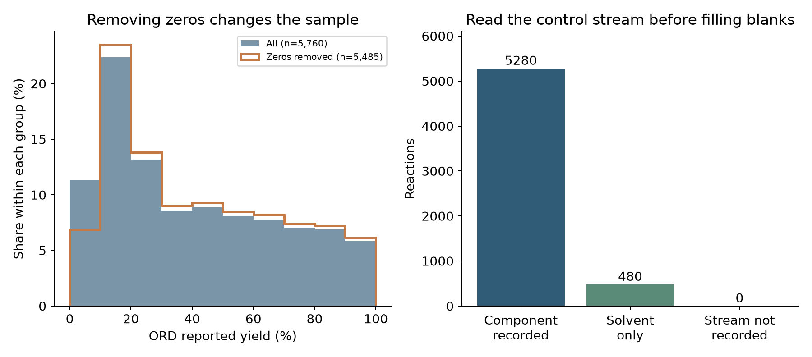

# 低產率、零值與缺值，該怎麼記錄？ {#sec-negative-results}

## 產率是零、配體用量空白，都能當成沒有做出產物嗎？ {#開場問題}

兩者要分開看。產率欄的零，是來源記下的一個結果；配體用量空白，則要回頭看當初是怎麼投料的。在本章的資料裡，有 480 筆反應的配體投入股只記錄了溶劑，對應的是篩選設計中的無配體對照。

如果把這些空白補成平均配體用量，等於替實驗加了一個當初沒有加的試劑；如果把零產率刪掉，留下來的條件就會看起來比實際更容易成功。

## 核心概念

**零值**、**缺值**和**不適用**描述的是三件不同的事。零值可能是經過量測、整理之後得到的結果；缺值表示目前沒有這項資訊；不適用則表示這個欄位對這筆紀錄沒有意義。舉例來說，「沒有外加配體」和「不知道有沒有外加配體」是兩種狀態：前者可以由明確的對照設計和投料紀錄支持，後者則要保留為未知，讓程式預設成零就錯了。

ORD 把「加入了什麼」和「量到了什麼」分開記錄。投入物紀錄列出每一股溶液裡的組分、角色和用量；結果紀錄保存產率和對應的分析方法。所以看到配體用量空白時，先看那一股溶液是不是只有溶劑，再確認它是否屬於無配體對照；看到產率為零時，則去看量測方法和結果說明。單看一個空白或一個零，這些情況是分不出來的。

本例的 ORD 版本中，共有 275 筆 `yield_pct` 為零。量測紀錄顯示分析方法是 LCMS，使用了內標並經過正規化，但沒有這些反應的操作異常紀錄，也沒有足夠資訊判定每個零是否低於某個偵測極限。因此本章把它們稱為「來源記錄的零值」。「沒有形成目標產物」「分析時沒看到訊號」和「實驗中途停止」各需要不同的證據，本章不替這些零選定其中一種解釋。[@perera2018flow]

保留低結果的價值，在於留下條件探索的完整範圍。如果只保留高產率的條件，讀者就看不到哪些配體、鹼或底物組合表現不好，模型也只會學到被挑過的結果。實驗室裡「失敗」的那幾次，往往正是下一輪最需要參考的資料。

當然，低值也不一定都是可靠資料。如果原始紀錄明確寫著漏加試劑或分析失常，紀錄仍然要保存，但要標出問題，再決定哪些分析可以用。這份資料沒有這類原因標籤，所以本節只討論記錄方式，不替它另外編一套失敗分類。

## 動手做

[下載本節 notebook](../../notebooks/ch13/13-02-negative-results.ipynb){.btn .btn-sm .btn-outline-primary}　[在 Colab 開啟](ch13/13-02-negative-results.ipynb)

程式先讀取全部 5,760 筆量測，確認這個版本沒有缺少產率的反應，再把來源零值和正值分開。這項檢查的結論只適用於這一份固定的資料；換了資料以後要重新檢查，讀檔時也要讓缺值維持缺值，別自動換成零。

```python
result_status = pd.Series(np.where(y.eq(0), 'reported_zero', 'reported_positive'), index=y.index)
kept = y[y > 0]
print('reported_zero', int(y.eq(0).sum()), 'positive', int(y.gt(0).sum()), 'missing', int(y.isna().sum()))
```

第一行替每筆反應貼上狀態標籤：產率等於零的標成 `reported_zero`，其餘標成 `reported_positive`。第二行另外取出產率大於零的子集 `kept`，等一下用來比較。第三行印出零值、正值和缺值各有幾筆。

{#fig-zero-and-missing fig-alt="左側直方圖比較全體 5760 筆與移除 275 筆零值後的分析產率分布；右側長條為配體組分有紀錄 5280 筆、僅溶劑 480 筆、投入股未記錄 0 筆。"}

@fig-zero-and-missing 左圖的兩組分母不同：全體是 5,760 筆，刪除零值後是 5,485 筆。第二組的高產率占比變高了，原因是分析者排除了一部分結果，反應本身並沒有變好。所以報告「平均產率」時，除了數字和單位，也要說明納入了哪些紀錄。以「產率大於零」當篩選規則的話，結論就只能描述篩選後的這個子集。

右圖則是從投料紀錄判斷配體的狀態。程式先看 `Ligand in Solvent` 這股投入物存不存在，連投入股都沒有的，標成 `not_recorded`。投入股存在時，再看裡面有沒有 `CATALYST` 角色的組分；這份資料用這個角色記錄配體，所以有組分就標成 `recorded_component`，只有溶劑就標成 `solvent_only`。角色名稱沿用來源的寫法，沒有自行改成化學上的「金屬催化劑」，仍然加入的溶劑也保留著。

這樣的判讀和原研究的無配體對照一致，但它是針對這份固定資料的規則。在其他資料裡，如果有人漏列了溶質，表面上也會只剩溶劑；要判斷這是刻意設計的對照還是整理時的遺漏，得有資料集說明或原始紀錄可以查。換用另一個資料集時，請重新確認一次。同樣地，來源裡字面上寫著 `None` 的字串，可能代表「沒有外加試劑」，意思和程式語言裡的空值不一樣。

你可能也想把「低產率」定義成小於 5%。這可以當作描述分布時的分析門檻，但要記得它是我們自己訂的，和本資料的偵測極限是兩回事。而且門檻附近的數字如果經過四捨五入，分類結果還可能隨資料版本改變。所以我們保留連續的原始值，把門檻明確寫在分析程式裡，來源結果本身則維持原樣，小於門檻的數字也不改成零。

原始補充表另外保留了 UV 面積百分比和質譜離子計數，這兩者是不同的量。整理資料時會發現，有些 UV 欄為零的列，離子計數卻是正的。這提醒我們，一個數字不足以替整次實驗下結論；訊號是不是來自目標產物、背景怎麼扣除、怎麼校正，都需要原始分析資訊。正式的 notebook 使用的是 ORD 的單一分析百分比版本，兩種訊號分開看待，也不替缺少的原始圖譜補造量測證據。

對於未來要建立的實驗表，比較實用的做法是把「實驗有沒有執行」「分析有沒有完成」「量測結果」和「異常說明」分成幾欄。如果真的因為設備故障而停止，就記下停止原因和已完成的步驟；如果只是還沒量，就標成未量測。這些是建議新增的欄位，這份資料本身還沒有。把不知道的事情說清楚，通常比替每筆結果猜一個原因更有助於之後的判讀。

記錄結果狀態時，也要把觀察和解釋分開。「取樣時看見沉澱」是觀察；「催化劑失活所以產率低」則是對原因的解釋。兩者都可以保存，但要放在不同欄位，並記下觀察的時間和解釋的依據。如果只留一個「失敗」標籤，後來的人既不知道實際發生了什麼，也沒辦法檢查當時的推論。同樣是低產率，可能需要完全不同的補測才能釐清。

保留低結果，也不表示每次分析都要用上全部的資料。團隊可以分成兩層：「原始紀錄全部保留」和「這次分析納入哪些紀錄」，排除規則則另外保存。例如只分析已完成指定量測的反應時，要交代排除了幾筆、原因是什麼；被排除的紀錄仍然留在原始檔裡。將來如果修正了分析資料或補做量測，還能沿著反應編號找回原紀錄，不必把它當成一個沒有歷史的新實驗。

## 重點整理

- 零值、未記錄和未加入試劑是三種不同的狀態，要分開記錄。
- 刪除低結果會改變分析對象，原值要保留，篩選規則要寫清楚。
- 低產率的原因要有異常紀錄才能判斷，資料沒寫的就保留為未知。

## 小練習

同事提議只保留 `yield_pct >= 5` 的反應，再把剩下的平均值稱為「本次篩選的平均產率」，請算出保留筆數和平均值、和全體反應比較，並改寫這句結論，讓讀者知道分母和篩選條件。

提示：使用 `y.ge(5)`；5% 是題目指定的分析門檻，來源資料並沒有提供這個偵測極限。

## 延伸閱讀

[Perera 等人的原始研究](https://doi.org/10.1126/science.aap9112) · [ORD 的投入物、結果與分析欄位](https://docs.open-reaction-database.org/en/stable/schema.html)
