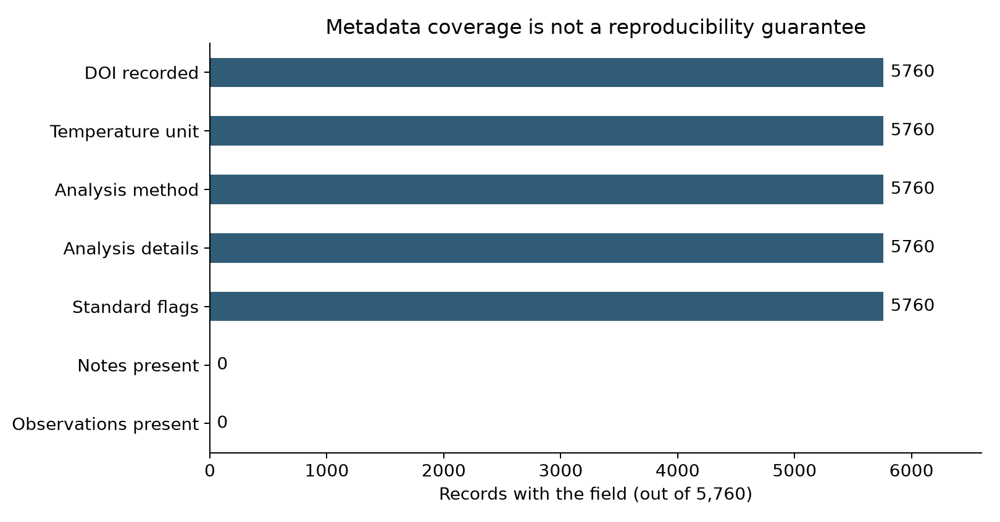

# 讓實驗資料能被理解與重用 {#sec-metadata-and-fair}

## 收到一欄叫 yield 的數字，就能接著分析嗎？ {#開場問題}

還不夠，至少要先知道它是百分比還是小數、是分析產率還是分離產率，以及對應哪一次反應。本例的產率欄來自 ORD 的百分比量測，紀錄裡另外寫著 LCMS 分析、使用內標和經過正規化等資訊。如果交接時只留下數字，即使表格一格空白都沒有，接手的人還是可能把它讀成完全不同的實驗結果。

## 核心概念

**後設資料**（metadata）是讓資料能被讀懂的說明，包括量測的對象、單位、分析方法、來源和處理紀錄。舉例來說，同樣寫著 50，可能是 UV 訊號占比、經過校正換算的產率，也可能是純化後的分離產率。欄名回答不了這些問題，要沿著量測紀錄找到方法才知道。

本例的 `analysis_key` 連到同一個結果裡的分析說明；`uses_internal_standard`、`uses_authentic_standard` 和 `is_normalized` 各自記錄一件事，三欄要分開保留，別因為看到「有用標準品」就把它們合成一欄。

**FAIR 原則**（FAIR principles）把資料再利用分成四個面向：可查找（Findable）、可存取（Accessible）、可互通（Interoperable）和可重用（Reusable）。放到這份反應資料上，就是讓識別碼找得到紀錄、交代資料怎麼取得、用明確的欄位和單位，並保留來源、授權和足夠的實驗背景。

要注意的是，FAIR 並不要求把所有檔案無條件公開。存取規則可以包含授權和身分驗證，重點是規則要寫清楚，讓使用者知道怎麼拿到需要的資料。[@wilkinson2016fair]

資料字典和版本紀錄，則讓這些原則落實到日常工作。**資料字典**（data dictionary）說明每個欄位代表什麼、單位在哪一欄、空白該怎麼解讀；版本紀錄說明這份表從哪個來源、經過哪些轉換而來。本章固定使用 ORD 的某一個歷史版本（以 commit 編號標記），並記下來源檔和本章抽取出的教學資料檔各自的 SHA-256。

SHA-256 可以想成檔案的「指紋」：內容只要改了一個字，算出來的值就會不同。它能確認兩份檔案的內容是否完全相同，至於量測本身對不對、操作紀錄有沒有缺，就要靠其他資訊來判斷。[@kearnes2021ord]

## 動手做

[下載本節 notebook](../../notebooks/ch13/13-03-metadata-and-fair.ipynb){.btn .btn-sm .btn-outline-primary}　[在 Colab 開啟](ch13/13-03-metadata-and-fair.ipynb)

Notebook 先從同一份固定版本的資料整理出三張表，再檢查 DOI、溫度單位、分析方法、分析說明和標準品相關欄位有沒有內容，也看看原始紀錄裡有沒有備註和觀察。最後它會產生 `ch13-data-package.zip`，把表格、資料字典、來源清單和資料授權打包在一起；你可以從 notebook 的連結或 Colab 的檔案面板下載。

```python
manifest['files'] = {
    p.name: hashlib.sha256(p.read_bytes()).hexdigest()
    for p in sorted(export.iterdir())
    if p.is_file() and p.name != 'manifest.json'
}
```

這段程式依檔名順序走過輸出資料夾 `export` 裡的每個檔案，讀出內容、算出 SHA-256，存進 `manifest` 的 `files` 欄位，形成「檔名對應指紋」的清單。重新打開資料包時，用同樣的方法再算一次、和清單比對，就能避免分析途中誤用了另一份 CSV。

來源檔和教學資料檔的內容不同，所以兩者的指紋分開保存。清單檔 `manifest.json` 本身則不算指紋，因為它的內容會隨著寫入指紋而改變，算了也對不上。

{#fig-metadata-coverage fig-alt="水平長條顯示 DOI、溫度單位、分析方法、分析說明與標準品旗標皆有 5760 筆；備註及觀察為 0 筆。"}

@fig-metadata-coverage 的前五項都有內容，但這只說明欄位有填，我們並沒有因此掌握全部的實驗資訊。舉例來說，分析說明欄有文字，原始色譜圖、積分結果和偵測極限卻不在資料裡。備註欄的零也一樣，應該讀成「這份來源沒有記錄」，實驗當時有沒有發生異常，從這裡看不出來。換句話說，這張完整性報告呈現的是資料涵蓋的範圍，替實驗品質評分是另一件事。

本例的量測中，`uses_internal_standard=True`、`is_normalized=True` 和 `uses_authentic_standard=False` 都原樣保留。最後一項是明確記錄「沒有使用真品標準品」，和空值的意思不同，也和前一項「有使用內標」並不衝突。這些欄位提供了方法的線索，但還不足以讓我們重新推導出完整的校正流程。寫報告時，就照來源實際提供的資訊描述，別把「有方法欄位」寫成「所有結果都經過同樣程度的定量驗證」。

為了避免輸出 CSV 時把空白、零和布林值搞混，程式把來源沒提供的欄位寫成 `__MISSING__`，並在資料字典裡說明。重新讀取時，關掉 pandas 預設的空值判定，再明確指定這個標記。這樣一來，如果來源裡真的有某個文字標籤叫做 `None`，也不會因為讀檔的預設值而消失；數值零仍然是零，布林值 `False` 也保有自己的意思。

資料包裡的三張表共有 32 個欄位定義。字典除了列出資料型態和單位，也說明了組分索引從零開始算、角色名稱沿用來源、體積是否包含溶質等細節。`volume_includes_solutes` 沒填的地方，我們保留為未知，不當成明確的 `False`。這類細節在資料量小時看起來只是多寫幾行說明，等到要跨來源合併時，就能避免把意義不同的量直接相加。

資料授權也要跟著資料包走。本章的教學資料取自 ORD 以 CC BY-SA 4.0 授權的資料，我們保留了來源和授權資訊，並說明刪去了提交者的聯絡欄位、保留全部反應、沒有填補產率。這些內容和本書自己寫的程式分開標示，讓接手的人分得清楚哪些是來源提供的實驗內容、哪些是我們的轉換與分析規則。

如果團隊已經有電子實驗簿或內部資料庫，不必為了這一節另外建一套系統。可以先挑一份最常被重複使用的表，補上識別碼、欄位字典和來源版本，再確認重新讀取之後，筆數、零值和缺值都沒有改變。這些檢查取代不了實驗上的判讀，但能先讓交接過程中遺失的資訊浮上檯面。

交接前，也可以做一次小演練：請一位沒有參與整理的人，只拿資料包回答「第一筆反應在什麼條件下進行、產率怎麼定義、用的是哪個來源版本」。如果他得回頭問作者才看得懂，缺的資訊就應該補進資料字典或說明文件。這比只確認每個欄位都有名字更貼近實際的再利用需求，也能找出團隊早就習慣、外人卻看不懂的縮寫。

資料更新時，要留下新舊版本和變更的理由。改一個欄位名稱、換一個單位、排除一筆結果，對分析的影響都不一樣。如果整張表直接覆寫，之後就算拿到相同的程式，也不一定能重現先前的圖表。本例把來源固定下來，就是要讓讀者先練習確認同一份內容；之後改用新版時，請重新產生完整性報告和圖表，筆數相同也要重新檢查一次內容。

## 重點整理

- 單位、方法和來源要和量測值一起交付，光靠欄名說不清楚。
- 欄位有填和實驗可以重現是兩回事；備註欄空白，只代表來源沒有記錄。
- 資料字典、版本、檔案指紋和授權，讓接手的人知道資料怎麼來、怎麼處理過。

## 小練習

請下載並解壓縮本節產生的資料包，依 `manifest.json` 比對 `measurements.csv` 的 SHA-256，再讀回產率欄確認筆數和零值筆數，最後說明這些檢查能證明什麼、還有哪些事情證明不了。

提示：用 `hashlib.sha256` 計算檔案內容；讀 CSV 時明確指定 `__MISSING__`。雜湊值一致，說的是檔案內容沒變。

## 延伸閱讀

[FAIR 原始論文](https://doi.org/10.1038/sdata.2016.18) · [ORD 資料格式與來源紀錄](https://docs.open-reaction-database.org/en/stable/schema.html) · [pandas 的 CSV 讀取選項](https://pandas.pydata.org/docs/reference/api/pandas.read_csv.html)
