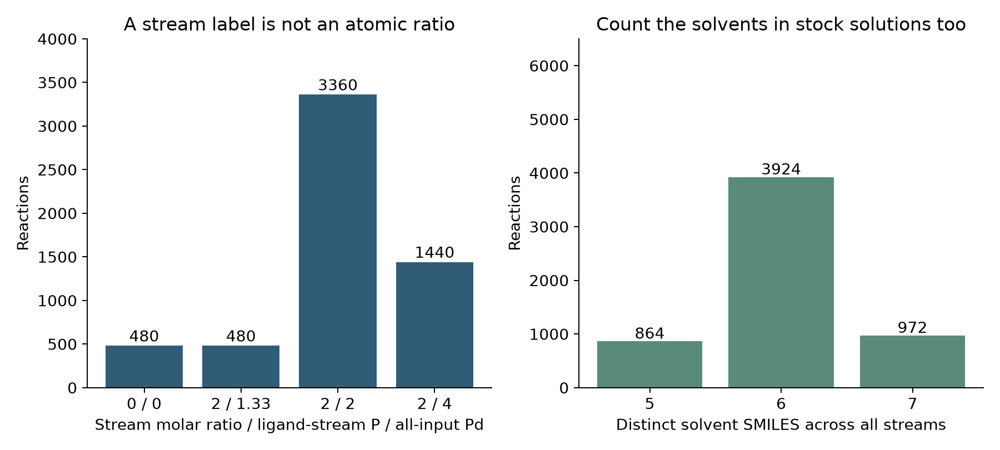

# 把化學判斷寫成可檢查的欄位 {#sec-expert-knowledge}

## 表格寫著配體與催化劑比為二，就代表磷／鈀比為二嗎？ {#開場問題}

不一定。來源可能把一整個含金屬的配合物放在「配體溶液」那一欄，也可能用的是含兩個磷原子的配體。所以同樣是 0.05 μmol 的投入組分，帶進來的磷原子數不一定相同。我們要先把來源中的莫耳比算對，再看結構裡的磷和鈀，才能說清楚自己建立的是哪一種欄位。

## 核心概念

把化學判斷轉成特徵，第一步是寫出**操作定義**（operational definition）。例如「配體比較多」，是相對於多少鈀？以配體分子計，還是以磷原子計？「含水溶劑」只看主溶劑，還是連試劑溶液帶進來的水也算？沒有定義的話，兩個人就算用同一個欄名，也可能算出不同的結果。本節沿用 @sec-data-silos 的原始組分表，另外產生分析用的欄位，讓每個值都能追回結構和用量。

這份 ORD 資料用 `CATALYST` 角色記錄金屬來源，也用同一個角色記錄配體投入股裡的組分。所以篩出所有 `CATALYST` 得到的是兩者的混合，要得到「鈀催化劑清單」還得再區分。我們保留投入股的名稱，再用 RDKit 讀取裡面完整的 SMILES，數出每個化學式單位有幾個 P 和 Pd。離子、配位片段和金屬都先保留，因為它們正是原子計量要算的內容。[@kearnes2021ord]

要提醒的是，**投入原子比**描述的是投料，活性物種的結構要另外找證據。從投料算出的 P／Pd，說不出反應中實際形成了哪種配合物、配位數是多少，或者哪些組分已經分解。同樣地，某個條件和較高的產率一起出現，也不足以證明是它讓產率上升。把經驗寫成欄位，是為了讓假設可以被檢驗；要談機理或因果，還需要適當的對照和額外的量測。

## 動手做

[下載本節 notebook](../../notebooks/ch13/13-04-expert-knowledge.ipynb){.btn .btn-sm .btn-outline-primary}　[在 Colab 開啟](ch13/13-04-expert-knowledge.ipynb)

程式先讀取 42 個不同的投入物 SMILES，確認 RDKit 全部都能解析。接著對每個非溶劑組分，確認莫耳數的單位是 `MICROMOLE`，再算出它帶入多少 μmol 的磷和鈀。

```python
p_atoms = sum(atom.GetSymbol() == 'P' for atom in mol.GetAtoms())
p_total += a['value'] * p_atoms
if stream == 'Ligand in Solvent':
    ligand_p += a['value'] * p_atoms
```

第一行逐一看分子裡的每個原子，數出有幾個是磷。第二行把「這個組分的莫耳數 × 磷原子數」累加到全部投入的磷 `p_total`。最後兩行只在組分屬於配體投入股時，才把同樣的數量另外加到 `ligand_p`，所以鹼裡的磷酸根不會被算成配體的磷。

這個範圍限制很重要。資料中有磷酸鹽被當作鹼使用，如果把所有投入物的 P 全部加起來，再稱為「配體磷／鈀比」，就把不同化學用途的磷混在一起了。Notebook 另外保留了全部投入磷的計量，方便對照；圖中用的是配體投入股的磷莫耳數，除以所有非溶劑投入物的鈀莫耳數。欄名 `ligand_P_to_input_Pd` 也直接寫出了這個範圍。

{#fig-chemical-features fig-alt="左側以投入股莫耳比與磷鈀原子比的組合分組，右側顯示含 5、6、7 種不同溶劑 SMILES 的反應筆數，分別為 864、3924、972。"}

@fig-chemical-features 左圖中，來源的組分比只有零和二兩種，原子比卻不只兩種。以第一筆反應為例，配體組分是 0.05 μmol，含一個 P；催化劑投入股含 0.025 μmol 的鈀來源，帶入一個 Pd，所以兩種比值都是二。如果配體分子含兩個 P，同樣的分子用量就會得到四。這純粹是化學式和投料的換算，不涉及任何量測結果的預測。

資料裡還有另一種配體股組分，它的來源 SMILES 同時含兩個含磷片段和一個鈀。照來源的紀錄，0.05 μmol 的這個組分帶入 0.10 μmol 的 P 和 0.05 μmol 的 Pd，再加上另一股的 0.025 μmol Pd，原子比就是 0.10／0.075，約 1.33。

這裡的計算照來源的寫法進行，沒有重新定義試劑的名稱或化學形式。如果研究者懷疑來源的表示方式有問題，應該回頭查文獻或實驗紀錄；直接刪掉多出來的 Pd、讓比值符合預期，就把原始資訊改掉了。

右圖說明溶劑欄位為什麼要讀完整。除了主溶劑，各股試劑溶液還會帶入其他溶劑。程式替每個反應收集所有 `SOLVENT` 角色的 SMILES，再去掉相同的字串，所以同一種溶劑由兩股加入，也只算一種。本資料得到的是五、六或七種。這是來源紀錄裡不同溶劑結構的數目；以濃度加權的混合物描述符、或實際量到的相數，都是另外的資訊。

如果要再進一步算含水比例或反應濃度，把所有體積欄位相加並不等於精確的最終體積。來源中有些體積明確註明包含溶質，有些沒有說明；混合方式和流動反應的取樣方式，也會影響體積的定義。所以本節保留各股的用量，先做現有紀錄能清楚算出的莫耳比和種類計數，濃度則等資料足夠時再推算。

另一項檢查，是看欄位到底有沒有變化。本資料的溫度全部是 100 °C，反應時間也固定。這些條件對重現實驗很重要，但想比較升溫或延長時間的效果，這批資料幫不上忙。Notebook 保留了溫度，並檢查它有幾個不同的值；就算常數欄位對某個模型沒有用處，也不從來源紀錄中刪掉。

最後，分析用的輸入和量測標籤要分開輸出。投入物、用量和設定條件，是實驗結果出來之前就拿得到的資訊；產率則是這次要解釋的結果。如果先用產率標出「反應良好」，再把這個標籤當成預測產率的特徵，模型就等於提前看到了答案，這就是前面章節提過的資料洩漏（data leakage）。實驗後才觀察到的沉澱或顏色變化，也要依「預測時拿不拿得到」來判斷能不能用。本節的資料沒有這類觀察欄位，我們也不憑猜測把它們補上。

欄位建好之後，最好挑幾筆具體的紀錄手算一次，光看程式跑完還不夠。本節第一筆反應的配體股和催化劑股用量可以直接換算；含兩個磷的配體和含鈀的組分，則提供了另外兩種情況。這幾個對照能確認規則真的是依結構計算，而不是假設每個配體都只有一個磷。如果某一筆缺少莫耳數，就保留為未知，並標出無法換算，別拿其他反應的平均值湊出一個原子比。

特徵表也要保留反應編號，這樣研究者看到一個異常的比值時，才能回到原始組分去查，而不是只面對一串匿名的數字。Notebook 輸出的 `reaction-features.csv` 和 `reaction-labels.csv` 都保留了這個鍵；之後即使挑選子集或改變排序，也能用編號確認，避免把某一筆的條件配到另一筆的產率上。

換句話說，欄位看得懂和資料追得回去是同一件工作的兩面。計算結果不符合化學直覺時，先回頭看原始投料和定義，再決定該修正的是程式、資料，還是自己的假設。

## 重點整理

- 建立欄位前，先寫清楚計算的對象和範圍，再用結構和用量確認。
- 投入股名稱、分子莫耳比和原子比各說各的事，原子比也只描述投料，不能當作機理證據。
- 保留重現實驗需要的常數條件，並把實驗前的輸入和實驗後的結果分開。

## 小練習

請找出 `stream_molar_ratio` 為二、但 `ligand_P_to_input_Pd` 約為 1.33 的反應，挑一筆列出配體股和催化劑股的非溶劑組分、SMILES 與 μmol 用量，用原子數驗算這個比值，並說明為什麼它不能直接稱為「活性催化劑的配位數」。

提示：比較浮點數可以用 `np.isclose`；分母要算進所有投入物的 Pd，只看 `Catalyst in Solvent` 會少算。

## 延伸閱讀

[ORD 的投入物與組分](https://docs.open-reaction-database.org/en/stable/schema.html#inputs) · [RDKit 分子與原子 API](https://www.rdkit.org/docs/source/rdkit.Chem.rdchem.html) · [原始反應研究](https://doi.org/10.1126/science.aap9112)
