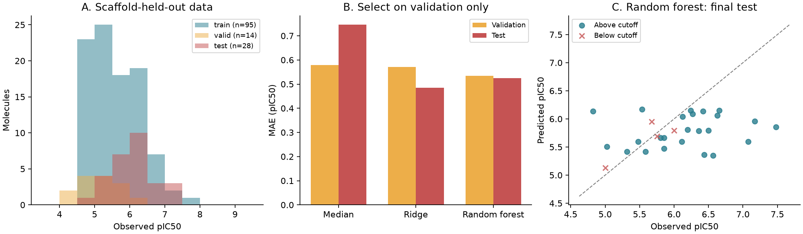
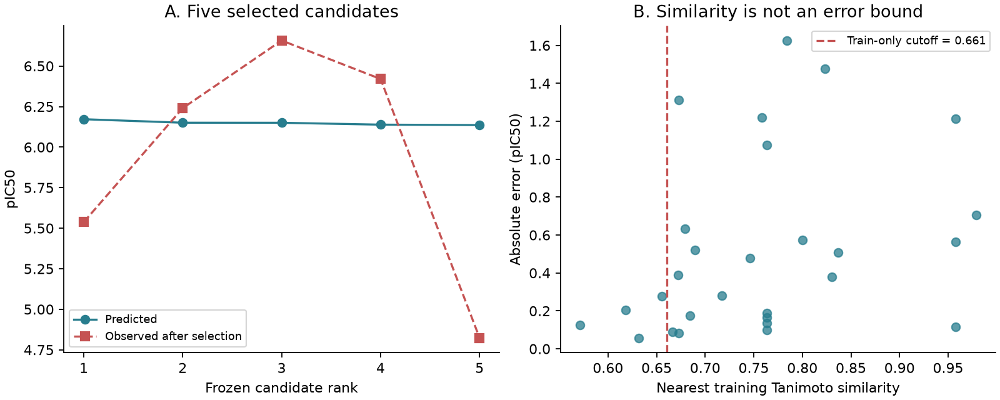

# 實戰一：從 ChEMBL 活性資料到候選分子 {#sec-chembl-case-study}

## 把 ChEMBL 活性預測排好名，就能選出值得測的分子嗎？ {#開場問題}

排名可以幫我們決定先測哪些分子，但前提是清楚模型學的是哪一種量測，也知道候選結構離訓練資料有多遠。這個專題從同一個重組 EGFR 酵素試驗整理出 137 個分子，按骨架分組，再從保留下來的 28 個分子中選出五個候選。名單選定後才揭露實測值：排名第一的 IC50 是 2,900 nM，第三名卻是 220 nM。也就是說，預測的順序和量測的順序對不太上，而這個落差正是本專題要仔細看的地方。

## 核心概念

**半抑制濃度**（IC50）是在指定實驗條件下，讓量測到的活性下降一半所需的濃度。EGFR 是**表皮生長因子受體**（epidermal growth factor receptor），具有酪胺酸激酶活性。抑制純化酵素、抑制細胞內的磷酸化，以及抑制細胞增生，是三種不同的**端點**（endpoint），即使資料庫都標成 EGFR，也要分開處理。所以本節只用 Apsel 等人研究中的一個生化試驗（assay）：重組 EGFR、放射性磷酸轉移測試、ATP 濃度 10 µM；同一篇研究的細胞增生資料則不放進來。[@apsel2008polypharmacology]

查來源時，查不清楚的欄位也要記下來。ChEMBL 的 assay `CHEMBL1243977` 指向文件 `CHEMBL1240340`，標的類型是單一蛋白質；但物種欄位是空白的，信心分數為 8，表示它被指派到同源蛋白質標的，比最高等級的直接指派低一級。資料也沒有突變註記，這只代表沒有記載，野生型與否仍是未知。因此，本節預測的對象就是「這份重組 EGFR 試驗所記錄的 IC50」，把它當成已確認的人類野生型資料，或用來推論對病人有沒有效，都超出了資料能支持的範圍。[assay 原始欄位](https://www.ebi.ac.uk/chembl/api/data/assay/CHEMBL1243977.json)

評估模型時，資料分成三個用途不同的集合：訓練集用來估計參數，驗證集用來選模型，測試集則留到所有決定都做完才拿出來評估。本節以 Bemis–Murcko 骨架分組，同一個骨架的分子會放在同一個集合，避免只換了側鏈的近親分子被隨機拆到兩邊。不同骨架之間仍可能共用相似的片段，骨架分組的作用，是讓測試更接近「遇到沒看過的結構」的情況。

還要說清楚的是，這是一場用既有資料做的**回溯演練**（retrospective exercise）：候選分子本來就有量測結果，只是選點時刻意不看。它可以檢驗整個流程，卻不能代替新的實驗，也預測不了未來真的去合成、測試時的成功率。

## 動手做

[下載本節 notebook](../../notebooks/ch14/14-01-chembl-case-study.ipynb){.btn .btn-sm .btn-outline-primary}　[在 Colab 開啟](ch14/14-01-chembl-case-study.ipynb)

### 從來源到可用標籤

Notebook 已經附上 2026-11-06 從 ChEMBL 37 下載的資料，包含所選 assay 的全部 209 筆紀錄。表中有三種編號，各自指向不同的東西：活動編號 `activity_id` 對應一筆量測，`molecule_chembl_id` 對應化合物，`assay_chembl_id` 對應測試方法，使用時要認清是哪一種。這份 ChEMBL 公開資料，以及本書從中取出的欄位，都採用 CC BY-SA 3.0 授權，使用時要署名 ChEMBL／EMBL-EBI 與原研究作者。[ChEMBL 資料授權](https://chembl.gitbook.io/chembl-interface-documentation/about)

整理數值時，依序看四個欄位：量測類型 `standard_type`、關係符號 `standard_relation`、單位 `standard_units` 和數值 `standard_value`。本例只保留 IC50、等號、單位 nM 且為正的有限數值，並排除帶有品質疑慮或可能重複註記的紀錄。有 39 筆沒有數值，來源註記為 `Not Determined`，意思是「沒有測定」，所以既不補成零，也不解讀成「沒有活性」。另外三筆帶有大於或小於符號，像是「大於某個濃度」，它們只告訴我們數值的界限，適合另外保存，不放進迴歸的目標值。

帶等號的數值，也要回頭對照原文。原文方法記載的試驗濃度範圍是 0.001–50 µM，換成 nM 就是 1–50,000。167 筆帶等號的數值中，有 30 筆高於這個上限，沒有任何一筆低於下限。這些數值可能是超出範圍的外推估計，也可能是報告習慣，本節保留原始值，不擅自改成大於符號，只是以「高於原文試驗範圍」為理由，保守地排除。

最後留下 137 筆。換句話說，後面的結論只適用於這個保留下來的活性範圍；被排除的弱活性分子分布如何，這份資料沒有告訴我們。

| 整理階段 | 剩餘筆數 | 為什麼這樣處理 |
|---|---:|---|
| 單一 assay 全部紀錄 | 209 | 保存來源，不截取前幾十筆 |
| 有數值的 IC50 | 170 | 39 筆未測定值不補填 |
| 等號且單位為 nM | 167 | 三筆設限值另留原始紀錄 |
| 原文濃度範圍內 | 137 | 保守排除 30 筆高於上限值 |
| 結構整理與去重後 | 137 | 本例沒有結構被合併 |

接著把 nM 換算成 **pIC50**：$\mathrm{pIC}_{50}=9-\log_{10}(\mathrm{IC}_{50}[\mathrm{nM}])$。舉例來說，1,000 nM 對應 6，100 nM 對應 7，所以 pIC50 越大，代表抑制所需的濃度越低，活性越強。這只是換一種刻度表示同一個量測，ATP 濃度、酵素製備和量測方法造成的差異都還在，IC50 也沒有因此變成結合常數。

結構整理用 RDKit 的 `FragmentParent` 取出主要片段（例如去掉鹽類的相對離子），再用 `Uncharger` 把可以中和的電荷中和，原始 SMILES 另外保留，方便回查。分析用的 SMILES 保留立體資訊，沒有另外合併互變異構體。如果整理後同一個結構有多筆紀錄，程式會取 pIC50 的中位數，並記下活動編號、筆數和最小／最大值；本例每個結構剛好只有一筆，所以實際上沒有平均任何量測。

如果要處理金屬配合物或多組分藥物，這套規則要重新考慮，因為拿掉某個片段，可能就改變了研究的對象。

下表從整理後的分析表中列出三筆真實紀錄。每一列代表一個整理後的分子；IC50 是同一個 assay 的量測結果，pIC50 則是模型要預測的目標。這三筆剛好都分到訓練集。完整的表格另外保留了活動編號、骨架和資料分組，方便追查來源、確認切分是否正確。

| 化合物編號 | 分子結構（SMILES） | IC50（nM） | pIC50 |
|---|---|---:|---:|
| CHEMBL1242569 | `C=CCn1nc(-c2ccc(OCC)c(OC)c2)c2c(N)ncnc21` | 5,080 | 5.294 |
| CHEMBL1241773 | `CC(=O)c1ccc(-c2nn(C(C)C)c3ncnc(N)c23)cc1` | 12,000 | 4.921 |
| CHEMBL1241946 | `CC(=O)c1cccc(-c2nn(C(C)C)c3ncnc(N)c23)c1` | 2,800 | 5.553 |

模型的輸入只有 SMILES 所代表的結構，後面會轉成 Morgan 指紋；化合物編號只是用來辨認分子的名牌。IC50 和 pIC50 是同一個量測的兩種寫法，所以預測 pIC50 時，IC50 也要排除在輸入之外，否則答案已經藏在輸入裡了。表中的 pIC50 顯示到小數第三位，計算時則使用完整的精度。

### 先分骨架，再選模型

137 個結構共有 50 個骨架。`GroupShuffleSplit` 是 scikit-learn 中「以組為單位」隨機切分資料的工具：先用固定的隨機種子 42 保留 20% 的骨架組當測試集，再用種子 43 從其餘的組裡抽 25% 當驗證集。要注意這裡的百分比算的是骨架組數，而不是分子數，所以最後訓練、驗證、測試分別有 95、14、28 個分子，骨架數則是 30、10、10。程式會兩兩比較三個集合，確認沒有共用的骨架；種子在切分前就固定好，分數不好看也不換。

每個結構轉成半徑 2、長度 2,048 位元、包含立體資訊的 Morgan 指紋。我們事先固定三種模型來比較：一律預測訓練標籤中位數的基準模型、`alpha=10` 的 Ridge，以及 300 棵樹、每個葉節點至少兩筆資料的隨機森林。三個模型都只用 95 筆訓練資料擬合，再依 14 筆驗證資料的**平均絕對誤差**（mean absolute error, MAE）挑出最好的一個。本例沒有另外做參數搜尋，選定之後也維持只用訓練集擬合的版本。

```python
models = {
    'Median': DummyRegressor(strategy='median'),
    'Ridge': Ridge(alpha=10),
    'Random forest': RandomForestRegressor(
        n_estimators=300, min_samples_leaf=2,
        random_state=42, n_jobs=1),
}
validation = []
for name, model in models.items():
    model.fit(X[train], y_train)
    validation.append({
        'model': name,
        'valid_MAE': mean_absolute_error(
            y_valid, model.predict(X[valid])),
    })
validation = pd.DataFrame(validation)
chosen = validation.sort_values(['valid_MAE', 'model']).iloc[0]['model']
```

這段程式先把三個模型放進字典 `models`，再用迴圈逐一做兩件事：用訓練集擬合，然後計算它在驗證集上的 MAE。最後一行把結果依 MAE 由小到大排序，取第一列的模型名稱存成 `chosen`，也就是驗證誤差最小的模型。

{#fig-chembl-evaluation fig-alt="三面板顯示訓練95、驗證14、測試28個分子的活性分布；隨機森林驗證MAE最低，Ridge測試MAE最低；散點與對角線的距離表示預測誤差。"}

| 模型 | 驗證 MAE | 測試 MAE | 測試 RMSE |
|---|---:|---:|---:|
| 訓練集中位數 | 0.578 | 0.746 | 0.898 |
| Ridge | 0.571 | 0.486 | 0.649 |
| 隨機森林 | 0.534 | 0.524 | 0.698 |

表中的誤差單位都是 pIC50。隨機森林的驗證 MAE 最低，所以我們用它來產生候選排名。揭露測試結果後，Ridge 的誤差反而比較小；但我們仍然保留事先選定的隨機森林，因為這時候改選 Ridge，等於把測試集當成第二次驗證來用。

從結果來看，14 筆驗證資料能提供的證據有限，這張表只說明隨機森林在這次切分中被選中。想要更穩定地比較模型，要在打開測試結果之前，就先設計好分組交叉驗證；這次的測試集已經看過結果，下一輪比較需要另外的資料。

### 固定候選名單，再揭露結果

除了預測值，每個候選還要附上它和訓練集中最相似分子（最近鄰）的 Tanimoto 指紋相似度。門檻的定法是：對訓練集裡的每個分子，找出除了自己以外的最近鄰相似度，再取這些值的第 10 百分位數，得到 0.661。這是只用訓練結構設定的**適用範圍**（applicability domain）提示，用來標出「這個候選和模型看過的分子有多像」，它的意義是提醒，而不是準確度的保證。測試池中有 24 個分子達到門檻，四個沒有達到。

排序依預測 pIC50 由高到低，平手時依化合物編號排列；相似度只另外列出作為提示，選點過程完全沒有用到觀測值。Notebook 先把全部排名寫進不含觀測值的 `ranking_before_reveal.csv`，固定前五名之後，才把測試集的 pIC50 加進來，輸出 `ranking_after_reveal.csv`。由於資料本來就內嵌在 notebook 裡，這種做法隔開的是程式流程，操作的人其實看得到答案，和真正的盲測有所區別。

| 固定排名 | ChEMBL 化合物編號 | 預測 pIC50 | 最近鄰相似度 | 揭露後 IC50（nM） |
|---|---|---:|---:|---:|
| 1 | CHEMBL1240566 | 6.172 | 0.679 | 2,900 |
| 2 | CHEMBL1241491 | 6.151 | 0.667 | 575 |
| 3 | CHEMBL1242574 | 6.150 | 0.837 | 220 |
| 4 | CHEMBL1242293 | 6.139 | 0.717 | 380 |
| 5 | CHEMBL1240565 | 6.136 | 0.673 | 15,000 |

五個候選都通過了這次的相似度門檻，實測結果卻差很多。第一名的實測 IC50 比第二、三、四名都高，也就是活性反而較弱；第二名的預測和觀測比較接近；第三名的實測活性比預測更強。第四名同樣比第一名強，而第五名的觀測 pIC50 約 4.824，和預測差了 1.312。換句話說，五個幾乎一樣的預測值，背後可能是差很多的真實量測，名次只是安排測試順序的參考，結構相似也擋不住這種落差。

{#fig-chembl-ranking fig-alt="前五名預測pIC50接近，但第五名觀測值較低；相似度與誤差散點顯示門檻右側仍有明顯誤差，相似度不能作為誤差上限。"}

從整體來看，這次排序也沒有把活性較強的分子集中到前段。前五名的平均觀測 pIC50 是 5.936，比全部 28 個測試分子的平均 6.070 還低；測試池中有三個 pIC50 至少為 7（IC50 至多 100 nM）的分子，全都沒有進入前五名。這裡的 7 只是揭露後用來描述結果的界線，沒有參與選點。

所以，雖然模型的整體迴歸誤差比中位數基準小，這份名單還不足以直接拿去合成。比較合適的下一步，是補充資料、回頭檢查模型，並安排複測。

交給實驗端的結果，應該包括化合物與活動編號、結構、預測值、相似度、使用的 assay 範圍，以及還沒確認清楚的來源欄位（例如前面提到的物種）。如果要挑選真正的新候選，還要確認化合物買不買得到、純度、溶解度和是否干擾檢測，再用相同條件的對照實驗驗證。本節的五筆量測早就存在，它們檢驗的是排序流程本身，至於發現新的 EGFR 抑制劑，則要靠新的實驗。

## 實驗上的考量

第五名通過了相似度門檻，預測卻明顯高估了活性。複測時應該先確認樣品的身分和純度，維持來源試驗的 ATP 濃度和酵素條件，再看濃度反應曲線是否正常。如果改做細胞實驗，膜通透性和細胞內的藥物濃度都會帶來新的影響，誤差範圍要在細胞實驗中重新估計，酵素 IC50 的預測誤差只適用於酵素試驗。

## 重點整理

- 標的名稱相同還不夠，要確認試驗條件一致，等號數值也要對照原文的濃度範圍。
- 以骨架分組、只用驗證集選模型，測試結果揭露後就不再改模型或重新排名。
- 候選清單要附上預測、來源和相似度；回溯演練檢驗的是流程，新活性要靠新實驗確認。

## 小練習

如果實驗端要求最近鄰相似度至少 0.80，原本固定的前五名還剩幾個？請從揭露前的排名檔篩選，寫出留下來的化合物編號，再想一想：只憑這次的揭露結果，為什麼還不足以說 0.80 是比較好的通用門檻？

提示：在 `ranking_before_reveal.csv` 的前五名上加一個相似度條件即可，名次不變，也不要從測試池補進其他分子。

## 延伸閱讀

[Apsel 等人的原始研究](https://doi.org/10.1038/nchembio.117) · [ChEMBL 活性資料欄位與品質說明](https://chembl.gitbook.io/chembl-interface-documentation/frequently-asked-questions/chembl-data-questions) · [RDKit 指紋產生器](https://www.rdkit.org/docs/source/rdkit.Chem.rdFingerprintGenerator.html) · [scikit-learn 分組切分](https://scikit-learn.org/stable/modules/generated/sklearn.model_selection.GroupShuffleSplit.html)
