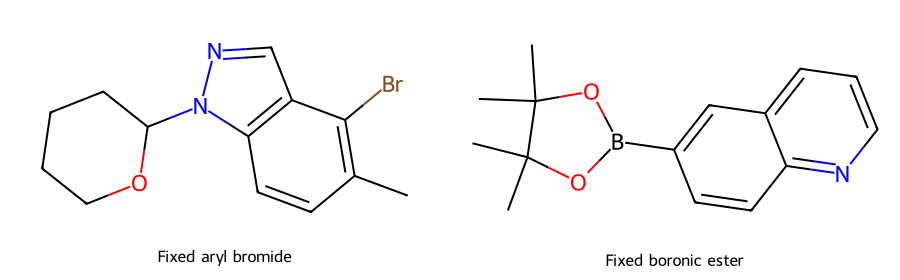
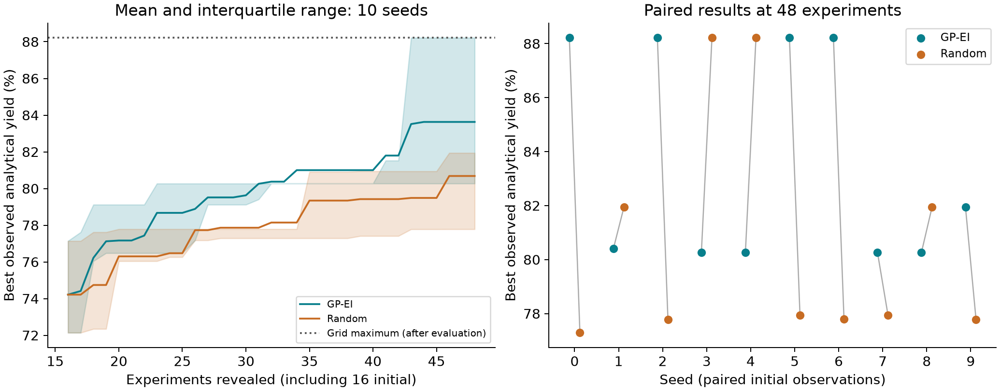

# 實戰二：以少量已知結果選擇下一組反應條件 {#sec-reaction-optimization}

## 只知道十六組條件的產率，下一次反應該做哪一組？ {#開場問題}

我們可以用已經量到的結果建立模型，同時考慮預測產率和不確定性，選出下一組最值得試的條件。舉例來說，一組條件預測產率普通、但模型很沒把握，它也可能值得一試，因為真實產率可能出乎意料地高。本節把既有的 Suzuki–Miyaura 反應資料當成一場還沒做完的篩選：先揭露 16 筆實測值，之後每次只揭露一筆，直到總共 48 筆。這種**貝氏最適化**（Bayesian optimization）是否真的比隨機選點有效，要在相同的起點和預算下比較才知道。

## 核心概念

**高斯過程**（Gaussian process, GP）會根據已觀察的資料，替每組候選條件給出預測的平均值和標準差。平均值是模型目前預期的結果，標準差則反映模型在它自己的假設下有多沒把握。

**預期改善量**（expected improvement, EI）把這兩個數字合成一個選點分數。若預測結果為 $Y$，目前觀察到的最佳值為 $y_\mathrm{best}$，EI 就是 $\mathbb{E}[\max(Y-y_\mathrm{best}-\xi,0)]$，也就是「平均來說，這組條件可望比目前最好的結果再高出多少」。本例把 $\xi$ 固定為 0.01 個產率百分點。EI 高，可能是因為預期產率高，也可能是因為那一區還很不確定、仍有改善的機會；它是一種期望，實際改善多少要等量完才知道。

本例使用 Perera 等人的反應篩選資料，取自 Open Reaction Database（ORD）中固定版本的一份副本，共 5,760 筆，涵蓋 15 組底物對，每組 384 筆。我們事先約定把兩個底物的原始 SMILES 配成一對，按字母順序（字典序）取第一組，選擇時完全沒有看產率。這組資料包含 12 種配體狀態、8 種鹼狀態和 4 種主溶劑條件，剛好組成 384 個不重複的組合。配體和鹼各有一個「不外加試劑」的 `None` 對照，這是原始實驗設計的一部分，要當成一個條件保留下來，而不是當作缺值刪掉。[@perera2018flow]

本節的目標很單純：在這個有限的條件網格裡，用較少的實驗找到分析產率高的條件。溫度固定在 100°C，反應時間固定為 1 分鐘，所以資料裡沒有溫度或時間的變化可以比較。資料中的產率是以內標校正、經過正規化的分析百分比，分析方法標為 LCMS，和分離產率是兩回事。所有低值和零值都保留下來，推薦條件的好壞，也都以這個量測定義來判斷。

## 動手做

[下載本節 notebook](../../notebooks/ch14/14-02-reaction-optimization.ipynb){.btn .btn-sm .btn-outline-primary}　[在 Colab 開啟](ch14/14-02-reaction-optimization.ipynb)

Notebook 已經附上完整資料，不用另外安裝 ORD 或 protobuf 套件。資料依 CC BY-SA 4.0 授權使用，原始研究、ORD 來源和資料版本都寫在 notebook 的說明格裡。執行後會輸出圖、候選條件表、逐輪的選點紀錄，以及十個隨機種子的摘要。有了這些檔案，我們就能依反應編號查到每一輪選了哪組條件、什麼時候揭露結果。

固定的底物如 @fig-reaction-substrates 所示：左邊是帶溴和甲基、氮上接四氫吡喃基的吲唑衍生物；右邊是喹啉環上的硼酸頻哪醇酯。Suzuki–Miyaura 偶聯會把左邊原本接溴的碳，和右邊原本接硼的碳連起來。本例兩個底物始終不變，變動的只有來源列出的反應條件。用字典序挑底物，好處是規則和產率無關、別人也能重現，至於這組底物是否最有代表性，則是另一個問題。

Notebook 保留完整的 SMILES，候選條件依反應編號排序；如果兩組條件的 EI 剛好相同，就取排在前面的那一組，這樣就用不到還沒揭露的產率來決定。

{#fig-reaction-substrates fig-alt="左圖為帶溴與甲基、氮上帶四氫吡喃基的吲唑衍生物；右圖為喹啉環上的硼酸頻哪醇酯。兩者在全部384組候選中固定。"}

這裡的「配體」欄位，沿用來源中名為 `Ligand in Solvent` 的一股進料（即事先配好、一起加入的一份溶液），分類時保留其中標為 `CATALYST` 角色組分的完整 SMILES。這些組分不全是游離配體，例如有一類同時含有兩個 AmPhos 膦片段和 `Cl[Pd]Cl`，比較適合看成來源列出的含鈀組成。所以這一類和其他類別的產率差異，可能同時來自配體和鈀的形式。`None` 則只表示這股進料只有溶劑，和「整個反應沒有催化劑」是兩回事。

三個條件欄位都用**獨熱編碼**（one-hot encoding）轉成數字，共 24 個欄位。每一種配體、鹼或溶劑各占一欄，用了就填 1，沒用就填 0。這樣模型知道兩個候選是否用了相同的試劑，卻不知道不同配體在電子效應或立體障礙上有多接近；對模型來說，任兩種不同的配體都一樣「不同」。

主溶劑股 `Solvent_1` 有四種選項：甲醇、乙腈、四氫呋喃和 DMF，各自和水一起加入，體積固定為 445.5 與 49.5 μL。其他試劑股也各自帶有溶劑，所以這個比例只是主溶劑股本身的組成，反應器裡全部液體的最終組成，還要把其他股帶進來的溶劑算進去；本例也沒有改變這個混合比例。

實際用來分析的資料，可以整理成下面這張表。這三列取自種子 0 一開始揭露的 16 筆結果，每列是一組做過的反應條件，底物都和上圖相同。為了方便閱讀，表中把試劑的 SMILES 換成化學名稱；完整的候選表仍保留原始結構和反應編號。

| 候選索引 | 配體股中的試劑 | 鹼股中的試劑 | 主溶劑股 | 分析產率（%） |
|---:|---|---|---|---:|
| 114 | 三苯基膦 | 三乙胺 | 乙腈／水 | 57.06 |
| 189 | 三叔丁基膦 | 無外加鹼 | DMF／水 | 42.35 |
| 280 | 三（鄰甲苯基）膦 | 無外加鹼 | 四氫呋喃／水 | 50.04 |

候選索引從 0 起算，只是用來對照完整表的流水號，和產率高低無關。模型的輸入是配體股、鹼股和主溶劑股的類別，預測目標是最右欄的分析產率；「無外加鹼」也算一種實驗條件。還沒被選到的候選，只有條件欄位能參與選點，產率要等它被選中之後才揭露給模型，在那之前就是「未知」，而不是零。表中這三筆產率都屬於起始資料，所以可以用在第一輪擬合。

為了讓選點流程容易看懂，GP 使用長度尺度固定為 1 的 RBF 核函數，`alpha=0.01`，不另外搜尋超參數。**核函數**（kernel）決定模型怎麼判斷兩組條件「像不像」：RBF 依編碼後的距離來衡量，距離越近，模型就預期兩者的產率越接近；本例的距離完全由獨熱編碼決定。

每一輪設定 `normalize_y=True`，只用當時已觀察到的產率計算平均和尺度，先把產率標準化再擬合，預測完再換回原本的百分比。`alpha` 是加在模型內部共變異矩陣對角線上的一個小數值，可以想成假設的雜訊大小；這裡它是在標準化尺度上的固定設定，而不是從重複實驗估出來的誤差。這些簡化會影響探索的路徑，所以模型輸出的標準差，要和真正的實驗誤差棒分開看待。

選點函式只拿得到三樣東西：所有候選的條件、已觀察的候選索引，以及這些候選的產率。每一輪的順序如下，完整的模型擬合和 EI 計算寫在 notebook 裡：

```python
chosen = propose(X, seen, np.asarray(observed))
assert chosen not in seen
seen.append(chosen)
observed.append(reveal(chosen))  # 決定條件後，才揭露這筆實測值
```

這四行的意思是：`propose()` 根據目前已知的結果挑出下一組條件，`assert` 確認它沒有被選過，接著把它加進已觀察清單，最後才用 `reveal()` 取出它的產率。`reveal()` 從封存的表格中取出已經存在的真實結果，不會自己編出產率。程式其實讀得到整份資料，所以這裡的「封存」靠的是流程上的約定，而不是檔案權限。

模型擬合、EI 計算、產率標準化和停止條件，都只用已揭露的產率；整個網格的最高產率，要等所有路徑都跑完才計算。如果我們先看過結果，再回頭調整底物、種子或核函數，直到曲線變漂亮，那就失去了事先固定比較條件的意義。

每個種子先從 384 組條件中不重複地抽出 16 組，GP-EI 和隨機方法共用這 16 筆起始結果。之後兩種方法各選 32 次，每次只挑還沒觀察過的條件，所以總預算都是 48 筆。隨機方法使用另一串固定的亂數；種子 0–9 的結果全部保留，而不是挑出其中一條最好看的來當結論。換種子時資料會重設，所以這十條路徑代表的是十種不同起點的回溯演練，背後仍是同一份既有資料。

{#fig-reaction-selection fig-alt="左圖GP-EI與隨機方法從相同16筆起始，平均最佳產率隨揭露筆數增加；48筆時分別為83.63%與80.684%。右圖列出種子0至9，GP-EI六次較高、四次較低。"}

@fig-reaction-selection 畫的是「到目前為止找到的最佳值」，而不是每一輪的新結果。即使下一筆產率很低，最佳值也不會下降；曲線變平，只表示這幾次沒有刷新紀錄，模型其實每輪都在更新。換句話說，這條曲線回答的是「多快找到好條件」，模型的預測誤差要另外評估，曲線上升也只是紀錄被刷新，反應本身並沒有變好。

從結果來看，GP-EI 平均略勝一籌，但差距不大，也不是每次都贏。到 48 筆時，GP-EI 的最佳已觀察產率在十個種子間平均為 83.630%，隨機方法為 80.684%，平均差 2.946 個百分點。GP-EI 的中位數為 81.17%，隨機方法為 77.94%；前者的最終結果範圍是 80.27%–88.22%，後者是 77.29%–88.22%。逐一配對比較時，GP-EI 六次較高、四次較低，沒有平手。這些數字描述的是固定底物、固定模型和固定預算下的十條路徑，換一組反應之後的勝率，還需要另外的資料來估計。

右圖特別保留了表現較差的路徑：種子 3 和 4 的 GP-EI 最後停在 80.27%，隨機方法卻找到了 88.22%。整個網格的最高值也是 88.22%，但這是事後評估才知道的參考線，選點函式從頭到尾都不知道這個目標。如果只展示種子 0，會看到 GP-EI 比隨機高 10.93 個百分點；只展示種子 3，印象又完全相反。左圖的陰影呈現的是起始點和選點造成的變動，和模型的預測區間或平均值的信賴區間是不同的東西。

這個演練能回答的問題範圍也很明確。384 個候選都來自同一份既有篩選，網格以外沒有新的配體，也沒有重複量測可以檢查這條最佳化路徑穩不穩定。同一組條件在不同路徑中都會拿到同一個封存值，所以儀器漂移或批次差異都沒有被模擬進來。如果想加入更複雜的化學描述符或調整核函數，要另外準備開發用的資料和評估程序；這十條路徑的結果我們已經看過了，拿它們反覆挑設定，就失去了驗證的意義。

實際安排下一次反應時，除了產率，還要考慮試劑庫存、溶解度、設備相容性和分析的排程。這些限制最好在選點之前就先整理成一份做得到的候選清單，讓模型只在裡面挑選；EI 再高的條件，做不了就沒有用。本例把全部 384 組都當成成本相同的候選；至於放大反應該怎麼做，則要另外開發程序。

## 重點整理

- 每次先選條件、再揭露結果，模型和選點只用當時已經量到的產率。
- 比較兩種策略時，要共用起始資料和總預算，並保留所有種子的路徑。
- 這是固定底物、有限條件網格的回溯演練，結論只適用於這組底物和這 384 組條件。

## 小練習

請改看「總共揭露 32 筆」這個時點，用 `selection-log.csv` 計算兩種方法的平均最佳已觀察產率、成對差值的平均，以及 GP-EI 較高、相同、較低的種子各有幾個。再和正文 48 筆的結果比較，想一想：為什麼只看某一個預算時點，還不足以判定哪個方法比較好？

提示：選點設定不用改，也不用重跑；在 `selection-log.csv` 中先篩出 `experiments == 32` 的列，再以 `seed` 為索引、`method` 為欄建立表格。差值的單位是百分點。

## 延伸閱讀

[Perera 等人的原始研究](https://doi.org/10.1126/science.aap9112) · [ORD 資料庫論文](https://doi.org/10.1021/jacs.1c09820) · [scikit-learn 的 GaussianProcessRegressor 參數與預測介面](https://scikit-learn.org/stable/modules/generated/sklearn.gaussian_process.GaussianProcessRegressor.html) · [本節資料來源與重現紀錄](../../data/ch14/reaction/README.md)
