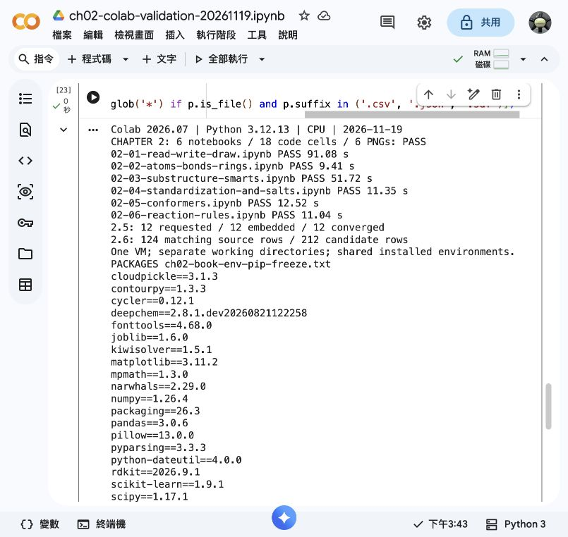

# 第 2 章 Colab 實機驗證（2026-11-19）

第 2 章六份 notebooks 原樣執行通過，共 18 個程式格與六張 PNG。這次使用實際 Colab 2026.07、Python 3.12.13、CPU，沒有以本機測試代替，也沒有修改教材程式。

| 小節 | 結果 | 執行時間 | 核對內容 |
|---|---|---|---|
| 2.1 讀寫與畫出分子 | 通過 | 91.08 秒 | ESOL 1,128 筆；三筆 SDF 讀回的結構與溶解度相符 |
| 2.2 原子、鍵與環 | 通過 | 9.41 秒 | 酚、苯甲醚、環己醇的氧鄰接原子、氫數與芳香性符合預期 |
| 2.3 子結構搜尋與 SMARTS | 通過 | 51.72 秒 | 對照分子檢查通過；醇類命中 154 筆、274 個位置；酚類 91 筆 |
| 2.4 分子標準化與鹽類 | 通過 | 11.35 秒 | 苯甲酸鈉三步結果正確；四甲基銨保留正電荷；ESOL 中 Cleanup 改寫四筆表示法 |
| 2.5 產生與比較三維構形 | 通過 | 12.52 秒 | 1-丁醇要求 12 個構形、產生 12 個、MMFF 最佳化全部收斂；相對能量與二面角已輸出 |
| 2.6 用反應規則產生候選產物 | 通過 | 11.04 秒 | 乙醇與異丙醇分別產生醛、酮候選；三級醇與酚未命中；ESOL 命中 124 筆、產生 212 筆候選 |

六份 notebook 各有三個非空執行編號，保存的執行輸出沒有 error；六張 PNG 均經 Pillow 解碼成功。兩份新拆分 notebook 另外產生 `conformers.csv`、`reaction_candidates.csv` 與各自的 `results.json`。2.1 的 SDF 讀回檢查通過，但封存目錄沒有另存 SDF，不能視為已交付獨立 SDF 檔案。

實際文字輸出見 [observed-outputs.txt](observed-outputs.txt)，執行時間、圖像尺寸與來源比對結果見 [remote-checks.json](remote-checks.json)。

## 環境與驗證方式

實際映像為 `release-colab-external-images_20260715-060047_RC00`，詳見 [environment.json](environment.json)。教材來源固定為公開庫提交 `c68a8dcd5cc3e66a0c2ca8fba53d7bf2b65bbefb`。六份 notebook 的完整檔案與程式碼 SHA-256 均與本機版本一致，見 [source-manifest.json](source-manifest.json)。

測試先清除原有輸出，再透過 Colab IPython 核心依序執行原始程式格，保留每份 notebook 的版本斷言、套件安裝與 `pip check`。六份共用同一 CPU VM、各用不同工作目錄；2.3 使用 `/content/ch02-smarts-env`，其餘使用 `/content/ch02-book-env`。這不是六次獨立乾淨 VM 測試。

表列時間含各 notebook 的設定與執行，不含 VM 分配及人工操作；2.1、2.3 分別建立套件環境，後續沿用已安裝的環境，不宜據此比較各節運算效能。

主要套件為 RDKit 2026.9.1、DeepChem 2.8.1.dev20260821122258、NumPy 1.26.4、pandas 3.0.6。完整清單由 Colab 畫面轉錄於 [一般環境套件清單](ch02-book-env-pip-freeze.txt) 與 [SMARTS 環境套件清單](ch02-smarts-env-pip-freeze.txt)。2.3 輸出含 DeepChem 的可選 PyTorch 模組提示，但未使用該模組，資料載入、搜尋、繪圖及斷言均完成；不需要為這份練習另裝 PyTorch。

## 紀錄保存範圍

本目錄保存由 Colab 頁面輸出轉錄的結果、環境、套件清單、來源雜湊及摘要截圖。這些文字紀錄不是下載回來的已執行 notebooks。

Colab 驗證筆記本已確認「已儲存所有變更」。完整已執行 notebooks、兩套環境清單、圖像輸出與兩份新節的 CSV/JSON 已打包為 `/content/ch02-verified-20261119.zip`。透過 `files.download` 與檔案面板下載各試一次，都未收到下載檔案；**完整封存檔尚未保存至本機**，VM 中的 ZIP 會隨執行階段回收而消失。

本機另保留來源副本、驗證程式及頁面原始文字證據。作者已於 2026-11-19 確認驗證結果，核准將 README 與本次紀錄發布至教材庫。

