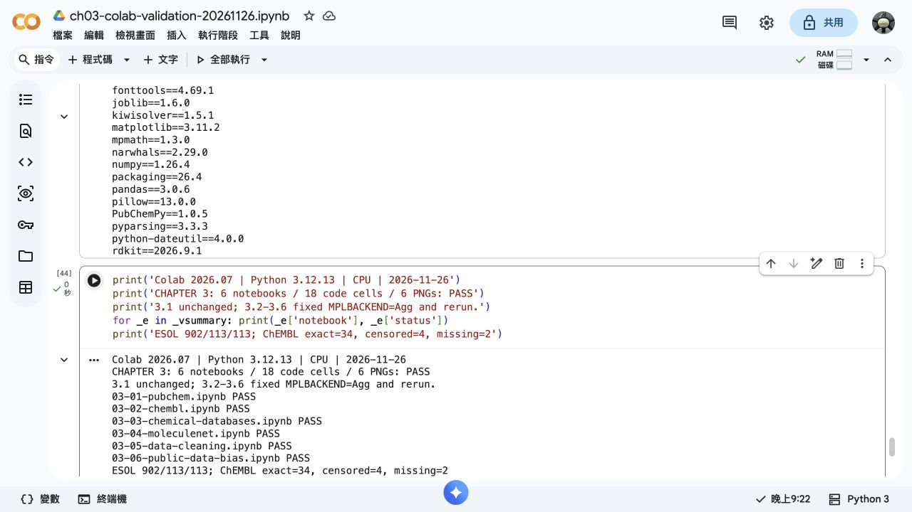

# 第 3 章 Colab 實機驗證（2026-11-26）

六份 notebooks 最終全部通過，共 18 個程式格與六張 PNG。3.1 原樣通過；3.2–3.6 首次執行因繪圖後端不相容而失敗，修正後重跑通過。這是實際 Colab 2026.07、Python 3.12.13、CPU 的測試結果。

| 小節 | 最終結果 | 最終重跑時間 | 核對內容 |
|---|---|---|---|
| 3.1 PubChem 與 PubChemPy | 原樣通過 | 6.83 秒 | 三筆丙胺酸 CID；莫耳質量均為 89.09 g/mol；ConnectivitySMILES 一種、完整 SMILES 三種 |
| 3.2 ChEMBL | 修正後通過 | 8.87 秒 | 40 筆活性紀錄、36 個化合物；同一化合物的三項 IC50 為 41、300、7820 nM |
| 3.3 其他常用資料庫 | 修正後通過 | 8.61 秒 | PDB 1IEP → 實體 3 → STI；X 光繞射、2.10 Å、小鼠來源；配體 C29H31N7O、37 個重原子 |
| 3.4 MoleculeNet 與 DeepChem | 修正後通過 | 10.96 秒 | 訓練／驗證／測試 902／113／113 筆；MACCS 167 位元；首筆實測 logS = −2.06；無標籤尺度轉換 |
| 3.5 資料清理 | 修正後通過 | 7.12 秒 | 34 筆精確值、4 筆設限值、2 筆缺值；0.041 μM 對應 pIC50 約 7.387；>1250 μM 對應 pIC50 <2.903 |
| 3.6 公開資料的偏差 | 修正後通過 | 7.93 秒 | 40 筆紀錄來自三篇文獻，分別為 26、8、6 筆（65%、20%、15%）；36 個分子、7 項試驗 |

六份 notebook 各有三個非空執行編號，最終輸出沒有 error；六張 PNG 均經 Pillow 解碼成功。詳見 [最終結果與來源比對](remote-checks.json)、[實際文字輸出](observed-outputs.txt) 與 [首輪結果](initial-results.json)。

## 環境與測試範圍

實際 Colab 映像為 `release-colab-external-images_20260715-060047_RC00`。六份使用同一台 CPU VM、各自的工作目錄，共四套套件環境：3.1 與 3.3 共用 `ch03-book-env`，3.2 與 3.5 共用 `ch03-api-env`，3.4 使用 `cheminfo-models-env`，3.6 使用 `ch03-bias-env`。這不是六次獨立乾淨 VM 測試。

測試來源是教材庫提交 `d17cec2e11e1c481b7b711771a863a6e579368a1`，最終另加入下述五份 notebook 的後端修正。完整檔案與程式碼雜湊已和本機修正版逐一核對一致，見 [首輪來源](source-manifest.json) 與 [最終來源](final-source-manifest.json)。原始程式格先清除輸出，再由實際 Colab IPython 核心依序執行，保留 notebook 自己的版本檢查、安裝和 `pip check`。

表列時間是環境安裝完成後的最終重跑時間，不含 VM 分配與人工操作，不能當作首次開啟所需時間。3.1 首次執行為 55.47 秒，其餘首輪時間包含部分環境建立及失敗執行，見首輪結果。

本次測試 notebook 的預設使用方式：3.1、3.2、3.3、3.5、3.6 使用隨附的官方查詢快照，3.4 透過 DeepChem 下載 ESOL。**未測試前述五節的可選即時 API 查詢模式**，因此不代表今天的 PubChem、ChEMBL、RCSB 回傳內容與快照相同。3.4 的末格直接執行子程式，文字輸出未全部被驗證程式捕捉；另以同一修正版分析程式重跑並擷取 stdout/stderr，確認上述筆數、指紋與標籤。

環境資訊見 [environment.json](environment.json)。各套環境的清單由 Colab 頁面輸出轉錄：

- [PubChem／PDB 環境](ch03-book-env-pip-freeze.txt)
- [ChEMBL／資料清理環境](ch03-api-env-pip-freeze.txt)
- [MoleculeNet 環境](cheminfo-models-env-pip-freeze.txt)
- [公開資料偏差環境](ch03-bias-env-pip-freeze.txt)

## 首次失敗與修正

3.2–3.6 的分析子程式繼承 Colab 的 `MPLBACKEND=module://matplotlib_inline.backend_inline`。獨立環境無法使用這個後端，Matplotlib 在匯入時便拋出 `ValueError`，程式原有的 `matplotlib.use("Agg")` 尚未執行。3.4 額外擷取的錯誤也確認是同一原因。

修正是在這五份 notebook 的分析程式開頭、匯入繪圖套件之前加入：

```python
import os
# 使用適合輸出圖檔的繪圖後端，避免沿用 Colab 的顯示設定。
os.environ["MPLBACKEND"] = "Agg"
```

修正沒有更換套件版本、資料、分析規則或化學計算，也沒有更動 Colab 核心的全域後端設定。五份修正版與未修改的 3.1 一起重新執行，最終六份皆通過。

驗證工具讀取舊 notebook 格式時出現缺少 cell ID 的相容性警告，但仍完成執行；3.4 的 DeepChem 顯示未安裝 PyTorch、TensorFlow 等可選模組及部分描述符正規化提示，本節使用的 MACCS 特徵與資料載入仍正常完成。這些提示未被當成失敗原因，也未為了消除提示額外安裝大型套件。

## 保存範圍與發布狀態

本目錄保存結果、環境、套件清單、來源雜湊與截圖；文字紀錄由 Colab 頁面輸出轉錄，**不是下載回來的已執行 notebooks**。本機審閱目錄另保留六份原始來源、最終來源、驗證程式與原始頁面文字證據。

Colab 驗證筆記本已確認「已儲存所有變更」，保留首輪失敗、診斷、修正重跑與最終摘要。VM 中首輪封存為 `/content/ch03-verified-20261126.zip`，最終封存為 `/content/ch03-final-20261126.zip`，包含執行後 notebooks、工作檔、圖像輸出與環境清單。透過檔案面板下載最終 ZIP 時未收到下載檔案，**完整封存檔尚未保存到本機**；VM 檔案會隨執行階段回收而消失。

作者已確認第 3 章 Colab 驗證結果，核准將 README、五份修正後的 notebooks 與本次驗證紀錄發布至教材庫。


